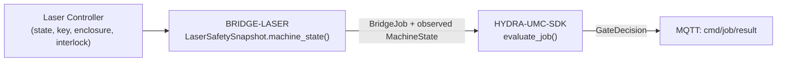

<!-- =============================================================================
HYDRA-UMC-BRIDGE-LASER - Laser cell coordination bridge
Copyright (C) JuanenRac (Electro Hobby 3D) <electrohobby3d@gmail.com>
GPL-3.0-or-later - see LICENSE
============================================================================= -->

<p align="center">
  
</p>

# 🔆 HYDRA-UMC-BRIDGE-LASER

<p align="center">🇺🇸 <b>English</b> | <a href="README_spa.md">🇪🇸 Español</a> | <a href="README_fra.md">🇫🇷 Français</a> | <a href="README_ita.md">🇮🇹 Italiano</a> | <a href="README_deu.md">🇩🇪 Deutsch</a> | <a href="README_zho.md">🇨🇳 简体中文</a> | <a href="README_jpn.md">🇯🇵 日本語</a> | <a href="README_por.md">🇵🇹 Português</a></p>

### 🛑 Fail-Safe Coordination Bridge for Laser Cells

<p align="center">
  
  
  
  
  
  
</p>

---

> **Honesty check - what actually runs today:** the four-signal safety snapshot and gate (`cell.py`'s `LaserSafetySnapshot`/`LaserCellBridge`, funneling every job through `HYDRA-UMC-SDK`'s own `evaluate_job()`), the read-only evidence normalizer (`observation.py`), the real GPIO interlock reader (`gpio_safety.py`'s `GpioSafetyProbe`, libgpiod v2), and the MQTT status/evidence transport (`mqtt_transport.py`) are real and covered by 149 passing `unittest` cases (`python tools/build_test.py`), including `tests/test_gpio_mqtt_emulator.py` running this bridge against a protocol-faithful, hand-written GPIO/MQTT emulator. None of it has touched a real GPIO chip, a real MQTT broker, or an actual laser controller - `test_gpio_safety.py` reads against a fake chip and `test_mqtt_transport.py` uses a fake broker client. There is no concrete laser controller/software integration yet, because the machine and its documented interface aren't available - see "Roadmap & Known limits" below, which already says this plainly, and `CHANGELOG.md` for exactly what has shipped so far.

> **Safety and security status:** this ecosystem is not a certified safety system. There is no hardware E-STOP path, no firmware-enforced limits or interlocks and no verified motion command yet; firmware images are checked with CRC-32 and an Ed25519 signature, and a release build refuses the published development keys (the tool heads and expansion boards behind the relay still run URTC bootloaders, which take a shared-key HMAC-SHA256 instead of a signature); TLS and mutual TLS are optional and off by default; no custom board has been populated or tested yet. Read the [security baseline](https://github.com/JuanenRac/HYDRA-UMC-DOCS/blob/main/docs/SECURITY_BASELINE.md) and the [threat model](https://github.com/JuanenRac/HYDRA-UMC-DOCS/blob/main/docs/THREAT_MODEL.md) before relying on any statement here for the safety of a person.

---

## 📋 At a glance

| | |
|---|---|
| Version | `0.1.8` |
| Maturity | Functional |
| Tests | 149 (`python tools/build_test.py`) |
| Stack | Python / Laser controller / G-code / Safety evidence / GPIO interlock reading |
| Target | The Raspberry Pi CM5 of a HYDRA-UMC cell |
| On real hardware | Simulated only: tested against emulators, fakes or simulators; no run on real hardware is recorded for this version |

**Jump to:** [Overview](#-overview) · [Architecture](#-architecture) · [Features](#-features) · [Security & Safety](#-security--safety) · [Interfaces](#-interfaces) · [Configuration](#-configuration) · [Quick start](#-quick-start) · [Testing](#-testing) · [Troubleshooting](#-troubleshooting) · [Repository Structure](#-repository-structure) · [Related Projects](#-related-projects)

## 🚦 Project status

Each line is one part of this repository and the light says how far it is today. It is written from what the repository can show (tests, builds, runs), not from what is planned.

🟢 Done and verified · 🟡 Works, with known limits · 🟠 Partly done or not verified yet · 🔴 Not done or not working

| Area | State | What it means here |
|---|---|---|
| Software | 🟡 | Works for its main purpose; the honesty check above lists what is still missing |
| Tests | 🟢 | 149 automated tests, run on every change |
| Real hardware | 🟠 | Simulated only: tested against emulators, fakes or simulators; no run on real hardware is recorded for this version |
| Documentation | 🟢 | README in eight languages, checked against the manifest on every change |

## 🎯 Overview

**HYDRA-UMC-BRIDGE-LASER** is the high-level bridge for laser cells and HYDRA-UMC robot auxiliaries. It can coordinate safe peripheral tasks such as material hand-off, but it can **never** arm, fire or override a laser controller — those are observations it reads, not authorities it holds.

It belongs to the **External Automation Bridges** family: a set of sibling repositories (CNC, LASER, OPENPNP, PRINTER3D, ROS2) that all speak the same shared safety contract from `HYDRA-UMC-SDK`, so no bridge can invent its own definition of "safe to work".

## 🧩 Role in HYDRA-UMC

**HYDRA-UMC-BRIDGE-LASER** lets a robot cell work around a laser cutter or engraver without ever being able to arm or fire it. It reads three independent safeguards (key switch, enclosure, interlock) over GPIO and the state of a GRBL laser controller, and only a cell where every safeguard says safe gets work.

Every bridge speaks the shared safety contract of `HYDRA-UMC-SDK`: a job is accepted only after the shared `evaluate_job()` gate says so, and the gate fails closed. The parent project is `HYDRA-UMC-SERVER`; this bridge does not call it, it answers over MQTT through `HYDRA-UMC-MQTT-BROKER` to whoever commands the cell.

## 🏛️ Architecture

<p align="center">
  
</p>

<details>
<summary>Text version of the diagram (Mermaid)</summary>



</details>

**Why it is built this way**

* **Why three independent safeguards instead of one boolean.** `LaserSafetySnapshot.machine_state()` checks `key_enabled`, `enclosure_closed` and `interlock_healthy` as three separate conditions — real laser safety needs every physical safeguard to be independently true; collapsing them into one flag would hide which one actually failed.
* **Why the bridge documents that it can never arm or fire a laser.** `LaserCellBridge`'s own docstring states it "coordinates only external auxiliaries; it cannot arm or fire a laser" — those conditions are observations of the controller's own certified interlocks, never a substitute for them.
* **Why the controller-state mapping is deliberately conservative.** Only the literal string `IDLE` maps to `MachineState.IDLE`. Every unrecognized value falls back to `OFFLINE`, never to something that would permit auxiliary work.
* **Why the bridge builds a new `BridgeJob` and delegates to the shared `evaluate_job()` instead of writing its own accept/reject logic.** All five External Automation Bridges (CNC, LASER, OPENPNP, PRINTER3D, ROS2) reuse the exact same `bridge_contract` from `HYDRA-UMC-SDK`, so "what counts as safe to start a job" cannot silently diverge between them.
* **Why the choice of real laser software/controller is intentionally deferred.** Committing to a specific vendor interface before the machine and its documented interlock reporting are available would mean claiming a real safety guarantee this local core cannot verify.
* **How this fits the rest of the ecosystem.** BRIDGE-LASER sits between the laser controller and `HYDRA-UMC-SDK` → `HYDRA-UMC-MQTT-BROKER` → independent safety — it coordinates auxiliary robot work around the laser cell, it does not replace or override certified laser safety.

The observation helper is an evidence normalizer, not a laser-controller adapter: it does not open a network or serial link, alter settings, upload jobs, arm or fire. [Laser Controller Evidence Boundary](docs/CONTROLLER_EVIDENCE_BOUNDARY.md) defines the validation required before a real integration.

## ✨ Features

* ✅ **Four-signal safety snapshot (software logic, tested without a laser):** `cell.py`'s `LaserSafetySnapshot.machine_state()` requires the key switch enabled, the enclosure closed **and** the interlock healthy simultaneously — any one missing resolves to `SAFE_STOP`, before `controller_state` is even read. *(implemented, tested in `tests/test_cell.py`)*
* ✅ **Real shared safety gate:** every observed job is re-evaluated through `evaluate_job()` from `HYDRA-UMC-SDK`'s `bridge_contract`, the same gate every sibling bridge uses. *(implemented)*
* ✅ **Conservative state mapping:** only `IDLE` is treated as idle; `RUN`/`RUNNING` maps to `RUNNING`, `PAUSED` maps to `HOLDING` (a real, distinct condition - the beam is not actively cutting/engraving), `FAULT`/`ALARM`/`ERROR` map to `FAULT`, and anything unrecognized falls back to `OFFLINE`. *(implemented)*
* ✅ **Read-only safety evidence:** `observation.py` accepts only genuine Boolean key, enclosure and interlock signals; missing, numeric or text-like values fail closed. It cannot arm or fire a laser. *(implemented, tested in `tests/test_observation.py`)*
* ✅ **Controller-neutral GPIO interlock reading (tested against a fake chip only):** `gpio_safety.py`'s `GpioSafetyProbe` reads the same 3 independent safeguards from GPIO lines (libgpiod v2; the tests use a fake chip) instead of a saved mapping - deliberately controller-agnostic, since a key switch/door sensor/interlock relay is universal across laser cutters regardless of brand. A GPIO read failure fails all 3 safeguards closed. *(implemented, tested in `tests/test_gpio_safety.py`)*
* ✅ **Edge-triggered interlock monitoring (tested against a fake chip only):** `open_gpio_safety()` opens the key, enclosure and interlock lines ONCE (`INPUT`, `Edge.BOTH`) and serves both the level readers and the edge watcher from that single request - the kernel refuses a second request for the same lines. `watch_for_interlock_edges()` blocks on libgpiod v2's own kernel edge-event notifications instead of only re-reading levels when an unrelated MQTT message happens to ask, and `run_forever(edge_watcher=...)` starts a background daemon thread that publishes an updated, retained `state` the instant a line transitions; if the watcher fails it publishes a fail-closed `state` (`SAFE_STOP`, with the reason) and keeps trying. Each line's wiring is declared (`GpioLineSettings`: `active_low`, `bias` - the default makes a cut wire read as unsafe - and `debounce_ms`); see `docs/WIRING_GUIDE.md`. Not yet validated on a real GPIO chip. *(implemented, tested in `tests/test_gpio_safety.py` and, against a fake `gpiod`, `tests/test_hardening.py`)*
* ✅ **Safety event stream (tested with fake lines and a simulated edge watcher):** `events.py` turns every change of the key, enclosure and interlock into a timestamped record on `hydra/bridges/laser/event/safety` (the log a data lake keeps for audit and OEE) and, once, when the cell goes from safe to unsafe, an `hydra/bridges/laser/event/interlock_open` event naming the safeguards that opened, so the orchestrator can stop the arms of the cell at once. Both are QoS 1 and never retained; each carries `at_ms` and a growing `sequence`; the first reading is only a baseline; a failing edge watcher reports the loss as an open interlock too. The bridge only reports: it cannot stop a laser. *(implemented, tested in `tests/test_events.py`)*
* ✅ **Optional auxiliary safeguards (tested with simulated inputs):** `auxiliary.py` lets the cell declare extra conditions - fume extraction running, assist air on, CO2 tube temperature at most a given limit - as `AuxiliaryCheck`s given to `LaserMqttBridge(auxiliary=...)`. A job other than ABORT is refused, naming the failed check, while any of them is not satisfied; an unreadable, non-numeric or non-finite reading counts as not satisfied; `state` carries an `auxiliary` map. With none declared nothing changes. Read-only: it switches nothing. *(implemented, tested in `tests/test_auxiliary.py`)*
* ✅ **Non-mutating build/test:** `build-test.bat`/`.sh` compile the source and run the deterministic safety-gate test suite without touching version files or CHANGELOG. *(implemented, see Build & Release below)*
* ✅ **GRBL laser state reader (tested against a simulated board only):** `grbl_state.py`'s `GrblLaserState` is the real `controller_state` for a GRBL-family laser controller on a serial port (the boards LaserGRBL and LightBurn drive): it sends GRBL's status query `?` and returns the state word of the report. It is read-only on purpose - the only byte it writes is `?`, there is no hold, reset, resume or G-code - and it fails closed (no answer is an empty state, never idle). The port, the reconnecting connection and the parser are the shared SDK serial link that the CNC bridge uses too. The laser power and the feed of the report go into `state` as information (`laser_power`, `feed_rate`), never as a safeguard. A GRBL board has one serial port: while LightBurn or LaserGRBL holds it, this reader cannot use it. *(implemented, not tried on a real board)*
* 🔜 **Concrete laser controller/software integration** — deliberately deferred until the machine and its documented interface are available; GPIO-level interlock reading is real today, a specific G-code/controller command path isn't. *(planned)*
* ✅ **Repeated idempotency keys:** `LaserMqttBridge` accepts an `IdempotencyStore`: a repeated job key gets the answer given the first time instead of being evaluated again. *(implemented, tested in `tests/test_idempotency.py`)*
* ✅ **Hardened MQTT loop and fail-closed reads:** a payload that is too large (over 16 KiB) or cannot be read, deeply nested JSON and any unexpected failure are answered with a refusal on the result topic and never end the loop; `cmd/job` answers say `"mode": "gate-only"` and an ABORT through it says that nothing was stopped (the physical E-STOP stops the laser); the state carries `observed_at` and the bridge announces itself on an `availability` topic with a Last Will; any exception while reading the GPIO lines - not only `OSError` - fails all three safeguards, and the three levels are read in one operation under a lock; GRBL-style controller states such as `Hold:0`, `Alarm:1`, `Door:1`, `Jog` and `Home` are understood. *(implemented, tested in `tests/test_hardening.py`)*
* ✅ **Jobs through the shared intake:** the check of a malformed job and of a repeated `idempotency_key` is the `JobIntake` of the SDK instead of code of this bridge (the keys are no longer prefixed with `job:`).
* ✅ **Answers published at QoS 1:** the answers to the commands are published at QoS 1 (the shared dispatcher keeps the QoS a bridge gives an answer), so a result is not lost on a flaky link.

## 🔒 Security & Safety

| Threat | Defence | Where |
|---|---|---|
| A job for a cell or machine that is not in a safe state | Every job goes through the shared `evaluate_job()` gate of the SDK, which fails closed; the bridge has no accept/reject logic of its own | SDK `bridge_contract` |
| Oversized or unbounded job data | At most 32 parameters, keys up to 64 characters, values up to 1024, identifiers up to 128 (`MAX_PARAMETERS`, `MAX_PARAMETER_KEY_CHARS`, `MAX_PARAMETER_VALUE_CHARS`, `MAX_IDENTIFIER_CHARS`) | SDK `bridge_contract` |
| A repeated or replayed order | An `IdempotencyStore` remembers each key for 24 hours and at most 10 000 entries; a repeat gets the first answer instead of being evaluated again | SDK `job_intake` |
| A huge or hostile MQTT payload | A payload over 16 KiB, unreadable or deeply nested JSON and any unexpected failure are answered with a refusal on the result topic and never end the loop | `mqtt_transport.py` |
| A laser armed by mistake | Three independent safeguards (`key_enabled`, `enclosure_closed`, `interlock_healthy`) must all say safe; only the exact controller state `IDLE` counts as idle, anything else is `OFFLINE` | `cell.py`, `events.py` |
| A cut interlock wire | The default bias makes a cut wire read as unsafe (pull-up for an active-low signal, pull-down for active-high), contact bounce is ignored for 10 ms by default and the three lines are distinct | `gpio_safety.py` |
| A GPIO read that fails | The retained `state` becomes fail-closed with the reason (every safeguard unsatisfied, `SAFE_STOP`) so nobody keeps reading an old good state | `mqtt_transport.py` |
| A retained command replayed on reconnect | A retained `cmd/` message is ignored on reconnect | `mqtt_transport.py` |

**What it never does:** it coordinates external auxiliaries only: it cannot arm or fire a laser, and to the GRBL controller it sends nothing but the status query.

## 🔌 Interfaces

Topics under `hydra/bridges/laser/`; there is no stop verb (`STOP_VERBS` is empty).

| Topic or route | What it carries |
|---|---|
| `cmd/status` | empty payload: reads the three GPIO lines again and publishes the state |
| `cmd/job` → `cmd/job/result` | a `BridgeJob` as JSON; it only plans: the answer is a `GateDecision` |
| `state`, `availability` | the retained snapshot with its time stamp, and `online`/`offline` |
| `event/safety`, `event/interlock_open` | QoS 1 events, not retained, when a safeguard changes |

The library: `LaserCellBridge`, `LaserSafetySnapshot`, `LaserMqttBridge`, `GpioSafetyProbe`, `open_gpio_safety()`, `GrblLaserState`, `open_grbl_laser_state()` and `AuxiliarySupervisor` (fume extraction, assist air, CO2 tube temperature).

## ⚙️ Configuration

| Variable | Default | What it sets |
|---|---|---|
| `GpioLineSettings.active_low` | required | `True` when the signal is safe at logic 0 (a normally-closed contact to ground) |
| `GpioLineSettings.bias` | fail-safe | `pull-up`, `pull-down`, `disabled` or `as-is`; unset picks the one that makes a cut wire read unsafe |
| `GpioLineSettings.debounce_ms` | `10.0` | contact bounce ignored for this long; `0` turns it off, a negative value is refused |
| `HYDRA_MQTT_USERNAME` | none | The MQTT user name; the broker binds it to a client-ID prefix |
| `HYDRA_MQTT_PASSWORD` | none | The password; only valid together with the user name |
| `HYDRA_MQTT_PASSWORD_FILE` | none | The password read from a file (a Docker or systemd secret); ignored when `HYDRA_MQTT_PASSWORD` is set |
| `HYDRA_MQTT_TLS_CA` | none | The CA file that signed the broker's certificate: the connection is TLS and the certificate is verified |
| `HYDRA_MQTT_TLS` | off | `1` turns TLS on, verified against the system's trusted CAs |
| `HYDRA_MQTT_TLS_CERT` / `HYDRA_MQTT_TLS_KEY` | none | The client certificate and its key for a broker that demands mutual TLS; both are needed |

The three GPIO line offsets and the chip are arguments of `open_gpio_safety()`; the serial device of the GRBL controller is the argument of `open_grbl_laser_state()` (115200 baud, 1 second time-out by default).

## 🚀 Quick start

Requires Python 3.11 or newer. The tests and the build scripts expect `HYDRA-UMC-SDK` checked out next to this repository (`../HYDRA-UMC-SDK`) or pointed at with `HYDRA_UMC_SDK_ROOT`.

Try it without hardware (this checks the whole bridge against its emulators and fakes):

```bash
py -3 tools/build_test.py          # Windows
python3 tools/build_test.py         # Linux, macOS
```

Start the service (there is no console script: the service is the `run_forever()` of the MQTT transport, which you call from your own start-up code):

```python
from hydra_umc_bridge_laser.gpio_safety import GpioLineSettings, open_gpio_safety
from hydra_umc_bridge_laser.grbl_state import open_grbl_laser_state
from hydra_umc_bridge_laser.mqtt_transport import LaserMqttBridge, run_forever
wiring = GpioLineSettings(active_low=True)                       # normally-closed contacts to ground
safety = open_gpio_safety("/dev/gpiochip0", 17, 27, 22, key=wiring, enclosure=wiring, interlock=wiring)
bridge = LaserMqttBridge(safety.lines, controller_state=open_grbl_laser_state("/dev/ttyUSB0"), cell_state=lambda: cell_state)
run_forever(bridge, host="192.168.0.180", edge_watcher=safety.watcher)   # serves cmd/# and publishes the events
```

The user name, the password and the TLS files come from the `HYDRA_MQTT_*` variables (see Configuration); the code above needs no credentials of its own.

## 🧪 Testing

149 automated `unittest` cases run with `python tools/build_test.py` (it also compiles every module). The tests need no hardware, no network and no optional package: the ones that would need `paho-mqtt`, `pyserial` or a vendor library use a stand-in or are skipped when the package is missing.

| Test file | Tests | What it covers |
|---|---|---|
| `test_cell.py`, `test_observation.py`, `test_events.py`, `test_auxiliary.py` | - | safeguards, evidence, events and auxiliary checks |
| `test_gpio_safety.py`, `test_gpio_mqtt_emulator.py`, `gpio_mqtt_emulator.py` | - | the GPIO reader against fake lines; the real bridge against GPIO and MQTT fixtures |
| `test_grbl_state.py` | - | the GRBL reader against an in-memory controller that talks like GRBL (banner, `ok`, stale answers) |
| `test_mqtt_transport.py`, `test_mqtt_environment.py`, `test_hardening.py`, `test_edge_cases.py`, `test_idempotency.py` | - | topic dispatch, the credentials of the environment, hostile clients, odd readings and repeated keys |

The CI runs `HYDRA_UMC_CI=1 python tools/ci_validate.py`, which checks the manifest, the documents, the eight READMEs and the pictures, and runs the tests with an SDK checkout.

## 🏗️ Build & Release

Requires Python 3.11+. `tools/build_test.py` expects `HYDRA-UMC-SDK` checked out as a sibling directory (`../HYDRA-UMC-SDK`) or pointed at via the `HYDRA_UMC_SDK_ROOT` environment variable.

```bash
# Windows
build-test.bat      # validate only — no version/CHANGELOG change
build.bat            # Validate and build (building never changes the version)

# Linux/macOS
bash build-test.sh
bash build.sh
```

`build-test` compiles every module under `src/` and `tools/` with `py_compile` and runs the full `unittest` suite discovered under `tests/` (`test_cell.py`, `test_observation.py`, `test_gpio_safety.py`, `test_mqtt_transport.py`, `test_gpio_mqtt_emulator.py`, `test_hardening.py`, `test_idempotency.py`, `test_mqtt_environment.py` - 149 tests), proving safe-idle admission, enclosure rejection and abort forwarding among everything else covered — it never modifies the repository. `build` runs that same validation first and, only on success, calls `tools/bump_version.py` to synchronize the version across `pyproject.toml`, `hydra-umc.project.json` and `CHANGELOG.md`. There is no live laser `run` command yet — that requires a validated, safe controller integration.

## 🩺 Troubleshooting

| You see | Because | Do |
|---|---|---|
| `ModuleNotFoundError: hydra_umc_sdk` | The SDK is not installed or not next to this repository | Check out `HYDRA-UMC-SDK` next to this repository or set `HYDRA_UMC_SDK_ROOT` |
| `paho-mqtt is not installed` | The MQTT client is an optional extra | `pip install ".[mqtt]"` (it needs `paho-mqtt` 2.1 or newer, below 3) |
| `password was given without a username` | MQTT credentials need both parts | Set `HYDRA_MQTT_USERNAME` as well as the password |
| `could not reach the MQTT broker after N attempts` | The broker is down, the address is wrong or the port is closed | Start `HYDRA-UMC-MQTT-BROKER`, check the host and port given to the transport (it tries 5 times, 2 seconds apart); a TLS handshake failure is not retried |
| `the MQTT broker refused the connection` | The broker refused the credential (or did not answer within the time limit) | Check `HYDRA_MQTT_USERNAME` and the password; the client ID must start with the prefix the broker bound to the credential |
| `state` with every safeguard unsatisfied and `SAFE_STOP` | A GPIO read failed (chip missing, permission, a released request) or the edge watcher stopped | Read the reason in the retained `state`; check the chip path, the line offsets and the permissions of the user running the service |
| `"allowed": false` + `reason` | The shared gate or a guard refused the order | Read `reason` and fix the cause; do not retry blindly |

## 📂 Repository Structure

<p align="center">
  
</p>

<details>
<summary>Text version of the tree</summary>

```text
HYDRA-UMC-BRIDGE-LASER/
├── src/hydra_umc_bridge_laser/
│   ├── cell.py                    rejects work unless the safeguards report a safe idle
│   ├── gpio_safety.py             reads the three safeguard lines over GPIO (libgpiod)
│   ├── grbl_state.py              GRBL controller state; only the status query
│   ├── observation.py             local safety evidence, never a laser command
│   ├── events.py                  timestamped events when a safeguard changes
│   ├── auxiliary.py               fume extraction, assist air and tube temperature checks
│   └── mqtt_transport.py          MQTT command, state and event transport
├── tests/                         149 tests, with a GPIO and MQTT emulator
├── docs/                          bridge guide, evidence boundary, wiring guide
├── tools/                         build and test runner, version bump, CI validator, README and picture generators and checks
├── images/                        banner and the pictures of the README
├── .github/                       CI workflow and issue templates
├── pyproject.toml                 package metadata and dependencies
├── hydra-umc.project.json         manifest: version, maturity, family
├── CHANGELOG.md                   what changed in each version
├── build.sh build.bat             build scripts (they never change the version)
├── build-test.sh build-test.bat   build scripts (they never change the version)
├── test.sh test.bat               run the tests
└── SECURITY.md SUPPORT.md CONTRIBUTING.md CODE_OF_CONDUCT.md LICENSE LICENSE.md
```

</details>

## 🗺️ Roadmap & Known limits

**Known limits today**

**Real today:** version `0.1.8`, a locally tested fail-safe planning core (`LaserSafetySnapshot` + `LaserCellBridge`) backed by `HYDRA-UMC-SDK`'s shared job gate, strict read-only safety-evidence normalization distinguishing a real paused job (`HOLDING`) from an actively firing one (`RUNNING`), a real controller-neutral GPIO reader (`GpioSafetyProbe`) for the 3 independent key/enclosure/interlock safeguards, a real MQTT status/evidence transport (`mqtt_transport.py`), a 149-test deterministic `unittest` suite, and non-mutating build-test scripts wired into CI with an SDK checkout.

**Integration boundary:** the laser controller's own certified enclosure, key-switch and interlock authority is never bypassed; this bridge only ever gates *auxiliary* robot work around it, and only by reading its reported state.

**Still ahead:** the bridge has not been connected to or used to operate a real laser system — choosing and validating a concrete controller/software interface is deferred until the machine and its documented interface are available.

## 🌍 Languages

This README and the documents of the repository exist in eight languages: English, Spanish, German, French, Italian, Japanese, Chinese and Portuguese (Portugal). They are written together and checked in the CI so that the eight files have the same sections and the same links. This repository has no screen or message catalogue of its own, so there are no interface strings to translate.

## 🔗 Related Projects

This project is part of the HYDRA-UMC robotics ecosystem by the same author (JuanenRac / Electro Hobby 3D). Worth knowing about, since a request might actually be about one of these rather than this repository.

**Parent Project**
- **[HYDRA-UMC-SERVER](https://github.com/JuanenRac/HYDRA-UMC-SERVER)** — the real headless backend (REST/WebSocket) every control client actually talks to; this bridge does not call it - it answers over MQTT, through HYDRA-UMC-MQTT-BROKER, to whoever commands the cell.

**Sibling Projects** — also talk to HYDRA-UMC-SERVER's own API, each their own client
- **[HYDRA-UMC-STUDIO](https://github.com/JuanenRac/HYDRA-UMC-STUDIO)** — web control dashboard with real-time multi-robot 3D visualization.
- **[HYDRA-UMC-SUITE](https://github.com/JuanenRac/HYDRA-UMC-SUITE)** — desktop (PySide6) swarm command center for multiple servers at once, packaged as a standalone executable.
- **[HYDRA-UMC-ANDROID-CONTROL](https://github.com/JuanenRac/HYDRA-UMC-ANDROID-CONTROL)** — native Android control app with biometric login and a paired Wear OS companion.
- **[HYDRA-UMC-IOS-CONTROL](https://github.com/JuanenRac/HYDRA-UMC-IOS-CONTROL)** — iOS/iPadOS control app (Flutter) with real-time WebSocket sync.
- **[HYDRA-UMC-DSI](https://github.com/JuanenRac/HYDRA-UMC-DSI)** — native touch UI for the onboard 7" DSI touchscreen, embedded on the CM5 itself.
- **[HYDRA-UMC-BRIDGE-AMR](https://github.com/JuanenRac/HYDRA-UMC-BRIDGE-AMR)** — coordination boundary for AGV/AMR fleets via a VDA 5050 MQTT publisher (tested against an emulated fleet only).
- **[HYDRA-UMC-BRIDGE-CNC](https://github.com/JuanenRac/HYDRA-UMC-BRIDGE-CNC)** — high-level CNC-cell coordinator with GRBL status/control-byte access (tested against an emulator only).
- **[HYDRA-UMC-BRIDGE-DROIDS](https://github.com/JuanenRac/HYDRA-UMC-BRIDGE-DROIDS)** — coordination boundary for legged/humanoid droids, with a Boston Dynamics Spot command sender (tested against an emulator only).
- **[HYDRA-UMC-BRIDGE-OPENPNP](https://github.com/JuanenRac/HYDRA-UMC-BRIDGE-OPENPNP)** — safe high-level board-flow coordinator for OpenPnP pick-and-place.
- **[HYDRA-UMC-BRIDGE-PRINTER3D](https://github.com/JuanenRac/HYDRA-UMC-BRIDGE-PRINTER3D)** — safe coordination boundary for Moonraker/Klipper 3D printers, with real gated job commands.
- **[HYDRA-UMC-BRIDGE-ROS2](https://github.com/JuanenRac/HYDRA-UMC-BRIDGE-ROS2)** — coordinator with a lazily imported rclpy ROS 2 transport (not yet run against a ROS 2 installation).
- **[HYDRA-UMC-BRIDGE-UAV](https://github.com/JuanenRac/HYDRA-UMC-BRIDGE-UAV)** — coordination boundary for camera-equipped UAVs, with a MAVLink command sender (tested against an emulator only).

**Directly Related**
- **[HYDRA-UMC-SDK](https://github.com/JuanenRac/HYDRA-UMC-SDK)** — the shared JSON-Schema contract and software job-gate boundary every bridge validates its commands against (not a certified safety function).
- **[HYDRA-UMC-CONNECTOR-HUB](https://github.com/JuanenRac/HYDRA-UMC-CONNECTOR-HUB)** — declarative adapter-manifest registry and validator for external-machine connectors; extends the SDK's own contract idea to external machines without replacing the industrial-gateway projects.
- **[HYDRA-UMC-MQTT-BROKER](https://github.com/JuanenRac/HYDRA-UMC-MQTT-BROKER)** — `mqtt_transport.py`'s real transport for this bridge's own `hydra/bridges/laser/...` topics — safeguard status only, since no real actuation command exists here (this bridge can't arm or fire a laser either way); see that repo's own `docs/BRIDGE_TOPICS.md`.
- **[HYDRA-UMC-SAFETY-ZONES](https://github.com/JuanenRac/HYDRA-UMC-SAFETY-ZONES)** — future cell-zone safety evidence for this bridge.

**Also Part of the Ecosystem**

*Core Hardware & Platform*
- **[HYDRA-UMC](https://github.com/JuanenRac/HYDRA-UMC)** — the robot-arm motherboard design: CM5 host + dual-core STM32H745, meant to orchestrate up to 8 tool arms over CAN-OTA/SPI-OTA (firmware at an early stage; no populated board yet).
- **[HYDRA-UMC-OS](https://github.com/JuanenRac/HYDRA-UMC-OS)** — reproducible Raspberry Pi OS product layer for the CM5: read-only agent, validated config/profiles, WiFi first-contact provisioning.

*Core Backend & Clients*
- **[HYDRA-UMC-EDITOR-URDF](https://github.com/JuanenRac/HYDRA-UMC-EDITOR-URDF)** — desktop graphical URDF creator/editor that pushes finished models into STUDIO's own catalog.
- **[HYDRA-UMC-EDITOR-STL](https://github.com/JuanenRac/HYDRA-UMC-EDITOR-STL)** — desktop STL model editor, transforming/replacing/removing/adding real parts in the same model catalog HYDRA-UMC-EDITOR-URDF also edits.

*URTC Tool Platform*
- **[URTC](https://github.com/JuanenRac/URTC)** — firmware for the physical Universal Robot Tool Controller PCB, 25+ tool profiles over CAN bus.
- **[URTC-FLASHER](https://github.com/JuanenRac/URTC-FLASHER)** — desktop GUI flashing tool for URTC boards, CAN-OTA plus full-chip SWD/JTAG.
- **[URTC-TESTER](https://github.com/JuanenRac/URTC-TESTER)** — desktop live CAN-bus diagnostic tool for URTC boards, one panel per tool profile.
- **[URTC-WEB-STUDIO](https://github.com/JuanenRac/URTC-WEB-STUDIO)** — browser-based alternative to URTC-TESTER via the Web Serial API, no local install needed.
- **[URTC-GATEWAY](https://github.com/JuanenRac/URTC-GATEWAY)** — gateway in front of the URTC CAN bus: an allowed list of identifiers, a rate limit and a session key; software tested on a computer, not yet on a real bus.

*Vision AI Node (Hailo-8)*
- **[HYDRA-UMC-VISION-NODE](https://github.com/JuanenRac/HYDRA-UMC-VISION-NODE)** — integration hub for the Hailo-8 vision pipeline, with a real per-stage hardware-readiness check.
- **[HYDRA-UMC-DETECTION-HEF](https://github.com/JuanenRac/HYDRA-UMC-DETECTION-HEF)** — real compiled-model registry with Hailo-architecture/checksum safe-load verification.
- **[HYDRA-UMC-VISION-STREAMER](https://github.com/JuanenRac/HYDRA-UMC-VISION-STREAMER)** — real GStreamer pipeline + MediaMTX config generator with a real HailoRT integration boundary.
- **[HYDRA-UMC-VISUAL-SERVOING-API](https://github.com/JuanenRac/HYDRA-UMC-VISUAL-SERVOING-API)** — Position-Based Visual Servoing correction law with authorisation gated on the zone state; no camera pose estimation yet.

*Cognitive AI Node (Hailo-10)*
- **[HYDRA-UMC-COGNITIVE-NODE](https://github.com/JuanenRac/HYDRA-UMC-COGNITIVE-NODE)** — integration hub for the Hailo-10 cognitive pipeline (LLM/VLA/voice orchestration).
- **[HYDRA-UMC-VLA-ENGINE](https://github.com/JuanenRac/HYDRA-UMC-VLA-ENGINE)** — real action-token encoding/decoding and trajectory generation for a Vision-Language-Action model.
- **[HYDRA-UMC-VOICE-UI](https://github.com/JuanenRac/HYDRA-UMC-VOICE-UI)** — real voice front-end (VAD + intent parser) with a bounded, confirmation-gated Watch relay.
- **[HYDRA-UMC-SEMANTIC-PLANNER](https://github.com/JuanenRac/HYDRA-UMC-SEMANTIC-PLANNER)** — real rule-based task decomposition and semantic error recovery over MCU error codes.
- **[HYDRA-UMC-DOCS-QA](https://github.com/JuanenRac/HYDRA-UMC-DOCS-QA)** — real stdlib-only TF-IDF document search over this ecosystem's own Markdown docs.
- **[HYDRA-UMC-LOCAL-TECHNICIAN](https://github.com/JuanenRac/HYDRA-UMC-LOCAL-TECHNICIAN)** — local, policy-gated AI maintenance technician for the ecosystem itself - observes, diagnoses and proposes fixes; the two highest risk levels are deliberately not implemented yet.

*Orchestration & Swarm*
- **[HYDRA-UMC-ORCHESTRATOR](https://github.com/JuanenRac/HYDRA-UMC-ORCHESTRATOR)** — integration hub with a real gRPC/Protobuf health-report contract and mission state machine.
- **[HYDRA-UMC-JOB-DISPATCHER](https://github.com/JuanenRac/HYDRA-UMC-JOB-DISPATCHER)** — real priority-based job queue with deduplication, over a real HTTP API.
- **[HYDRA-UMC-NODE-HEALING](https://github.com/JuanenRac/HYDRA-UMC-NODE-HEALING)** — real gRPC-based fleet health watchdog with retry/backoff and identity-mismatch detection.
- **[HYDRA-UMC-PATH-PLANNER-3D](https://github.com/JuanenRac/HYDRA-UMC-PATH-PLANNER-3D)** — real RRT-based 3D path planner with real obstacle/workspace collision validation.
- **[HYDRA-UMC-SWARM-SYNC](https://github.com/JuanenRac/HYDRA-UMC-SWARM-SYNC)** — real CRDT LWW-Element-Map state sync, property-tested for multi-cell convergence.

*Digital Twin & Simulation*
- **[HYDRA-UMC-TWIN](https://github.com/JuanenRac/HYDRA-UMC-TWIN)** — integration hub for the digital-twin engine, with a real version-compatibility sync contract.
- **[HYDRA-UMC-HIL-BRIDGE](https://github.com/JuanenRac/HYDRA-UMC-HIL-BRIDGE)** — hardware-in-the-loop router with a software collision interlock between simulation and real hardware (tested without real hardware).
- **[HYDRA-UMC-PHYSICS-REPLICA](https://github.com/JuanenRac/HYDRA-UMC-PHYSICS-REPLICA)** — real forward kinematics and joint-limit validation over a real URDF subset.
- **[HYDRA-UMC-SYNTHETIC-DATA-GEN](https://github.com/JuanenRac/HYDRA-UMC-SYNTHETIC-DATA-GEN)** — real procedural 2D scene generator with YOLO/COCO annotation export.

*Data & Analytics*
- **[HYDRA-UMC-DATALAKE](https://github.com/JuanenRac/HYDRA-UMC-DATALAKE)** — real sqlite3-backed time-series store with a real ingest/query HTTP API.
- **[HYDRA-UMC-ANOMALY-DETECTOR](https://github.com/JuanenRac/HYDRA-UMC-ANOMALY-DETECTOR)** — real FFT + statistical baseline anomaly detector with drift monitoring.
- **[HYDRA-UMC-PRODUCTION-REPORTS](https://github.com/JuanenRac/HYDRA-UMC-PRODUCTION-REPORTS)** — real OEE/availability calculation over DATALAKE history, with reproducible CSV export.
- **[HYDRA-UMC-TELEMETRY-COLLECTOR](https://github.com/JuanenRac/HYDRA-UMC-TELEMETRY-COLLECTOR)** — real CAN/WebSocket ingestion pipeline into DATALAKE, with sequence deduplication.

*Industrial Gateway*
- **[HYDRA-UMC-GATEWAY-INDUSTRIAL](https://github.com/JuanenRac/HYDRA-UMC-GATEWAY-INDUSTRIAL)** — integration hub relaying to industrial protocols, with a real command allowlist/backpressure layer.
- **[HYDRA-UMC-OPCUA-SERVER](https://github.com/JuanenRac/HYDRA-UMC-OPCUA-SERVER)** — real OPC-UA address space, verified with a real binary-protocol client session.
- **[HYDRA-UMC-MTCONNECT-ADAPTER](https://github.com/JuanenRac/HYDRA-UMC-MTCONNECT-ADAPTER)** — real MTConnect `/probe` and `/current` XML endpoints with degraded-mode output.

*Complementary Tools & Ecosystem Operations*
- **[HYDRA-UMC-DASHBOARD-AI](https://github.com/JuanenRac/HYDRA-UMC-DASHBOARD-AI)** — Smart Summaries and Anomaly Highlighting panels over DATALAKE/ANOMALY-DETECTOR, with an honest statistical fallback.
- **[HYDRA-UMC-TOOL-CLI](https://github.com/JuanenRac/HYDRA-UMC-TOOL-CLI)** — fleet CLI with a real, stable exit-code contract, a genuine live client of HYDRA-UMC-SERVER's own API.
- **[HYDRA-UMC-WATCH](https://github.com/JuanenRac/HYDRA-UMC-WATCH)** — WearOS companion app with haptic alert patterns and a paired-phone voice relay (not yet run on a physical watch).
- **[URTC-SMART-RACK](https://github.com/JuanenRac/URTC-SMART-RACK)** — firmware for a board-mounting rack with real tool-ID decoding and Smart Idle pre-heating logic.
- **[URTC-VISION-TOOL](https://github.com/JuanenRac/URTC-VISION-TOOL)** — firmware plus a real Python vision companion for a thermal/RGB inspection tool head.
- **[HYDRA-UMC-UPDATER](https://github.com/JuanenRac/HYDRA-UMC-UPDATER)** — administrative desktop tool that discovers, clones and updates every repo in this ecosystem.
- **[HYDRA-UMC-OS-REBUILDER](https://github.com/JuanenRac/HYDRA-UMC-OS-REBUILDER)** — Windows/Linux desktop tool that builds a ready-to-flash CM5 image pre-loaded with the ecosystem's most current versions, with Raspberry-Pi-Imager-style first-boot Wi-Fi/user/SSH configuration.
- **[HYDRA-UMC-OPS-AGENT](https://github.com/JuanenRac/HYDRA-UMC-OPS-AGENT)** — maintenance-incident coordinator: a low-privilege edge role collects a sanitized inventory/health snapshot, a control-plane role renders it read-only and asks an AI provider to suggest a diagnosis - never applies a patch or deploys anything.
- **[HYDRA-UMC-DEV-SERVER](https://github.com/JuanenRac/HYDRA-UMC-DEV-SERVER)** — reproducible development host (Raspberry Pi 5 / CM5) that stores the ecosystem's source and runs bounded build/test tasks under a durable queue; a dedicated dev role, explicitly not an operational CM5.

## 📚 Documentation

Where to read more:

* [docs/BRIDGE_GUIDE.md](docs/BRIDGE_GUIDE.md) - scope, GPIO wiring settings, the GRBL reader, scripts
* [docs/WIRING_GUIDE.md](docs/WIRING_GUIDE.md) - how the three safeguard signals are wired
* [docs/CONTROLLER_EVIDENCE_BOUNDARY.md](docs/CONTROLLER_EVIDENCE_BOUNDARY.md) - what counts as real safety evidence
* [Security baseline of the ecosystem](https://github.com/JuanenRac/HYDRA-UMC-DOCS/blob/main/docs/SECURITY_BASELINE.md)
* [Threat model of the ecosystem](https://github.com/JuanenRac/HYDRA-UMC-DOCS/blob/main/docs/THREAT_MODEL.md)
* [Changelog of this repository](CHANGELOG.md)
* [License of this repository](LICENSE.md)

## 🤝 Contributing & Community

* Before a pull request run `HYDRA_UMC_CI=1 py -3 tools/ci_validate.py` (or `HYDRA_UMC_CI=1 python3 tools/ci_validate.py`): it must print `CI_VALIDATION=PASS`. Do not run `build.sh` or `build.bat` for this check; building is not a check.
* The eight READMEs are written from one source in HYDRA-UMC-DOCS; do not edit them by hand. Change the source and write them again with `tools/make_readmes.py`.
* Do not state in a README what has not run: say "simulated" or "not tried on hardware" where that is the truth.
* See [CONTRIBUTING.md](CONTRIBUTING.md), the [code of conduct](CODE_OF_CONDUCT.md), [SECURITY.md](SECURITY.md) and [SUPPORT.md](SUPPORT.md).

## 👤 AUTHOR

**JuanenRac (Electro Hobby 3D)** · electrohobby3d@gmail.com

## 📜 LICENSE

GPL-3.0-or-later - [LICENSE](LICENSE).
