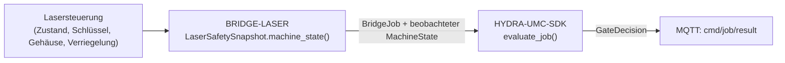

<!-- =============================================================================
HYDRA-UMC-BRIDGE-LASER - Laserzellen-Koordinationsbrücke
Copyright (C) JuanenRac (Electro Hobby 3D) <electrohobby3d@gmail.com>
GPL-3.0-or-later - see LICENSE
============================================================================= -->

<p align="center">
  
</p>

# 🔦 HYDRA-UMC-BRIDGE-LASER

<p align="center"><a href="README.md">🇺🇸 English</a> | <a href="README_spa.md">🇪🇸 Español</a> | <a href="README_fra.md">🇫🇷 Français</a> | <a href="README_ita.md">🇮🇹 Italiano</a> | 🇩🇪 <b>Deutsch</b> | <a href="README_zho.md">🇨🇳 简体中文</a> | <a href="README_jpn.md">🇯🇵 日本語</a> | <a href="README_por.md">🇵🇹 Português</a></p>

### 🛑 Ausfallsichere Koordinationsbrücke für Laserzellen

<p align="center">
  
  
  
</p>

---

> **Ehrlichkeitscheck - was heute wirklich läuft:** der Vier-Signal-Sicherheits-Snapshot und sein Gate (`cell.py` mit `LaserSafetySnapshot`/`LaserCellBridge`, das jeden Job durch das echte `evaluate_job()` von `HYDRA-UMC-SDK` leitet), der schreibgeschützte Evidenz-Normalisierer (`observation.py`), der echte GPIO-Verriegelungs-Leser (`gpio_safety.py` mit `GpioSafetyProbe`, libgpiod v2) und der MQTT-Status-/Evidenz-Transport (`mqtt_transport.py`) sind real und durch 149 bestehende `unittest`-Fälle abgedeckt (`python tools/build_test.py`), einschließlich `tests/test_gpio_mqtt_emulator.py`, das diese Bridge gegen einen protokolltreuen, von Hand geschriebenen GPIO/MQTT-Emulator laufen lässt. Nichts davon hat je einen echten GPIO-Chip, einen echten MQTT-Broker oder einen echten Laser-Controller berührt - `test_gpio_safety.py` liest gegen einen simulierten Chip, und `test_mqtt_transport.py` verwendet einen simulierten Broker-Client. Es gibt noch keine konkrete Laser-Controller-/Software-Integration, weil die Maschine und ihre dokumentierte Schnittstelle nicht verfügbar sind - siehe „Aktueller Status und nächste Schritte" weiter unten, das dies bereits klar sagt, sowie `CHANGELOG.md` für das, was bisher genau ausgeliefert wurde.

---

> **Stand von Sicherheit (Safety) und Security:** Dieses Ökosystem ist kein zertifiziertes Sicherheitssystem. Es gibt noch keinen Hardware-E-STOP-Pfad, keine von der Firmware durchgesetzten Grenzen oder Verriegelungen und keinen verifizierten Bewegungsbefehl; Firmware-Images werden mit CRC32 und einem HMAC-SHA256 mit gemeinsamem Schlüssel geprüft, nicht mit einer asymmetrischen Signatur; TLS und gegenseitiges TLS sind optional und standardmäßig aus; noch keine eigene Platine wurde bestückt oder getestet. Lesen Sie die [Sicherheitsbasis](https://github.com/JuanenRac/HYDRA-UMC-DOCS/blob/main/docs/SECURITY_BASELINE.md) und das [Bedrohungsmodell](https://github.com/JuanenRac/HYDRA-UMC-DOCS/blob/main/docs/THREAT_MODEL.md), bevor Sie sich für die Sicherheit einer Person auf eine Aussage hier verlassen.

## 📋 Auf einen Blick

| | |
|---|---|
| Version | `0.1.8` |
| Reifegrad | Funktionsfähig |
| Tests | 96 (`python tools/build_test.py`) |
| Technik | Python / Laser controller / G-code / Safety evidence / GPIO interlock reading |
| Ziel | Der Raspberry Pi CM5 einer HYDRA-UMC-Zelle |
| Auf echter Hardware | Nur simuliert: gegen Emulatoren, Attrappen oder Simulatoren getestet; für diese Version ist kein Lauf auf echter Hardware vermerkt |

## 🚦 Projektstatus

Jede Zeile ist ein Teil dieses Repositorys, und die Ampel sagt, wie weit er heute ist. Sie beruht auf dem, was das Repository zeigen kann (Tests, Builds, Läufe), nicht auf dem, was geplant ist.

🟢 Fertig und überprüft · 🟡 Funktioniert, mit bekannten Grenzen · 🟠 Teilweise fertig oder noch nicht überprüft · 🔴 Nicht gemacht oder funktioniert nicht

| Bereich | Stand | Was das hier bedeutet |
|---|---|---|
| Software | 🟡 | Funktioniert für seinen Hauptzweck; die Ehrlichkeitsprüfung oben nennt, was noch fehlt |
| Tests | 🟢 | 96 automatische Tests, bei jeder Änderung ausgeführt |
| Echte Hardware | 🟠 | Nur simuliert: gegen Emulatoren, Attrappen oder Simulatoren getestet; für diese Version ist kein Lauf auf echter Hardware vermerkt |
| Dokumentation | 🟢 | README in acht Sprachen, bei jeder Änderung gegen das Manifest geprüft |

## 1. 🛠️ TECHNISCHER ÜBERBLICK

**HYDRA-UMC-BRIDGE-LASER** ist die High-Level-Brücke für Laserzellen und HYDRA-UMC-Roboterhilfsfunktionen. Sie kann sichere Randaufgaben wie die Materialübergabe koordinieren, kann eine Lasersteuerung jedoch **niemals** scharfschalten, auslösen oder überstimmen — das sind Beobneunungen, die sie liest, keine Befugnisse, die sie besitzt.

Sie gehört zur Familie **External Automation Bridges**: einer Gruppe von Schwester-Repositories (CNC, LASER, OPENPNP, PRINTER3D, ROS2), die alle denselben gemeinsamen Sicherheitsvertrag von `HYDRA-UMC-SDK` sprechen, sodass keine Brücke ihre eigene Definition von "sicher zum Arbeiten" erfinden kann.

### Kernfunktionen:
* ✅ **Vier-Signal-Sicherheits-Snapshot (Software-Logik, ohne Laser getestet):** `cell.py` — `LaserSafetySnapshot.machine_state()` verlangt, dass der Schlüsselschalter aktiviert, das Gehäuse geschlossen **und** die Verriegelung intakt sind — gleichzeitig; fehlt eines davon, wird auf `SAFE_STOP` aufgelöst, noch bevor `controller_state` überhaupt gelesen wird. *(implementiert, getestet in `tests/test_cell.py`)*
* ✅ **Echtes gemeinsames Sicherheitsgatter:** jeder beobachtete Auftrag wird über `evaluate_job()` aus dem `bridge_contract` von `HYDRA-UMC-SDK` neu bewertet — demselben Gatter, das jede Schwesterbrücke verwendet. *(implementiert)*
* ✅ **Konservative Zustandsabbildung:** nur `IDLE` wird als Leerlauf behandelt; `RUN`/`RUNNING`/`PAUSED` werden auf `RUNNING` abgebildet, `FAULT`/`ALARM`/`ERROR` auf `FAULT`, und jeder nicht erkannte Wert fällt auf `OFFLINE` zurück. *(implementiert)*
* ✅ **Schreibgeschützter Sicherheitsnachweis:** `observation.py` akzeptiert nur echte boolesche Signale für Schlüssel, Gehäuse und Verriegelung; fehlende, numerische oder textartige Werte schlagen sicher fehl. Es kann einen Laser weder scharfschalten noch auslösen. *(implementiert, getestet in `tests/test_observation.py`)*
* ✅ **Controller-neutrales GPIO-Verriegelungs-Lesen (nur gegen einen simulierten Chip getestet):** `GpioSafetyProbe` aus `gpio_safety.py` liest dieselben 3 unabhängigen Schutzeinrichtungen von GPIO-Leitungen (libgpiod v2; die Tests nutzen einen simulierten Chip) statt aus einem gespeicherten Mapping - bewusst controller-unabhängig, da ein Schlüsselschalter/Türsensor/Verriegelungsrelais bei Laserschneidern herstellerunabhängig universell ist. Ein GPIO-Lesefehler lässt alle 3 Schutzeinrichtungen sicher fehlschlagen. *(implementiert, getestet in `tests/test_gpio_safety.py`)*
* ✅ **Flankengesteuerte Überwachung der Verriegelungen (nur gegen einen simulierten Chip getestet):** `open_gpio_safety()` öffnet die Leitungen für Schlüssel, Gehäuse und Verriegelung EINMAL (`INPUT`, `Edge.BOTH`) und bedient mit dieser einen Anforderung sowohl die Pegelleser als auch den Flankenwächter — der Kernel lehnt eine zweite Anforderung derselben Leitungen ab. `watch_for_interlock_edges()` blockiert auf den Flanken-Ereignismeldungen des Kernels (libgpiod v2), statt Pegel nur dann neu zu lesen, wenn eine fremde MQTT-Nachricht danach fragt, und `run_forever(edge_watcher=...)` startet einen Daemon-Thread, der in dem Augenblick einen aktualisierten, retained `state` veröffentlicht, in dem eine Leitung wechselt; fällt der Wächter aus, veröffentlicht er einen fail-closed `state` (`SAFE_STOP`, mit Grund) und versucht es weiter. Die Verdrahtung jeder Leitung wird deklariert (`GpioLineSettings`: `active_low`, `bias` — der Standard lässt ein durchtrenntes Kabel als unsicher lesen — und `debounce_ms`); siehe `docs/WIRING_GUIDE.md`. Noch nicht an einem echten GPIO-Chip validiert. *(implementiert, getestet in `tests/test_gpio_safety.py` und, mit einem simulierten `gpiod`, in `tests/test_hardening.py`)*
* ✅ **Sicherheitsereignis-Strom (getestet mit simulierten Leitungen und einem simulierten Flankenwächter):** `events.py` macht aus jeder Änderung von Schlüssel, Gehäuse und Interlock einen Datensatz mit Zeitstempel auf `hydra/bridges/laser/event/safety` (das Protokoll, das ein Data Lake für Audit und OEE aufbewahrt) und, genau einmal, wenn die Zelle von sicher auf unsicher wechselt, ein Ereignis `hydra/bridges/laser/event/interlock_open` mit den geöffneten Schutzeinrichtungen, damit der Orchestrator die Arme der Zelle sofort anhält. Beide sind QoS 1 und nie retained; sie tragen `at_ms` und eine wachsende `sequence`; die erste Messung ist nur eine Basis; fällt der Flankenwächter aus, wird der Verlust ebenfalls als offenes Interlock gemeldet. Die Bridge meldet nur: Sie kann keinen Laser stoppen. *(implementiert, getestet in `tests/test_events.py`)*
* ✅ **Optionale Zusatz-Schutzeinrichtungen (getestet mit simulierten Eingängen):** `auxiliary.py` lässt die Zelle zusätzliche Bedingungen deklarieren - laufende Rauchabsaugung, Hilfsluft an, Temperatur der CO2-Röhre höchstens ein Grenzwert - als `AuxiliaryCheck`, die an `LaserMqttBridge(auxiliary=...)` übergeben werden. Ein Auftrag außer ABORT wird abgelehnt, mit Nennung der fehlgeschlagenen Prüfung, solange eine nicht erfüllt ist; ein nicht lesbarer, nicht numerischer oder nicht endlicher Wert gilt als nicht erfüllt; `state` enthält eine Map `auxiliary`. Ohne Deklaration ändert sich nichts. Nur lesend: Es schaltet nichts. *(implementiert, getestet in `tests/test_auxiliary.py`)*
* ✅ **Nicht-mutierender Build/Test:** `build-test.bat`/`.sh` kompilieren den Quellcode und führen die Sicherheitsgatter-Testsuite aus, ohne Versionsdateien oder das CHANGELOG anzufassen. *(implementiert, siehe BUILD & AUSFÜHRUNG unten)*
* ✅ **GRBL-Laser-Statusleser (nur gegen eine simulierte Platine getestet):** `GrblLaserState` in `grbl_state.py` ist der echte `controller_state` für eine Laser-Steuerung der GRBL-Familie an einem seriellen Port (die Platinen, die LaserGRBL und LightBurn ansteuern): er sendet die GRBL-Statusabfrage `?` und gibt das Statuswort des Berichts zurück. Er ist absichtlich nur lesend - das einzige Byte, das er schreibt, ist `?`, es gibt weder Halt, Reset, Fortsetzen noch G-Code - und fällt sicher aus (keine Antwort ist ein leerer Zustand, nie Leerlauf). Port, wiederverbindende Verbindung und Parser sind die gemeinsame serielle Anbindung des SDK, die auch die CNC-Bridge nutzt. Laserleistung und Vorschub des Berichts gehen als Information in `state` (`laser_power`, `feed_rate`), nie als Sicherung. Eine GRBL-Platine hat nur einen seriellen Port: solange LightBurn oder LaserGRBL ihn hält, kann dieser Leser ihn nicht nutzen. *(implementiert, nicht an einer echten Platine erprobt)*
* 🔜 **Konkrete Laser-Controller-/Software-Integration** — bewusst zurückgestellt, bis Maschine und dokumentierte Schnittstelle verfügbar sind. *(geplant)*
* ✅ **Wiederholte Idempotenzschlüssel:** `LaserMqttBridge` nimmt einen `IdempotencyStore` an: ein wiederholter Auftragsschlüssel erhält die Antwort vom ersten Mal, statt erneut bewertet zu werden. *(implementiert, getestet in `tests/test_idempotency.py`)*
* ✅ **Gehärtete MQTT-Schleife und fail-closed Lesen:** eine zu große (über 16 KiB) oder unlesbare Nutzlast, tief verschachteltes JSON und jeder unerwartete Fehler werden mit einer Ablehnung auf dem Ergebnis-Topic beantwortet und beenden die Schleife nie; die Antworten von `cmd/job` tragen `"mode": "gate-only"`, und ein ABORT darüber sagt, dass nichts gestoppt wurde (der physische E-STOP stoppt den Laser); der Zustand enthält `observed_at`, und die Bridge meldet sich auf einem `availability`-Topic mit Last Will; jede Ausnahme beim Lesen der GPIO-Leitungen — nicht nur `OSError` — lässt alle drei Sicherungen fehlschlagen, und die drei Pegel werden in einer Operation unter einer Sperre gelesen; Controller-Zustände im GRBL-Stil wie `Hold:0`, `Alarm:1`, `Door:1`, `Jog` und `Home` werden verstanden. *(implementiert, getestet in `tests/test_hardening.py`)*

---

## 2. 🔄 ZELLKOORDINATIONSABLAUF



---

## 3. 🧱 ARCHITEKTUR UND DESIGN-ENTSCHEIDUNGEN

* **Warum drei unabhängige Sicherungen statt eines einzelnen Booleans.** `LaserSafetySnapshot.machine_state()` prüft `key_enabled`, `enclosure_closed` und `interlock_healthy` als drei getrennte Bedingungen — echte Lasersicherheit erfordert, dass jede physische Schutzmaßnahme unabhängig voneinander wahr ist; sie zu einem einzigen Flag zusammenzufassen würde verschleiern, welche davon tatsächlich fehlgeschlagen ist.
* **Warum die Brücke dokumentiert, dass sie einen Laser niemals scharfschalten oder auslösen kann.** Der eigene Docstring von `LaserCellBridge` besagt, dass sie "nur externe Hilfsfunktionen koordiniert; sie kann einen Laser nicht scharfschalten oder auslösen" — diese Bedingungen sind Beobneunungen der eigenen zertifizierten Verriegelungen der Steuerung, niemals ein Ersatz dafür.
* **Warum die Zustandsabbildung des Controllers bewusst konservativ ist.** Nur die wörtliche Zeichenkette `IDLE` wird auf `MachineState.IDLE` abgebildet. Jeder nicht erkannte Wert fällt auf `OFFLINE` zurück, niemals auf etwas, das Hilfsarbeit erlauben würde.
* **Warum die Brücke einen neuen `BridgeJob` erstellt und an das gemeinsame `evaluate_job()` delegiert, statt eigene Annahme-/Ablehnungslogik zu schreiben.** Alle fünf External Automation Bridges (CNC, LASER, OPENPNP, PRINTER3D, ROS2) verwenden exakt denselben `bridge_contract` von `HYDRA-UMC-SDK` wieder, sodass "was als sicher für den Start eines Auftrags zählt" zwischen ihnen nicht stillschweigend auseinanderdriften kann.
* **Warum die Wahl der echten Laser-Software/-Steuerung bewusst zurückgestellt wird.** Sich auf die Schnittstelle eines bestimmten Herstellers festzulegen, bevor Maschine und ihre dokumentierte Verriegelungsmeldung verfügbar sind, würde bedeuten, eine echte Sicherheitsgarantie zu behaupten, die dieser lokale Kern nicht verifizieren kann.
* **Wie das in den Rest des Ökosystems passt.** BRIDGE-LASER sitzt zwischen der Lasersteuerung und `HYDRA-UMC-SDK` → `HYDRA-UMC-MQTT-BROKER` → unabhängiger Sicherheit: es koordiniert Roboter-Hilfsarbeit rund um die Laserzelle, es ersetzt oder überschreibt nicht die zertifizierte Lasersicherheit.

Der Beobachtungs-Helfer ist ein Evidenz-Normalisierer, kein Laser-Controller-Adapter: er öffnet keine Netzwerk- oder serielle Verbindung, ändert keine Einstellungen, lädt keine Jobs hoch, scharf schaltet oder zündet nicht. [Laser Controller Evidence Boundary](docs/CONTROLLER_EVIDENCE_BOUNDARY.md) definiert die vor einer echten Integration erforderliche Validierung.

---

## 📂 VERZEICHNISSTRUKTUR

```text
HYDRA-UMC-BRIDGE-LASER/
├── src/
│   └── hydra_umc_bridge_laser/
│       ├── __init__.py
│       ├── cell.py              # Sicherheitsgatter LaserSafetySnapshot + LaserCellBridge
│       ├── auxiliary.py       # extraction / assist air / tube temperature checks
│       ├── events.py          # interlock_open + safeguard-change events
│       ├── observation.py       # Nur-Lese-Normalisierung der Sicherheitsnachweise
│       ├── grbl_state.py       # Schreibgeschützter Zustand der GRBL-Lasersteuerung: die Statusabfrage und nichts sonst
│       ├── gpio_safety.py       # Liest die 3 echten unabhängigen Schutzsignale über GPIO - niemals ein Laserbefehl
│       └── mqtt_transport.py    # Echter MQTT-Broker-Transport - nur Status/Nachweis, diese Bridge kann keinen Laser scharfschalten oder auslösen
├── tests/
│   ├── test_cell.py             # Zulassung im sicheren Leerlauf, Gehäuse-Ablehnung, Abbruchweiterleitung
│   ├── test_observation.py      # Fehlende Sicherheitsnachweise schlagen fail-closed fehl
│   ├── test_gpio_safety.py      # Echte GPIO-Sicherheitslesungen gegen einen simulierten Chip, inkl. Fail-Closed-Pfade
│   ├── test_mqtt_transport.py   # MQTT-Status-/Nachweisform-Tests gegen einen simulierten Broker-Client
│   ├── test_mqtt_environment.py # Die MQTT-Zugangsdaten und TLS der Dienstumgebung erreichen den Client
│   ├── test_grbl_state.py       # GRBL-Leser gegen eine simulierte Platine: Banner und veraltete Zeilen, toter Link, Wiederverbinden, stumme Platine
│   ├── test_idempotency.py      # Ein wiederholter Idempotenzschlüssel wird nur einmal beantwortet
│   ├── gpio_mqtt_emulator.py    # Protokolltreuer GPIO/MQTT-Emulator (realistischer Test-Double)
│   ├── test_gpio_mqtt_emulator.py # Bridge-Verhalten gegenüber dem GPIO/MQTT-Emulator
│   └── test_hardening.py        # Feindliche Nutzlasten, Einzelanforderung mit simuliertem gpiod, Wächterausfall, ehrliche Antworten
├── tools/
│   ├── build_test.py            # Nicht-mutierender Compiler + Testläufer (build-test.bat/.sh)
│   ├── bump_version.py          # Synchronisiert pyproject.toml, Manifest und CHANGELOG.md
│   ├── ci_validate.py           # Abhängigkeitsfreie, nicht-destruktive CI-Basislinie (verwendet von .github/workflows/ci.yml)
│   └── inspect_controller_evidence.py # Normalisiert eine gespeicherte lokale Evidenz-JSON-Datei (keine Verbindung geöffnet)
├── docs/
│   ├── BRIDGE_GUIDE.md                    # Umfang, kompatible Plattformen, Skripte, Hardware-Abnahmegatter
│   ├── CONTROLLER_EVIDENCE_BOUNDARY.md    # Was als echter Sicherheitsnachweis zählt und was diese Bridge nicht ableitet
│   └── WIRING_GUIDE.md                    # Verdrahtung der drei Sicherungen: Polarität, Öffner-Kontakte, Bias, Entprellung
├── images/
│   └── HYDRA_UMC_BANNER.svg     # README-Banner
├── build-test.bat / build-test.sh  # Validiert nur, ändert das Repository nie
├── build.bat / build.sh            # Validiert und baut (Bauen ändert nie die Version)
├── pyproject.toml               # Paket-Metadaten; hängt von HYDRA-UMC-SDK ab (git)
├── hydra-umc.project.json       # Ökosystem-Manifest (Version, Reifegrad, Familie)
├── CHANGELOG.md
├── CODE_OF_CONDUCT.md / CONTRIBUTING.md / SECURITY.md / SUPPORT.md
├── LICENSE / LICENSE.md
└── README.md / README_*.md      # Diese Datei und ihre 6 Übersetzungen
```

---

## 4. ⚙️ BUILD & AUSFÜHRUNG

Erfordert Python 3.11+. `tools/build_test.py` erwartet, dass `HYDRA-UMC-SDK` als Schwesterverzeichnis (`../HYDRA-UMC-SDK`) ausgecheckt oder über die Umgebungsvariable `HYDRA_UMC_SDK_ROOT` angegeben ist.

```bash
# Windows
build-test.bat      # nur Validierung — keine Versions-/CHANGELOG-Änderung
build.bat            # Validiert und baut (Bauen ändert nie die Version)

# Linux/macOS
bash build-test.sh
bash build.sh
```

`build-test` kompiliert jedes Modul unter `src/` und `tools/` mit `py_compile` und führt die vollständige, unter `tests/` entdeckte `unittest`-Suite aus (`test_cell.py`, `test_observation.py`, `test_gpio_safety.py`, `test_mqtt_transport.py`, `test_gpio_mqtt_emulator.py`, `test_hardening.py`, `test_idempotency.py`, `test_mqtt_environment.py` - 149 Tests), was unter anderem die Zulassung im sicheren Leerlauf, die Gehäuse-Ablehnung und die Abbruchweiterleitung belegt — es ändert das Repository nie. `build` führt zuerst dieselbe Validierung aus und ruft nur bei Erfolg `tools/bump_version.py` auf, um die Version in `pyproject.toml`, `hydra-umc.project.json` und `CHANGELOG.md` zu synchronisieren. Es gibt noch keinen echten Laser-`run`-Befehl — dafür ist eine validierte, sichere Controller-Integration erforderlich.

---

## ✅ AKTUELLER STATUS UND NÄCHSTE SCHRITTE

**Heute real:** Version `0.1.8`, ein lokal getesteter ausfallsicherer Planungskern (`LaserSafetySnapshot` + `LaserCellBridge`), gestützt auf das gemeinsame Auftragsgatter von `HYDRA-UMC-SDK`, strenge schreibgeschützte Normalisierung von Sicherheits-Evidenz, die einen echt pausierten Auftrag (`HOLDING`) von einem echt aktiv feuernden (`RUNNING`) unterscheidet, ein echtes, controller-neutrales GPIO-Verriegelungs-Lesen (`GpioSafetyProbe`) für die 3 unabhängigen Schlüssel-/Gehäuse-/Verriegelungs-Schutzeinrichtungen, ein echter MQTT-Status-/Evidenz-Transport (`mqtt_transport.py`), eine deterministische `unittest`-Suite mit 149 Tests sowie nicht-mutierende Build-Test-Skripte, die in CI mit SDK-Checkout eingebunden sind.

**Integrationsgrenze:** das eigene zertifizierte Gehäuse, der Schlüsselschalter und die Verriegelungsautorität der Lasersteuerung werden nie umgangen; diese Brücke steuert ausschließlich *Hilfs*-Roboterarbeit um sie herum, und das nur durch Lesen ihres gemeldeten Zustands.

**Noch offen:** die Brücke wurde noch nicht mit einem realen Lasersystem verbunden oder zu dessen Betrieb genutzt — die Auswahl und Validierung einer konkreten Controller-/Software-Schnittstelle wird zurückgestellt, bis Maschine und ihre dokumentierte Schnittstelle verfügbar sind.

---

## 🔗 Verwandte Projekte

Dieses Projekt ist Teil des HYDRA-UMC-Robotik-Ökosystems desselben Autors (JuanenRac / Electro Hobby 3D). Gut zu wissen, da eine Anfrage eigentlich eines dieser Projekte betreffen könnte statt dieses Repositorys.

**Übergeordnetes Projekt**
- **[HYDRA-UMC-SERVER](https://github.com/JuanenRac/HYDRA-UMC-SERVER)** — das reale Headless-Backend (REST/WebSocket), mit dem jeder Steuerungsclient tatsächlich spricht; diese Bridge ruft es nicht auf: sie antwortet über MQTT, via HYDRA-UMC-MQTT-BROKER, demjenigen, der die Zelle steuert.

**Geschwisterprojekte** — sprechen ebenfalls mit der eigenen API von HYDRA-UMC-SERVER, jeweils als eigener Client
- **[HYDRA-UMC-STUDIO](https://github.com/JuanenRac/HYDRA-UMC-STUDIO)** — Web-Steuerungs-Dashboard mit Echtzeit-3D-Visualisierung mehrerer Roboter.
- **[HYDRA-UMC-SUITE](https://github.com/JuanenRac/HYDRA-UMC-SUITE)** — Desktop-Schwarmleitstand (PySide6) für mehrere Server gleichzeitig, verpackt als eigenständige ausführbare Datei.
- **[HYDRA-UMC-ANDROID-CONTROL](https://github.com/JuanenRac/HYDRA-UMC-ANDROID-CONTROL)** — native Android-Steuerungs-App mit biometrischem Login und einer gekoppelten Wear-OS-Begleit-App.
- **[HYDRA-UMC-IOS-CONTROL](https://github.com/JuanenRac/HYDRA-UMC-IOS-CONTROL)** — iOS/iPadOS-Steuerungs-App (Flutter) mit Echtzeit-WebSocket-Synchronisierung.
- **[HYDRA-UMC-DSI](https://github.com/JuanenRac/HYDRA-UMC-DSI)** — native Touch-UI für das eingebaute 7"-DSI-Touchscreen, direkt auf dem CM5 eingebettet.
- **[HYDRA-UMC-BRIDGE-AMR](https://github.com/JuanenRac/HYDRA-UMC-BRIDGE-AMR)** — Koordinationsschranke für AGV-/AMR-Flotten über einen VDA-5050-MQTT-Publisher (nur gegen eine emulierte Flotte getestet).
- **[HYDRA-UMC-BRIDGE-CNC](https://github.com/JuanenRac/HYDRA-UMC-BRIDGE-CNC)** — High-Level-Koordinator für CNC-Zellen mit GRBL-Status-/Steuerbyte-Zugriff (nur gegen einen Emulator getestet).
- **[HYDRA-UMC-BRIDGE-DROIDS](https://github.com/JuanenRac/HYDRA-UMC-BRIDGE-DROIDS)** — Koordinationsschranke für laufende/humanoide Droiden, mit einem Boston-Dynamics-Spot-Befehlssender (nur gegen einen Emulator getestet).
- **[HYDRA-UMC-BRIDGE-OPENPNP](https://github.com/JuanenRac/HYDRA-UMC-BRIDGE-OPENPNP)** — sicherer High-Level-Koordinator für den Leiterplattenfluss von OpenPnP Pick-and-Place.
- **[HYDRA-UMC-BRIDGE-PRINTER3D](https://github.com/JuanenRac/HYDRA-UMC-BRIDGE-PRINTER3D)** — sichere Koordinationsschranke für Moonraker/Klipper-3D-Drucker, mit echten gesicherten Job-Befehlen.
- **[HYDRA-UMC-BRIDGE-ROS2](https://github.com/JuanenRac/HYDRA-UMC-BRIDGE-ROS2)** — Koordinator mit einem träge importierten rclpy-ROS-2-Transport (noch nicht gegen eine ROS-2-Installation ausgeführt).
- **[HYDRA-UMC-BRIDGE-UAV](https://github.com/JuanenRac/HYDRA-UMC-BRIDGE-UAV)** — Koordinationsschranke für kameraausgestattete UAVs, mit einem MAVLink-Befehlssender (nur gegen einen Emulator getestet).

**Direkt verwandt**
- **[HYDRA-UMC-SDK](https://github.com/JuanenRac/HYDRA-UMC-SDK)** — der gemeinsame JSON-Schema-Vertrag und die Software-Auftragsschranke, gegen die jede Bridge ihre Befehle validiert (keine zertifizierte Sicherheitsfunktion).
- **[HYDRA-UMC-CONNECTOR-HUB](https://github.com/JuanenRac/HYDRA-UMC-CONNECTOR-HUB)** — deklaratives Adapter-Manifest-Register und Validator für Konnektoren externer Maschinen; erweitert die eigene Vertragsidee des SDK auf externe Maschinen, ohne die Industrie-Gateway-Projekte zu ersetzen.
- **[HYDRA-UMC-MQTT-BROKER](https://github.com/JuanenRac/HYDRA-UMC-MQTT-BROKER)** — der echte Transport von `mqtt_transport.py` für die eigenen `hydra/bridges/laser/...`-Topics dieser Bridge — nur Sicherungsstatus, da hier kein echter Aktivierungsbefehl existiert (diese Bridge kann einen Laser weder scharfschalten noch auslösen); siehe die eigene `docs/BRIDGE_TOPICS.md` dieses Repositorys.
- **[HYDRA-UMC-SAFETY-ZONES](https://github.com/JuanenRac/HYDRA-UMC-SAFETY-ZONES)** — zukünftiger Zellzonen-Sicherheitsnachweis für diese Bridge.

**Ebenfalls Teil des Ökosystems**

*Kern-Hardware & Plattform*
- **[HYDRA-UMC](https://github.com/JuanenRac/HYDRA-UMC)** — der Entwurf des Motherboards des Roboterarms: CM5-Host + Dual-Core-STM32H745, gedacht zur Koordination von bis zu 8 Werkzeugarmen über CAN-OTA/SPI-OTA (Firmware in einer frühen Phase; noch keine bestückte Platine).
- **[HYDRA-UMC-OS](https://github.com/JuanenRac/HYDRA-UMC-OS)** — reproduzierbare Raspberry-Pi-OS-Produktschicht für den CM5: schreibgeschützter Agent, validierte Konfiguration/Profile, WiFi-Ersteinrichtung.

*Kern-Backend & Clients*
- **[HYDRA-UMC-EDITOR-URDF](https://github.com/JuanenRac/HYDRA-UMC-EDITOR-URDF)** — grafischer Desktop-URDF-Ersteller/-Editor, der fertige Modelle in STUDIOs eigenen Katalog überträgt.
- **[HYDRA-UMC-EDITOR-STL](https://github.com/JuanenRac/HYDRA-UMC-EDITOR-STL)** — Desktop-STL-Modelleditor, der echte Teile im selben Modellkatalog transformiert/ersetzt/entfernt/hinzufügt, den auch HYDRA-UMC-EDITOR-URDF bearbeitet.

*URTC-Werkzeugplattform*
- **[URTC](https://github.com/JuanenRac/URTC)** — Firmware für die physische Universal-Robot-Tool-Controller-Platine, 25+ Werkzeugprofile über CAN-Bus.
- **[URTC-FLASHER](https://github.com/JuanenRac/URTC-FLASHER)** — Desktop-GUI-Flash-Tool für URTC-Platinen, CAN-OTA plus Full-Chip-SWD/JTAG.
- **[URTC-TESTER](https://github.com/JuanenRac/URTC-TESTER)** — Desktop-Live-CAN-Bus-Diagnosetool für URTC-Platinen, ein Panel pro Werkzeugprofil.
- **[URTC-WEB-STUDIO](https://github.com/JuanenRac/URTC-WEB-STUDIO)** — browserbasierte Alternative zu URTC-TESTER über die Web-Serial-API, ohne lokale Installation.
- **[URTC-GATEWAY](https://github.com/JuanenRac/URTC-GATEWAY)** — Gateway vor dem CAN-Bus von URTC: Liste erlaubter Kennungen, Ratenbegrenzung und Sitzungsschlüssel; Software auf dem Computer getestet, noch nicht an einem echten Bus.

*Vision-KI-Knoten (Hailo-8)*
- **[HYDRA-UMC-VISION-NODE](https://github.com/JuanenRac/HYDRA-UMC-VISION-NODE)** — Integrationsknoten für die Hailo-8-Vision-Pipeline, mit einer echten stufenweisen Hardware-Bereitschaftsprüfung.
- **[HYDRA-UMC-DETECTION-HEF](https://github.com/JuanenRac/HYDRA-UMC-DETECTION-HEF)** — echte Registry für kompilierte Modelle mit Hailo-Architektur-/Prüfsummen-Safe-Load-Verifizierung.
- **[HYDRA-UMC-VISION-STREAMER](https://github.com/JuanenRac/HYDRA-UMC-VISION-STREAMER)** — echter GStreamer-Pipeline- + MediaMTX-Konfigurationsgenerator mit einer echten HailoRT-Integrationsschranke.
- **[HYDRA-UMC-VISUAL-SERVOING-API](https://github.com/JuanenRac/HYDRA-UMC-VISUAL-SERVOING-API)** — Position-Based-Visual-Servoing-Korrekturgesetz mit Freigabe abhängig vom Zonenstatus; noch keine Posenschätzung per Kamera.

*Kognitiver KI-Knoten (Hailo-10)*
- **[HYDRA-UMC-COGNITIVE-NODE](https://github.com/JuanenRac/HYDRA-UMC-COGNITIVE-NODE)** — Integrationsknoten für die Hailo-10-Cognitive-Pipeline (LLM-/VLA-/Sprach-Orchestrierung).
- **[HYDRA-UMC-VLA-ENGINE](https://github.com/JuanenRac/HYDRA-UMC-VLA-ENGINE)** — echte Aktions-Token-Kodierung/-Dekodierung und Trajektoriengenerierung für ein Vision-Language-Action-Modell.
- **[HYDRA-UMC-VOICE-UI](https://github.com/JuanenRac/HYDRA-UMC-VOICE-UI)** — echtes Sprach-Frontend (VAD + Intent-Parser) mit einem begrenzten, bestätigungsgesicherten Watch-Relay.
- **[HYDRA-UMC-SEMANTIC-PLANNER](https://github.com/JuanenRac/HYDRA-UMC-SEMANTIC-PLANNER)** — echte regelbasierte Aufgabenzerlegung und semantische Fehlerbehebung über MCU-Fehlercodes.
- **[HYDRA-UMC-DOCS-QA](https://github.com/JuanenRac/HYDRA-UMC-DOCS-QA)** — echte, nur auf der Standardbibliothek basierende TF-IDF-Dokumentensuche über die eigenen Markdown-Dokumente dieses Ökosystems.
- **[HYDRA-UMC-LOCAL-TECHNICIAN](https://github.com/JuanenRac/HYDRA-UMC-LOCAL-TECHNICIAN)** — lokaler, richtlinien-gesteuerter KI-Wartungstechniker für das Ökosystem selbst - beobachtet, diagnostiziert und schlägt Korrekturen vor; die zwei höchsten Risikostufen sind absichtlich noch nicht implementiert.

*Orchestrierung & Schwarm*
- **[HYDRA-UMC-ORCHESTRATOR](https://github.com/JuanenRac/HYDRA-UMC-ORCHESTRATOR)** — Integrationsknoten mit einem echten gRPC/Protobuf-Health-Report-Vertrag und einer Missions-Zustandsmaschine.
- **[HYDRA-UMC-JOB-DISPATCHER](https://github.com/JuanenRac/HYDRA-UMC-JOB-DISPATCHER)** — echte prioritätsbasierte Job-Queue mit Deduplizierung, über eine echte HTTP-API.
- **[HYDRA-UMC-NODE-HEALING](https://github.com/JuanenRac/HYDRA-UMC-NODE-HEALING)** — echter gRPC-basierter Flotten-Health-Watchdog mit Retry/Backoff und Identitäts-Mismatch-Erkennung.
- **[HYDRA-UMC-PATH-PLANNER-3D](https://github.com/JuanenRac/HYDRA-UMC-PATH-PLANNER-3D)** — echter RRT-basierter 3D-Pfadplaner mit echter Hindernis-/Arbeitsraum-Kollisionsvalidierung.
- **[HYDRA-UMC-SWARM-SYNC](https://github.com/JuanenRac/HYDRA-UMC-SWARM-SYNC)** — echte CRDT-LWW-Element-Map-Zustandssynchronisation, eigenschaftsgetestet auf Multi-Zellen-Konvergenz.

*Digitaler Zwilling & Simulation*
- **[HYDRA-UMC-TWIN](https://github.com/JuanenRac/HYDRA-UMC-TWIN)** — Integrationsknoten für die Digital-Twin-Engine, mit einem echten Versionskompatibilitäts-Sync-Vertrag.
- **[HYDRA-UMC-HIL-BRIDGE](https://github.com/JuanenRac/HYDRA-UMC-HIL-BRIDGE)** — Hardware-in-the-Loop-Router mit einer Software-Kollisionsverriegelung zwischen Simulation und echter Hardware (ohne echte Hardware getestet).
- **[HYDRA-UMC-PHYSICS-REPLICA](https://github.com/JuanenRac/HYDRA-UMC-PHYSICS-REPLICA)** — echte Vorwärtskinematik und Gelenkgrenzenvalidierung über eine echte URDF-Teilmenge.
- **[HYDRA-UMC-SYNTHETIC-DATA-GEN](https://github.com/JuanenRac/HYDRA-UMC-SYNTHETIC-DATA-GEN)** — echter prozeduraler 2D-Szenengenerator mit YOLO/COCO-Annotationsexport.

*Daten & Analytik*
- **[HYDRA-UMC-DATALAKE](https://github.com/JuanenRac/HYDRA-UMC-DATALAKE)** — echter sqlite3-gestützter Zeitreihenspeicher mit einer echten Ingest-/Abfrage-HTTP-API.
- **[HYDRA-UMC-ANOMALY-DETECTOR](https://github.com/JuanenRac/HYDRA-UMC-ANOMALY-DETECTOR)** — echter FFT- + statistischer Basislinien-Anomaliedetektor mit Drift-Überwachung.
- **[HYDRA-UMC-PRODUCTION-REPORTS](https://github.com/JuanenRac/HYDRA-UMC-PRODUCTION-REPORTS)** — echte OEE-/Verfügbarkeitsberechnung über den DATALAKE-Verlauf, mit reproduzierbarem CSV-Export.
- **[HYDRA-UMC-TELEMETRY-COLLECTOR](https://github.com/JuanenRac/HYDRA-UMC-TELEMETRY-COLLECTOR)** — echte CAN/WebSocket-Ingestion-Pipeline in DATALAKE, mit Sequenz-Deduplizierung.

*Industrie-Gateway*
- **[HYDRA-UMC-GATEWAY-INDUSTRIAL](https://github.com/JuanenRac/HYDRA-UMC-GATEWAY-INDUSTRIAL)** — Integrationsknoten, der zu Industrieprotokollen weiterleitet, mit einer echten Befehls-Allowlist-/Backpressure-Schicht.
- **[HYDRA-UMC-OPCUA-SERVER](https://github.com/JuanenRac/HYDRA-UMC-OPCUA-SERVER)** — echter OPC-UA-Adressraum, verifiziert mit einer echten Binärprotokoll-Client-Session.
- **[HYDRA-UMC-MTCONNECT-ADAPTER](https://github.com/JuanenRac/HYDRA-UMC-MTCONNECT-ADAPTER)** — echte MTConnect-`/probe`- und `/current`-XML-Endpunkte mit Degraded-Mode-Ausgabe.

*Ergänzende Tools & Ökosystembetrieb*
- **[HYDRA-UMC-DASHBOARD-AI](https://github.com/JuanenRac/HYDRA-UMC-DASHBOARD-AI)** — Smart-Summaries- und Anomaly-Highlighting-Panels über DATALAKE/ANOMALY-DETECTOR, mit einem ehrlichen statistischen Fallback.
- **[HYDRA-UMC-TOOL-CLI](https://github.com/JuanenRac/HYDRA-UMC-TOOL-CLI)** — Flotten-CLI mit einem echten, stabilen Exit-Code-Vertrag, ein echter Live-Client der eigenen API von HYDRA-UMC-SERVER.
- **[HYDRA-UMC-WATCH](https://github.com/JuanenRac/HYDRA-UMC-WATCH)** — WearOS-Begleit-App mit haptischen Alarmmustern und einem Sprach-Relay zum gekoppelten Telefon (noch nicht auf einer physischen Uhr ausgeführt).
- **[URTC-SMART-RACK](https://github.com/JuanenRac/URTC-SMART-RACK)** — Firmware für ein Platinenmontagegestell mit echter Werkzeug-ID-Dekodierung und Smart-Idle-Vorheizlogik.
- **[URTC-VISION-TOOL](https://github.com/JuanenRac/URTC-VISION-TOOL)** — Firmware plus ein echter Python-Vision-Begleiter für einen Thermal-/RGB-Inspektionswerkzeugkopf.
- **[HYDRA-UMC-UPDATER](https://github.com/JuanenRac/HYDRA-UMC-UPDATER)** — administratives Desktop-Tool, das jedes Repository in diesem Ökosystem entdeckt, klont und aktualisiert.
- **[HYDRA-UMC-OS-REBUILDER](https://github.com/JuanenRac/HYDRA-UMC-OS-REBUILDER)** — Windows/Linux-Desktop-Tool, das ein flashbereites CM5-Image baut, vorgeladen mit den aktuellsten Versionen des Ökosystems, mit Ersteinrichtungs-Konfiguration für WLAN/Benutzer/SSH im Stil von Raspberry Pi Imager.
- **[HYDRA-UMC-OPS-AGENT](https://github.com/JuanenRac/HYDRA-UMC-OPS-AGENT)** — Wartungsvorfall-Koordinator: eine Edge-Rolle mit niedrigem Privileg sammelt einen bereinigten Inventar-/Gesundheits-Snapshot, eine Control-Plane-Rolle rendert ihn schreibgeschützt und bittet einen KI-Anbieter um einen Diagnosevorschlag - wendet nie einen Patch an und stellt nie etwas bereit.
- **[HYDRA-UMC-DEV-SERVER](https://github.com/JuanenRac/HYDRA-UMC-DEV-SERVER)** — reproduzierbarer Entwicklungshost (Raspberry Pi 5 / CM5), der den Quellcode des Ökosystems vorhält und begrenzte Build-/Test-Aufgaben über eine dauerhafte Warteschlange ausführt; eine dedizierte Entwicklerrolle, ausdrücklich kein operativer CM5.

---

## 📚 Dokumentation & Community

- **[CONTRIBUTING.md](CONTRIBUTING.md)** — Technologie-Stack und Coding-Richtlinien für einen Pull Request.
- **[CODE_OF_CONDUCT.md](CODE_OF_CONDUCT.md)** — die in dieser Community erwarteten Verhaltensstandards.
- **[SECURITY.md](SECURITY.md)** — wie man eine Schwachstelle meldet, und die echten Sicherheitsschwerpunkte dieses Projekts.
- **[SUPPORT.md](SUPPORT.md)** — wo man Fragen stellt und Fehler meldet.
- **[LICENSE.md](LICENSE.md)** — die eigene Lizenz dieses Projekts.

## 👤 AUTOR
**JuanenRac** (Electro Hobby 3D)
📧 electrohobby3d@gmail.com
📺 [youtube.com/@electrohobby3d](https://youtube.com/@electrohobby3d)

## 📜 LIZENZ
GPL-3.0-or-later - Siehe LICENSE für Details.
