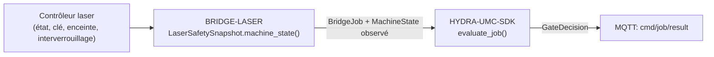

<!-- =============================================================================
HYDRA-UMC-BRIDGE-LASER - Laser cell coordination bridge
Copyright (C) JuanenRac (Electro Hobby 3D) <electrohobby3d@gmail.com>
GPL-3.0-or-later - see LICENSE
============================================================================= -->

<p align="center">
  
</p>

# 🔆 HYDRA-UMC-BRIDGE-LASER

<p align="center"><a href="README.md">🇺🇸 English</a> | <a href="README_spa.md">🇪🇸 Español</a> | 🇫🇷 <b>Français</b> | <a href="README_ita.md">🇮🇹 Italiano</a> | <a href="README_deu.md">🇩🇪 Deutsch</a> | <a href="README_zho.md">🇨🇳 简体中文</a> | <a href="README_jpn.md">🇯🇵 日本語</a> | <a href="README_por.md">🇵🇹 Português</a></p>

### 🛑 Pont de coordination à sécurité intrinsèque pour cellules laser

<p align="center">
  
  
  
  
  
  
</p>

---

> **Vérification d'honnêteté - ce qui fonctionne réellement aujourd'hui :** l'instantané de sécurité à quatre signaux et sa porte (`cell.py` avec `LaserSafetySnapshot`/`LaserCellBridge`, faisant passer chaque tâche par le propre `evaluate_job()` de `HYDRA-UMC-SDK`), le normaliseur d'évidence en lecture seule (`observation.py`), le vrai lecteur d'interverrouillage GPIO (`gpio_safety.py` avec `GpioSafetyProbe`, libgpiod v2), et le transport MQTT d'état/évidence (`mqtt_transport.py`) sont réels et couverts par 165 cas `unittest` qui passent (`python tools/build_test.py`), y compris `tests/test_gpio_mqtt_emulator.py`, qui fait tourner ce bridge contre un émulateur GPIO/MQTT fidèle au protocole mais écrit à la main. Rien de tout cela n'a touché une vraie puce GPIO, un vrai broker MQTT, ou un vrai contrôleur laser - `test_gpio_safety.py` lit contre une puce factice et `test_mqtt_transport.py` utilise un client de broker factice. Il n'existe pas encore d'intégration concrète avec un logiciel/contrôleur laser, car la machine et son interface documentée ne sont pas disponibles - voir « Feuille de route et limites connues » ci-dessous, qui le dit déjà clairement, et `CHANGELOG.md` pour ce qui a été exactement livré jusqu'à présent.

> **État de la sûreté et de la cybersécurité :** cet écosystème n'est pas un système de sécurité certifié. Il n'existe pas encore de chaîne d'E-STOP matérielle, ni de limites ou de verrouillages imposés par le firmware, ni de commande de mouvement vérifiée ; les images de firmware sont contrôlées par CRC-32 et une signature Ed25519, et une compilation de version refuse les clés de développement publiées (les têtes d'outil et les cartes d'extension derrière le relais utilisent encore les chargeurs d'URTC, qui prennent un HMAC-SHA256 à clé partagée au lieu d'une signature) ; TLS et TLS mutuel sont optionnels et désactivés par défaut ; aucune carte propre n'a encore été assemblée ni testée. Lisez la [base de sécurité](https://github.com/JuanenRac/HYDRA-UMC-DOCS/blob/main/docs/SECURITY_BASELINE.md) et le [modèle de menaces](https://github.com/JuanenRac/HYDRA-UMC-DOCS/blob/main/docs/THREAT_MODEL.md) avant de vous fier à une affirmation d'ici pour la sécurité d'une personne.

---

## 📋 En un coup d'œil

| | |
|---|---|
| Version | `0.1.9` |
| Maturité | Fonctionnel |
| Tests | 165 (`python tools/build_test.py`) |
| Technologie | Python / Laser controller / G-code / Safety evidence / GPIO interlock reading |
| Cible | Le Raspberry Pi CM5 d'une cellule HYDRA-UMC |
| Sur matériel réel | Simulé seulement : testé avec des émulateurs, des doubles de test ou des simulateurs ; aucune exécution sur du matériel réel n'est consignée pour cette version |

**Aller à :** [Présentation](#-présentation) · [Architecture](#-architecture) · [Fonctionnalités](#-fonctionnalités) · [Sécurité et protection](#-sécurité-et-protection) · [Interfaces](#-interfaces) · [Configuration](#-configuration) · [Démarrage rapide](#-démarrage-rapide) · [Tests](#-tests) · [Dépannage](#-dépannage) · [Structure du dépôt](#-structure-du-dépôt) · [Projets liés](#-projets-liés)

## 🚦 État du projet

Chaque ligne est une partie de ce dépôt et le feu dit où elle en est aujourd'hui. Elle est écrite d'après ce que le dépôt peut montrer (tests, compilations, exécutions), pas d'après ce qui est prévu.

🟢 Fait et vérifié · 🟡 Fonctionne, avec des limites connues · 🟠 À moitié fait ou pas encore vérifié · 🔴 Pas fait ou ne fonctionne pas

| Domaine | État | Ce que cela veut dire ici |
|---|---|---|
| Logiciel | 🟡 | Fonctionne pour son usage principal ; la vérification d'honnêteté ci-dessus liste ce qui manque encore |
| Tests | 🟢 | 165 tests automatiques, exécutés à chaque modification |
| Matériel réel | 🟠 | Simulé seulement : testé avec des émulateurs, des doubles de test ou des simulateurs ; aucune exécution sur du matériel réel n'est consignée pour cette version |
| Documentation | 🟢 | README en huit langues, vérifié par rapport au manifeste à chaque modification |

## 🎯 Présentation

**HYDRA-UMC-BRIDGE-LASER** est le pont haut niveau pour les cellules laser et les auxiliaires robotiques HYDRA-UMC. Il peut coordonner des tâches périphériques sûres comme le transfert de matière, mais il ne peut **jamais** armer, déclencher ou outrepasser un contrôleur laser — ce sont des observations qu'il lit, pas des autorités qu'il détient.

Il appartient à la famille **External Automation Bridges** : un ensemble de dépôts frères (CNC, LASER, OPENPNP, PRINTER3D, ROS2) qui partagent le même contrat de sécurité de `HYDRA-UMC-SDK`, afin qu'aucun pont ne puisse inventer sa propre définition du « sûr pour travailler ».

## 🧩 Rôle dans HYDRA-UMC

**HYDRA-UMC-BRIDGE-LASER** permet à une cellule de robots de travailler autour d'une découpeuse ou graveuse laser sans jamais pouvoir l'armer ni la déclencher. Il lit trois sécurités indépendantes (clé, capot, verrouillage) par GPIO et l'état d'un contrôleur laser GRBL, et seule une cellule où chaque sécurité dit « sûr » reçoit du travail.

Chaque bridge parle le contrat de sécurité partagé de `HYDRA-UMC-SDK` : un travail n'est accepté que si la porte partagée `evaluate_job()` le permet, et cette porte échoue en position fermée. Le projet parent est `HYDRA-UMC-SERVER` ; ce bridge ne l'appelle pas, il répond en MQTT, via `HYDRA-UMC-MQTT-BROKER`, à celui qui commande la cellule.

## 🏛️ Architecture

<p align="center">
  
</p>

<details>
<summary>Version texte du diagramme (Mermaid)</summary>



</details>

**Pourquoi il est construit ainsi**

* **Pourquoi trois protections indépendantes plutôt qu'un seul booléen.** `LaserSafetySnapshot.machine_state()` vérifie `key_enabled`, `enclosure_closed` et `interlock_healthy` comme trois conditions distinctes — la sécurité laser réelle exige que chaque protection physique soit indépendamment vraie ; les regrouper en un seul indicateur masquerait laquelle a réellement échoué.
* **Pourquoi le pont documente qu'il ne peut jamais armer ni déclencher un laser.** Le docstring de `LaserCellBridge` déclare lui-même qu'il « ne coordonne que des auxiliaires externes ; il ne peut ni armer ni déclencher un laser » — ces conditions sont des observations des propres interverrouillages certifiés du contrôleur, jamais un substitut à ceux-ci.
* **Pourquoi le mappage de l'état du contrôleur est délibérément conservateur.** Seule la chaîne littérale `IDLE` est mappée vers `MachineState.IDLE`. Toute valeur non reconnue retombe sur `OFFLINE`, jamais sur quelque chose qui permettrait un travail auxiliaire.
* **Pourquoi le pont construit un nouveau `BridgeJob` et délègue au `evaluate_job()` partagé plutôt que d'écrire sa propre logique d'acceptation/rejet.** Les cinq External Automation Bridges (CNC, LASER, OPENPNP, PRINTER3D, ROS2) réutilisent exactement le même `bridge_contract` de `HYDRA-UMC-SDK`, afin que « ce qui compte comme sûr pour démarrer une tâche » ne puisse pas diverger silencieusement entre eux.
* **Pourquoi le choix du logiciel/contrôleur laser réel est délibérément reporté.** S'engager sur l'interface d'un fournisseur donné avant que la machine et son rapport d'interverrouillage documenté soient disponibles reviendrait à affirmer une garantie de sécurité réelle que ce noyau local ne peut pas vérifier.
* **Comment cela s'intègre dans le reste de l'écosystème.** BRIDGE-LASER se situe entre le contrôleur laser et `HYDRA-UMC-SDK` → `HYDRA-UMC-MQTT-BROKER` → sécurité indépendante : il coordonne le travail robotique auxiliaire autour de la cellule laser, il ne remplace ni n'annule la sécurité laser certifiée.

L'assistant d'observation est un normalisateur de preuves, pas un adaptateur de contrôleur laser : il n'ouvre aucune liaison réseau ou série, ne modifie aucun réglage, ne charge aucune tâche, n'arme ni ne déclenche. [Laser Controller Evidence Boundary](docs/CONTROLLER_EVIDENCE_BOUNDARY.md) définit la validation requise avant une véritable intégration.

**Fonctionnement en service.** `python -m hydra_umc_bridge_laser --config /etc/hydra-umc/bridge-laser.toml` démarre le bridge depuis un seul fichier TOML : la puce GPIO et les trois lignes de sécurité (ligne, `active_low`, polarisation, anti-rebond), le port série du contrôleur GRBL, le broker MQTT, la source de l'état de la cellule et les sécurités auxiliaires facultatives. Une clé inconnue est refusée, la polarité d'une ligne n'a pas de valeur par défaut et tout échoue en mode fermé : sans contrôleur, l'état est OFFLINE, et un fichier d'état de la cellule absent, inconnu ou périmé vaut `SAFE_STOP`. `--check` valide le fichier ; `deploy/` contient l'unité systemd (`Restart=on-failure`) et un fichier d'exemple. Il a tourné contre des GPIO et un contrôleur simulés, pas sur une vraie cellule.

## ✨ Fonctionnalités

* ✅ **Instantané de sécurité à quatre signaux (logique logicielle, testé sans laser) :** `cell.py` — `LaserSafetySnapshot.machine_state()` exige que la clé soit activée, l'enceinte fermée **et** l'interverrouillage sain simultanément ; l'absence de l'un d'eux résout en `SAFE_STOP`, avant même la lecture de `controller_state`. *(implémenté, testé dans `tests/test_cell.py`)*
* ✅ **Portail de sécurité partagé, réel :** chaque tâche observée est réévaluée via `evaluate_job()` du `bridge_contract` de `HYDRA-UMC-SDK`, le même portail utilisé par tous les ponts frères. *(implémenté)*
* ✅ **Mappage d'état conservateur :** seul `IDLE` est traité comme repos ; `RUN`/`RUNNING`/`PAUSED` sont mappés vers `RUNNING`, `FAULT`/`ALARM`/`ERROR` vers `FAULT`, et toute valeur non reconnue retombe sur `OFFLINE`. *(implémenté)*
* ✅ **Preuve de sécurité en lecture seule :** `observation.py` n'accepte que des signaux booléens authentiques pour la clé, l'enceinte et l'interverrouillage ; les valeurs manquantes, numériques ou de type texte échouent en mode sécurisé. Il ne peut ni armer ni déclencher un laser. *(implémenté, testé dans `tests/test_observation.py`)*
* ✅ **Lecture GPIO neutre vis-à-vis du contrôleur (testée uniquement contre une puce simulée) :** `GpioSafetyProbe` de `gpio_safety.py` lit ces 3 mêmes protections indépendantes depuis des lignes GPIO (libgpiod v2 ; les tests utilisent une puce simulée) plutôt qu'un mappage enregistré - délibérément agnostique au contrôleur, puisqu'une clé/un capteur de porte/un relais d'interverrouillage est universel sur les découpeuses laser quelle que soit la marque. Un échec de lecture GPIO fait échouer les 3 protections en mode sécurisé. *(implémenté, testé dans `tests/test_gpio_safety.py`)*
* ✅ **Surveillance des interverrouillages par fronts (testée uniquement contre une puce simulée) :** `open_gpio_safety()` ouvre les lignes clé, enceinte et interverrouillage UNE seule fois (`INPUT`, `Edge.BOTH`) et sert, avec cette unique requête, à la fois les lecteurs de niveau et le surveillant de fronts — le noyau refuse une seconde requête sur les mêmes lignes. `watch_for_interlock_edges()` se bloque sur les notifications d'événements de front du noyau (libgpiod v2) au lieu de relire les niveaux seulement quand un message MQTT étranger le demande, et `run_forever(edge_watcher=...)` lance un thread démon qui publie un `state` retenu mis à jour à l'instant où une ligne change ; si le surveillant échoue, il publie un `state` en sécurité intrinsèque (`SAFE_STOP`, avec la raison) et réessaie. Le câblage de chaque ligne est déclaré (`GpioLineSettings` : `active_low`, `bias` — la valeur par défaut fait lire un fil coupé comme non sûr — et `debounce_ms`) ; voir `docs/WIRING_GUIDE.md`. Pas encore validé sur une vraie puce GPIO. *(implémenté, testé dans `tests/test_gpio_safety.py` et, avec un `gpiod` simulé, dans `tests/test_hardening.py`)*
* ✅ **Flux d'événements de sécurité (testé avec des lignes simulées et un veilleur de fronts simulé) :** `events.py` transforme chaque changement de clé, de capot et d'interlock en un enregistrement horodaté sur `hydra/bridges/laser/event/safety` (le journal qu'un data lake conserve pour l'audit et l'OEE) et, une seule fois, quand la cellule passe de sûre à non sûre, un événement `hydra/bridges/laser/event/interlock_open` nommant les protections ouvertes, afin que l'orchestrateur arrête aussitôt les bras de la cellule. Les deux sont en QoS 1 et jamais retenus ; ils portent `at_ms` et un `sequence` croissant ; la première lecture n'est qu'une base ; si le veilleur de fronts échoue, la perte est aussi signalée comme interlock ouvert. Le bridge ne fait que signaler : il ne peut pas arrêter un laser. *(implémenté, testé dans `tests/test_events.py`)*
* ✅ **Protections auxiliaires facultatives (testées avec des entrées simulées) :** `auxiliary.py` permet à la cellule de déclarer des conditions supplémentaires - extraction des fumées en marche, air d'assistance actif, température du tube CO2 au plus égale à une limite - sous forme d'`AuxiliaryCheck` passés à `LaserMqttBridge(auxiliary=...)`. Un travail autre qu'ABORT est refusé, avec le nom du contrôle en échec, tant que l'un d'eux n'est pas satisfait ; une lecture illisible, non numérique ou non finie compte comme non satisfaite ; `state` porte une table `auxiliary`. Sans déclaration, rien ne change. Lecture seule : rien n'est commuté. *(implémenté, testé dans `tests/test_auxiliary.py`)*
* ✅ **Build/test non mutant :** `build-test.bat`/`.sh` compilent le code source et exécutent la suite de tests du portail de sécurité sans toucher aux fichiers de version ni au CHANGELOG. *(implémenté, voir Compilation et publication ci-dessous)*
* ✅ **Lecteur d'état de laser GRBL (testé seulement contre une carte simulée) :** le `GrblLaserState` de `grbl_state.py` est le vrai `controller_state` d'un contrôleur laser de la famille GRBL sur un port série (les cartes que pilotent LaserGRBL et LightBurn) : il envoie la requête d'état GRBL `?` et renvoie le mot d'état du rapport. Il est en lecture seule à dessein - le seul octet qu'il écrit est `?`, il n'y a ni maintien, ni réinitialisation, ni reprise, ni G-code - et il échoue fermé (pas de réponse est un état vide, jamais au repos). Le port, la connexion qui se rouvre et l'analyseur sont le lien série partagé du SDK que le bridge CNC utilise aussi. La puissance laser et l'avance du rapport vont dans `state` à titre d'information (`laser_power`, `feed_rate`), jamais comme sécurité. Une carte GRBL n'a qu'un port série : tant que LightBurn ou LaserGRBL le tient, ce lecteur ne peut pas l'utiliser. *(implémenté, pas essayé sur une vraie carte)*
* 🔜 **Intégration concrète avec un contrôleur/logiciel laser** — délibérément reportée jusqu'à ce que la machine et son interface documentée soient disponibles. *(prévu)*
* ✅ **Clés d'idempotence répétées :** `LaserMqttBridge` accepte un `IdempotencyStore` : une clé de travail répétée reçoit la réponse donnée la première fois au lieu d'être évaluée de nouveau. *(implémenté, testé dans `tests/test_idempotency.py`)*
* ✅ **Boucle MQTT durcie et lectures en sécurité intrinsèque :** une charge trop grande (plus de 16 Kio) ou illisible, un JSON très imbriqué et toute défaillance inattendue reçoivent un refus sur le topic de résultat et ne terminent jamais la boucle ; les réponses de `cmd/job` portent `"mode": "gate-only"` et un ABORT par ce biais indique que rien n'a été arrêté (l'arrêt d'urgence physique arrête le laser) ; l'état porte `observed_at` et le bridge s'annonce sur un topic `availability` avec un Last Will ; toute exception à la lecture des lignes GPIO — pas seulement `OSError` — fait échouer les trois protections, et les trois niveaux sont lus en une seule opération sous verrou ; les états de contrôleur de style GRBL comme `Hold:0`, `Alarm:1`, `Door:1`, `Jog` et `Home` sont compris. *(implémenté, testé dans `tests/test_hardening.py`)*
* ✅ **Travaux par l'admission partagée :** le contrôle d'un travail mal formé et d'une `idempotency_key` répétée est le `JobIntake` du SDK au lieu de code de ce pont (les clés n'ont plus le préfixe `job:`).
* ✅ **Réponses publiées en QoS 1 :** les réponses aux commandes sont publiées en QoS 1 (le répartiteur partagé garde le QoS qu'un pont donne à une réponse), de sorte qu'un résultat ne se perd pas sur une liaison instable.

## 🔒 Sécurité et protection

| Menace | Défense | Où |
|---|---|---|
| Un travail pour une cellule ou une machine qui n'est pas en état sûr | Chaque travail passe par la porte partagée `evaluate_job()` du SDK, qui échoue en position fermée ; le bridge n'a aucune logique propre d'acceptation | SDK `bridge_contract` |
| Données de travail démesurées | Au plus 32 paramètres, clés jusqu'à 64 caractères, valeurs jusqu'à 1024, identifiants jusqu'à 128 (`MAX_PARAMETERS`, `MAX_PARAMETER_KEY_CHARS`, `MAX_PARAMETER_VALUE_CHARS`, `MAX_IDENTIFIER_CHARS`) | SDK `bridge_contract` |
| Un ordre répété ou rejoué | Un `IdempotencyStore` retient chaque clé 24 heures et au plus 10 000 entrées ; une répétition reçoit la première réponse au lieu d'être réévaluée | SDK `job_intake` |
| Une charge MQTT énorme ou hostile | Une charge de plus de 16 KiB, un JSON illisible ou très imbriqué et tout échec inattendu reçoivent un refus sur le topic de résultat et ne terminent jamais la boucle | `mqtt_transport.py` |
| Un laser armé par erreur | Les trois sécurités indépendantes (`key_enabled`, `enclosure_closed`, `interlock_healthy`) doivent toutes dire « sûr » ; seul l'état exact `IDLE` du contrôleur compte comme repos, tout autre est `OFFLINE` | `cell.py`, `events.py` |
| Un fil de verrouillage coupé | La polarisation par défaut fait lire un fil coupé comme non sûr (pull-up pour un signal actif bas, pull-down pour actif haut), le rebond est ignoré 10 ms par défaut et les trois lignes sont distinctes | `gpio_safety.py` |
| Une lecture GPIO qui échoue | Le `state` retenu passe en échec fermé avec la raison (toutes les sécurités non satisfaites, `SAFE_STOP`) pour que personne ne relise un vieil état correct | `mqtt_transport.py` |
| Une commande retenue rejouée à la reconnexion | Un message `cmd/` retenu est ignoré à la reconnexion | `mqtt_transport.py` |

**Ce qu'il ne fait jamais :** il ne coordonne que des auxiliaires externes : il ne peut ni armer ni déclencher un laser, et n'envoie au contrôleur GRBL que la requête d'état.

## 🔌 Interfaces

Topics sous `hydra/bridges/laser/` ; il n'y a pas de verbe d'arrêt (`STOP_VERBS` est vide).

| Topic ou route | Ce qu'il porte |
|---|---|
| `cmd/status` | charge vide : relit les trois lignes GPIO et publie l'état |
| `cmd/job` → `cmd/job/result` | un `BridgeJob` en JSON ; il ne fait que planifier : la réponse est une `GateDecision` |
| `state`, `availability` | l'instantané retenu avec son horodatage, et `online`/`offline` |
| `event/safety`, `event/interlock_open` | événements QoS 1, non retenus, quand une sécurité change |

La bibliothèque : `LaserCellBridge`, `LaserSafetySnapshot`, `LaserMqttBridge`, `GpioSafetyProbe`, `open_gpio_safety()`, `GrblLaserState`, `open_grbl_laser_state()` et `AuxiliarySupervisor` (extraction des fumées, air d'assistance, température du tube CO2).

## ⚙️ Configuration

| Variable | Par défaut | Ce qu'elle définit |
|---|---|---|
| `GpioLineSettings.active_low` | obligatoire | `True` quand le signal est sûr au niveau 0 (un contact normalement fermé à la masse) |
| `GpioLineSettings.bias` | sûr en cas de panne | `pull-up`, `pull-down`, `disabled` ou `as-is` ; sans valeur, on choisit celle qui fait lire un fil coupé comme non sûr |
| `GpioLineSettings.debounce_ms` | `10.0` | rebond ignoré pendant ce temps ; `0` le désactive, une valeur négative est refusée |
| `HYDRA_MQTT_USERNAME` | aucun | Le nom d'utilisateur MQTT ; le broker le lie à un préfixe d'identifiant client |
| `HYDRA_MQTT_PASSWORD` | aucun | Le mot de passe ; valable seulement avec le nom d'utilisateur |
| `HYDRA_MQTT_PASSWORD_FILE` | aucun | Le mot de passe lu dans un fichier (secret Docker ou systemd) ; ignoré si `HYDRA_MQTT_PASSWORD` est défini |
| `HYDRA_MQTT_TLS_CA` | aucun | Le fichier de l'AC qui a signé le certificat du broker : la connexion est en TLS et le certificat est vérifié |
| `HYDRA_MQTT_TLS` | désactivé | `1` active TLS, vérifié avec les AC de confiance du système |
| `HYDRA_MQTT_TLS_CERT` / `HYDRA_MQTT_TLS_KEY` | aucun | Le certificat client et sa clé pour un broker qui exige du TLS mutuel ; les deux sont requis |

Les décalages des trois lignes GPIO et la puce sont des arguments de `open_gpio_safety()` ; le périphérique série du contrôleur GRBL est l'argument de `open_grbl_laser_state()` (115200 bauds, délai d'une seconde par défaut).

## 🚀 Démarrage rapide

Nécessite Python 3.11 ou plus récent. Les tests et les scripts de build attendent `HYDRA-UMC-SDK` cloné à côté de ce dépôt (`../HYDRA-UMC-SDK`) ou indiqué par `HYDRA_UMC_SDK_ROOT`.

Essayez-le sans matériel (cela vérifie tout le bridge avec ses émulateurs et ses doubles de test) :

```bash
py -3 tools/build_test.py          # Windows
python3 tools/build_test.py         # Linux, macOS
```

Démarrer le service (il n'y a pas de script de console : le service est le `run_forever()` du transport MQTT, que vous appelez depuis votre propre code de démarrage) :

```python
from hydra_umc_bridge_laser.gpio_safety import GpioLineSettings, open_gpio_safety
from hydra_umc_bridge_laser.grbl_state import open_grbl_laser_state
from hydra_umc_bridge_laser.mqtt_transport import LaserMqttBridge, run_forever
wiring = GpioLineSettings(active_low=True)                       # normally-closed contacts to ground
safety = open_gpio_safety("/dev/gpiochip0", 17, 27, 22, key=wiring, enclosure=wiring, interlock=wiring)
bridge = LaserMqttBridge(safety.lines, controller_state=open_grbl_laser_state("/dev/ttyUSB0"), cell_state=lambda: cell_state)
run_forever(bridge, host="192.168.0.180", edge_watcher=safety.watcher)   # serves cmd/# and publishes the events
```

Le nom d'utilisateur, le mot de passe et les fichiers TLS viennent des variables `HYDRA_MQTT_*` (voir Configuration) ; le code ci-dessus n'a besoin d'aucun identifiant propre.

## 🧪 Tests

165 cas `unittest` automatiques s'exécutent avec `python tools/build_test.py` (qui compile aussi chaque module). Les tests n'ont besoin ni de matériel, ni de réseau, ni de paquet optionnel : ceux qui exigeraient `paho-mqtt`, `pyserial` ou une bibliothèque de fabricant utilisent un substitut ou sont ignorés si le paquet manque.

| Fichier de tests | Tests | Ce qu'il couvre |
|---|---|---|
| `test_cell.py`, `test_observation.py`, `test_events.py`, `test_auxiliary.py` | - | sécurités, preuves, événements et contrôles auxiliaires |
| `test_gpio_safety.py`, `test_gpio_mqtt_emulator.py`, `gpio_mqtt_emulator.py` | - | le lecteur GPIO contre de fausses lignes ; le vrai bridge contre des bancs GPIO et MQTT |
| `test_grbl_state.py` | - | le lecteur GRBL contre un contrôleur en mémoire qui parle comme GRBL (bannière, `ok`, réponses anciennes) |
| `test_mqtt_transport.py`, `test_mqtt_environment.py`, `test_hardening.py`, `test_edge_cases.py`, `test_idempotency.py` | - | répartition des topics, identifiants de l'environnement, clients hostiles, lectures étranges et clés répétées |

La CI exécute `HYDRA_UMC_CI=1 python tools/ci_validate.py`, qui vérifie le manifeste, les documents, les huit README et les images, et lance les tests avec une copie du SDK.

## 🏗️ Compilation et publication

Nécessite Python 3.11+. `tools/build_test.py` attend que `HYDRA-UMC-SDK` soit cloné en tant que répertoire frère (`../HYDRA-UMC-SDK`) ou indiqué via la variable d'environnement `HYDRA_UMC_SDK_ROOT`.

```bash
# Windows
build-test.bat      # validation uniquement — pas de changement de version/CHANGELOG
build.bat            # Valide et compile (compiler ne change jamais la version)

# Linux/macOS
bash build-test.sh
bash build.sh
```

`build-test` compile chaque module sous `src/` et `tools/` avec `py_compile` et exécute la suite complète `unittest` découverte sous `tests/` (`test_cell.py`, `test_observation.py`, `test_gpio_safety.py`, `test_mqtt_transport.py`, `test_gpio_mqtt_emulator.py`, `test_hardening.py`, `test_idempotency.py`, `test_mqtt_environment.py` - 165 tests), démontrant l'admission en repos sûr, le rejet enceinte et la transmission d'abandon parmi tout le reste couvert — il ne modifie jamais le dépôt. `build` exécute d'abord cette même validation et, seulement en cas de succès, appelle `tools/bump_version.py` pour synchroniser la version dans `pyproject.toml`, `hydra-umc.project.json` et `CHANGELOG.md`. Il n'existe pas encore de commande `run` laser réelle — cela nécessite une intégration de contrôleur validée et sûre.

## 🩺 Dépannage

| Vous voyez | Parce que | Faites |
|---|---|---|
| `ModuleNotFoundError: hydra_umc_sdk` | Le SDK n'est ni installé ni à côté de ce dépôt | Clonez `HYDRA-UMC-SDK` à côté de ce dépôt ou définissez `HYDRA_UMC_SDK_ROOT` |
| `paho-mqtt is not installed` | Le client MQTT est un extra optionnel | `pip install ".[mqtt]"` (il faut `paho-mqtt` 2.1 ou plus, avant 3) |
| `password was given without a username` | Les identifiants MQTT exigent les deux parties | Définissez aussi `HYDRA_MQTT_USERNAME`, pas seulement le mot de passe |
| `could not reach the MQTT broker after N attempts` | Le broker est arrêté, l'adresse est fausse ou le port est fermé | Démarrez `HYDRA-UMC-MQTT-BROKER` et vérifiez l'hôte et le port donnés au transport (5 essais à 2 secondes d'écart) ; un échec de la poignée de main TLS n'est pas réessayé |
| `the MQTT broker refused the connection` | Le broker a refusé l'identifiant (ou n'a pas répondu à temps) | Vérifiez `HYDRA_MQTT_USERNAME` et le mot de passe ; l'identifiant client doit commencer par le préfixe que le broker a lié à l'identifiant |
| `state` with every safeguard unsatisfied and `SAFE_STOP` | Une lecture GPIO a échoué (puce absente, droits, requête libérée) ou le guetteur de fronts s'est arrêté | Lisez la raison dans le `state` retenu ; vérifiez le chemin de la puce, les décalages de ligne et les droits de l'utilisateur du service |
| `"allowed": false` + `reason` | La porte partagée ou une garde a refusé l'ordre | Lisez `reason` et corrigez la cause ; ne réessayez pas à l'aveugle |

## 📂 Structure du dépôt

<p align="center">
  
</p>

<details>
<summary>Version texte de l'arborescence</summary>

```text
HYDRA-UMC-BRIDGE-LASER/
├── src/hydra_umc_bridge_laser/
│   ├── cell.py                    refuse le travail sauf si les sécurités indiquent un repos sûr
│   ├── gpio_safety.py             lit les trois lignes de sécurité par GPIO (libgpiod)
│   ├── grbl_state.py              état du contrôleur GRBL ; seulement la requête d'état
│   ├── observation.py             preuves locales de sécurité, jamais une commande au laser
│   ├── events.py                  événements horodatés quand une sécurité change
│   ├── auxiliary.py               contrôles d'extraction des fumées, d'air d'assistance et de température du tube
│   └── mqtt_transport.py          transport MQTT des commandes, de l'état et des événements
├── tests/                         149 tests, avec un émulateur GPIO et MQTT
├── deploy/                        unité systemd et configuration d'exemple
├── docs/                          guide du bridge, limite de la preuve, guide de câblage
├── tools/                         exécuteur de build et de tests, montée de version, validateur CI, générateurs et vérifications des README et des images
├── images/                        bannière et images du README
├── .github/                       workflow CI et modèles de tickets
├── pyproject.toml                 métadonnées du paquet et dépendances
├── hydra-umc.project.json         manifeste : version, maturité, famille
├── CHANGELOG.md                   ce qui a changé à chaque version
├── build.sh build.bat             scripts de build (ils ne changent jamais la version)
├── build-test.sh build-test.bat   scripts de build (ils ne changent jamais la version)
├── test.sh test.bat               lancent les tests
└── SECURITY.md SUPPORT.md CONTRIBUTING.md CODE_OF_CONDUCT.md LICENSE LICENSE.md
```

</details>

## 🗺️ Feuille de route et limites connues

**Limites connues aujourd'hui**

**Réel aujourd'hui :** version `0.1.9`, un noyau de planification à sécurité intrinsèque testé localement (`LaserSafetySnapshot` + `LaserCellBridge`) adossé au portail de tâches partagé de `HYDRA-UMC-SDK`, une normalisation stricte en lecture seule de l'évidence de sécurité distinguant un travail réellement en pause (`HOLDING`) d'un travail réellement en cours de découpe (`RUNNING`), une lecture GPIO réelle et neutre vis-à-vis du contrôleur (`GpioSafetyProbe`) pour les 3 protections indépendantes clé/enceinte/interverrouillage, un vrai transport MQTT d'état/évidence (`mqtt_transport.py`), une suite `unittest` déterministe de 165 tests, et des scripts build-test non mutants intégrés en CI avec clonage du SDK.

**Frontière d'intégration :** l'enceinte, la clé et l'interverrouillage certifiés du contrôleur laser lui-même ne sont jamais contournés ; ce pont ne fait que réguler le travail robotique *auxiliaire* autour de lui, uniquement en lisant son état rapporté.

**Encore à venir :** le pont n'a pas été connecté ni utilisé pour faire fonctionner un système laser réel — choisir et valider une interface concrète de contrôleur/logiciel est reporté jusqu'à ce que la machine et son interface documentée soient disponibles.

## 🌍 Langues

Ce README et les documents du dépôt existent en huit langues : anglais, espagnol, allemand, français, italien, japonais, chinois et portugais (Portugal). Ils sont écrits ensemble et la CI vérifie que les huit fichiers ont les mêmes sections et les mêmes liens. Ce dépôt n'a ni écran ni catalogue de messages propre, il n'y a donc aucune chaîne d'interface à traduire.

## 🔗 Projets liés

Ce projet fait partie de l'écosystème robotique HYDRA-UMC du même auteur (JuanenRac / Electro Hobby 3D). Bon à savoir, car une demande pourrait en réalité concerner l'un de ceux-ci plutôt que ce dépôt.

**Projet Parent**
- **[HYDRA-UMC-SERVER](https://github.com/JuanenRac/HYDRA-UMC-SERVER)** — le vrai backend headless (REST/WebSocket) auquel parle réellement chaque client de contrôle ; ce bridge ne l'appelle pas : il répond en MQTT, via HYDRA-UMC-MQTT-BROKER, à qui pilote la cellule.

**Projets Frères** — parlent également à la propre API de HYDRA-UMC-SERVER, chacun en tant que son propre client
- **[HYDRA-UMC-STUDIO](https://github.com/JuanenRac/HYDRA-UMC-STUDIO)** — tableau de bord de contrôle web avec visualisation 3D multi-robot en temps réel.
- **[HYDRA-UMC-SUITE](https://github.com/JuanenRac/HYDRA-UMC-SUITE)** — centre de commande d'essaim de bureau (PySide6) pour plusieurs serveurs à la fois, empaqueté en exécutable autonome.
- **[HYDRA-UMC-ANDROID-CONTROL](https://github.com/JuanenRac/HYDRA-UMC-ANDROID-CONTROL)** — application de contrôle Android native avec connexion biométrique et un compagnon Wear OS jumelé.
- **[HYDRA-UMC-IOS-CONTROL](https://github.com/JuanenRac/HYDRA-UMC-IOS-CONTROL)** — application de contrôle iOS/iPadOS (Flutter) avec synchronisation WebSocket en temps réel.
- **[HYDRA-UMC-DSI](https://github.com/JuanenRac/HYDRA-UMC-DSI)** — interface tactile native pour l'écran tactile DSI 7" embarqué, intégrée directement sur le CM5.
- **[HYDRA-UMC-BRIDGE-AMR](https://github.com/JuanenRac/HYDRA-UMC-BRIDGE-AMR)** — frontière de coordination pour les flottes AGV/AMR via un éditeur MQTT VDA 5050 (testé uniquement contre une flotte émulée).
- **[HYDRA-UMC-BRIDGE-CNC](https://github.com/JuanenRac/HYDRA-UMC-BRIDGE-CNC)** — coordinateur haut niveau pour cellules CNC avec accès au statut/octets de contrôle GRBL (testé uniquement contre un émulateur).
- **[HYDRA-UMC-BRIDGE-DROIDS](https://github.com/JuanenRac/HYDRA-UMC-BRIDGE-DROIDS)** — frontière de coordination pour droïdes à pattes/humanoïdes, avec un émetteur de commandes Boston Dynamics Spot (testé uniquement contre un émulateur).
- **[HYDRA-UMC-BRIDGE-OPENPNP](https://github.com/JuanenRac/HYDRA-UMC-BRIDGE-OPENPNP)** — coordinateur haut niveau sûr pour le flux de cartes du pick-and-place OpenPnP.
- **[HYDRA-UMC-BRIDGE-PRINTER3D](https://github.com/JuanenRac/HYDRA-UMC-BRIDGE-PRINTER3D)** — frontière de coordination sûre pour imprimantes 3D Moonraker/Klipper, avec de vraies commandes de tâche contrôlées.
- **[HYDRA-UMC-BRIDGE-ROS2](https://github.com/JuanenRac/HYDRA-UMC-BRIDGE-ROS2)** — coordinateur avec un transport ROS 2 rclpy à importation paresseuse (pas encore exécuté contre une installation ROS 2).
- **[HYDRA-UMC-BRIDGE-UAV](https://github.com/JuanenRac/HYDRA-UMC-BRIDGE-UAV)** — frontière de coordination pour UAV équipés de caméra, avec un émetteur de commandes MAVLink (testé uniquement contre un émulateur).

**Directement Liés**
- **[HYDRA-UMC-SDK](https://github.com/JuanenRac/HYDRA-UMC-SDK)** — le contrat JSON-Schema partagé et la barrière logicielle de contrôle des jobs contre laquelle chaque bridge valide ses commandes (pas une fonction de sécurité certifiée).
- **[HYDRA-UMC-CONNECTOR-HUB](https://github.com/JuanenRac/HYDRA-UMC-CONNECTOR-HUB)** — registre déclaratif et validateur de manifestes d'adaptateur pour les connecteurs de machines externes ; étend la propre idée de contrat du SDK aux machines externes sans remplacer les projets de passerelle industrielle.
- **[HYDRA-UMC-MQTT-BROKER](https://github.com/JuanenRac/HYDRA-UMC-MQTT-BROKER)** — le vrai transport de `mqtt_transport.py` pour les propres topics `hydra/bridges/laser/...` de ce bridge — uniquement le statut des sécurités, car aucune vraie commande d'actionnement n'existe ici (ce bridge ne peut ni armer ni déclencher un laser) ; voir le propre `docs/BRIDGE_TOPICS.md` de ce dépôt.
- **[HYDRA-UMC-SAFETY-ZONES](https://github.com/JuanenRac/HYDRA-UMC-SAFETY-ZONES)** — future preuve de sécurité de zone de cellule pour ce bridge.

**Fait Également Partie de l'Écosystème**

*Matériel & Plateforme de Base*
- **[HYDRA-UMC](https://github.com/JuanenRac/HYDRA-UMC)** — la conception de la carte mère du bras robotique : hôte CM5 + coprocesseur STM32H745 double cœur, destinée à coordonner jusqu'à 8 bras-outils via CAN-OTA/SPI-OTA (firmware à un stade précoce ; aucune carte assemblée pour l'instant).
- **[HYDRA-UMC-OS](https://github.com/JuanenRac/HYDRA-UMC-OS)** — couche produit reproductible sur Raspberry Pi OS pour le CM5 : agent en lecture seule, config/profils validés, provisionnement WiFi de premier contact.

*Backend Central & Clients*
- **[HYDRA-UMC-EDITOR-URDF](https://github.com/JuanenRac/HYDRA-UMC-EDITOR-URDF)** — créateur/éditeur graphique de bureau pour URDF qui envoie les modèles terminés vers le propre catalogue de STUDIO.
- **[HYDRA-UMC-EDITOR-STL](https://github.com/JuanenRac/HYDRA-UMC-EDITOR-STL)** — éditeur de bureau de modèles STL, transformant/remplaçant/retirant/ajoutant de vraies pièces dans le même catalogue de modèles qu'édite aussi HYDRA-UMC-EDITOR-URDF.

*Plateforme d'Outils URTC*
- **[URTC](https://github.com/JuanenRac/URTC)** — firmware pour la carte physique Universal Robot Tool Controller, plus de 25 profils d'outil sur bus CAN.
- **[URTC-FLASHER](https://github.com/JuanenRac/URTC-FLASHER)** — outil de bureau à interface graphique pour flasher les cartes URTC, CAN-OTA plus SWD/JTAG puce complète.
- **[URTC-TESTER](https://github.com/JuanenRac/URTC-TESTER)** — outil de bureau de diagnostic CAN-bus en direct pour cartes URTC, un panneau par profil d'outil.
- **[URTC-WEB-STUDIO](https://github.com/JuanenRac/URTC-WEB-STUDIO)** — alternative basée navigateur à URTC-TESTER via la Web Serial API, sans installation locale.
- **[URTC-GATEWAY](https://github.com/JuanenRac/URTC-GATEWAY)** — passerelle devant le bus CAN d'URTC : liste d'identifiants autorisés, limite de débit et clé de session ; logiciel testé sur ordinateur, pas encore sur un bus réel.

*Nœud IA de Vision (Hailo-8)*
- **[HYDRA-UMC-VISION-NODE](https://github.com/JuanenRac/HYDRA-UMC-VISION-NODE)** — hub d'intégration pour le pipeline de vision Hailo-8, avec une vraie vérification de disponibilité matérielle par étape.
- **[HYDRA-UMC-DETECTION-HEF](https://github.com/JuanenRac/HYDRA-UMC-DETECTION-HEF)** — registre réel de modèles compilés avec vérification de chargement sécurisé par architecture Hailo/checksum.
- **[HYDRA-UMC-VISION-STREAMER](https://github.com/JuanenRac/HYDRA-UMC-VISION-STREAMER)** — générateur réel de pipeline GStreamer + config MediaMTX, avec une vraie frontière d'intégration HailoRT.
- **[HYDRA-UMC-VISUAL-SERVOING-API](https://github.com/JuanenRac/HYDRA-UMC-VISUAL-SERVOING-API)** — loi de correction Position-Based Visual Servoing avec autorisation conditionnée à l'état de zone ; pas encore d'estimation de pose par caméra.

*Nœud IA Cognitif (Hailo-10)*
- **[HYDRA-UMC-COGNITIVE-NODE](https://github.com/JuanenRac/HYDRA-UMC-COGNITIVE-NODE)** — hub d'intégration pour le pipeline cognitif Hailo-10 (orchestration LLM/VLA/voix).
- **[HYDRA-UMC-VLA-ENGINE](https://github.com/JuanenRac/HYDRA-UMC-VLA-ENGINE)** — vrai encodage/décodage de jetons d'action et génération de trajectoire pour un modèle Vision-Language-Action.
- **[HYDRA-UMC-VOICE-UI](https://github.com/JuanenRac/HYDRA-UMC-VOICE-UI)** — vrai front-end vocal (VAD + analyseur d'intention) avec un relais Watch borné et soumis à confirmation.
- **[HYDRA-UMC-SEMANTIC-PLANNER](https://github.com/JuanenRac/HYDRA-UMC-SEMANTIC-PLANNER)** — vraie décomposition de tâches basée sur des règles et récupération sémantique d'erreurs sur les codes d'erreur MCU.
- **[HYDRA-UMC-DOCS-QA](https://github.com/JuanenRac/HYDRA-UMC-DOCS-QA)** — vraie recherche documentaire TF-IDF (bibliothèque standard uniquement) sur les propres documents Markdown de cet écosystème.
- **[HYDRA-UMC-LOCAL-TECHNICIAN](https://github.com/JuanenRac/HYDRA-UMC-LOCAL-TECHNICIAN)** — technicien de maintenance IA local et à portes de politique pour l'écosystème lui-même - observe, diagnostique et propose des corrections ; les deux niveaux de risque les plus élevés ne sont délibérément pas encore implémentés.

*Orchestration & Essaim*
- **[HYDRA-UMC-ORCHESTRATOR](https://github.com/JuanenRac/HYDRA-UMC-ORCHESTRATOR)** — hub d'intégration avec un vrai contrat de rapport de santé gRPC/Protobuf et une machine à états de mission.
- **[HYDRA-UMC-JOB-DISPATCHER](https://github.com/JuanenRac/HYDRA-UMC-JOB-DISPATCHER)** — vraie file de tâches basée sur la priorité avec déduplication, via une vraie API HTTP.
- **[HYDRA-UMC-NODE-HEALING](https://github.com/JuanenRac/HYDRA-UMC-NODE-HEALING)** — vrai chien de garde de santé de flotte basé sur gRPC, avec retry/backoff et détection d'incohérence d'identité.
- **[HYDRA-UMC-PATH-PLANNER-3D](https://github.com/JuanenRac/HYDRA-UMC-PATH-PLANNER-3D)** — vrai planificateur de trajectoire 3D basé sur RRT, avec vraie validation des collisions obstacle/espace de travail.
- **[HYDRA-UMC-SWARM-SYNC](https://github.com/JuanenRac/HYDRA-UMC-SWARM-SYNC)** — vraie synchronisation d'état CRDT LWW-Element-Map, testée par propriétés pour la convergence multi-cellule.

*Jumeau Numérique & Simulation*
- **[HYDRA-UMC-TWIN](https://github.com/JuanenRac/HYDRA-UMC-TWIN)** — hub d'intégration pour le moteur de jumeau numérique, avec un vrai contrat de synchronisation par compatibilité de version.
- **[HYDRA-UMC-HIL-BRIDGE](https://github.com/JuanenRac/HYDRA-UMC-HIL-BRIDGE)** — routeur hardware-in-the-loop avec un verrouillage logiciel de collision entre simulation et matériel réel (testé sans matériel réel).
- **[HYDRA-UMC-PHYSICS-REPLICA](https://github.com/JuanenRac/HYDRA-UMC-PHYSICS-REPLICA)** — vraie cinématique directe et validation des limites articulaires sur un vrai sous-ensemble URDF.
- **[HYDRA-UMC-SYNTHETIC-DATA-GEN](https://github.com/JuanenRac/HYDRA-UMC-SYNTHETIC-DATA-GEN)** — vrai générateur procédural de scènes 2D avec export d'annotations YOLO/COCO.

*Données & Analytique*
- **[HYDRA-UMC-DATALAKE](https://github.com/JuanenRac/HYDRA-UMC-DATALAKE)** — vrai magasin de séries temporelles basé sur sqlite3, avec une vraie API HTTP d'ingestion/requête.
- **[HYDRA-UMC-ANOMALY-DETECTOR](https://github.com/JuanenRac/HYDRA-UMC-ANOMALY-DETECTOR)** — vrai détecteur d'anomalies FFT + ligne de base statistique, avec surveillance de dérive.
- **[HYDRA-UMC-PRODUCTION-REPORTS](https://github.com/JuanenRac/HYDRA-UMC-PRODUCTION-REPORTS)** — vrai calcul OEE/disponibilité sur l'historique de DATALAKE, avec export CSV reproductible.
- **[HYDRA-UMC-TELEMETRY-COLLECTOR](https://github.com/JuanenRac/HYDRA-UMC-TELEMETRY-COLLECTOR)** — vrai pipeline d'ingestion CAN/WebSocket vers DATALAKE, avec déduplication par séquence.

*Passerelle Industrielle*
- **[HYDRA-UMC-GATEWAY-INDUSTRIAL](https://github.com/JuanenRac/HYDRA-UMC-GATEWAY-INDUSTRIAL)** — hub d'intégration relayant vers les protocoles industriels, avec une vraie couche de liste blanche de commandes/contre-pression.
- **[HYDRA-UMC-OPCUA-SERVER](https://github.com/JuanenRac/HYDRA-UMC-OPCUA-SERVER)** — vrai espace d'adressage OPC-UA, vérifié avec une vraie session client du protocole binaire.
- **[HYDRA-UMC-MTCONNECT-ADAPTER](https://github.com/JuanenRac/HYDRA-UMC-MTCONNECT-ADAPTER)** — vrais points de terminaison XML MTConnect `/probe` et `/current`, avec sortie en mode dégradé.

*Outils Complémentaires & Opérations de l'Écosystème*
- **[HYDRA-UMC-DASHBOARD-AI](https://github.com/JuanenRac/HYDRA-UMC-DASHBOARD-AI)** — panneaux Smart Summaries et Anomaly Highlighting sur DATALAKE/ANOMALY-DETECTOR, avec un repli statistique honnête.
- **[HYDRA-UMC-TOOL-CLI](https://github.com/JuanenRac/HYDRA-UMC-TOOL-CLI)** — CLI de flotte avec un vrai contrat de codes de sortie stable, un vrai client en direct de la propre API de HYDRA-UMC-SERVER.
- **[HYDRA-UMC-WATCH](https://github.com/JuanenRac/HYDRA-UMC-WATCH)** — application compagnon WearOS avec des motifs d'alerte haptique et un relais vocal vers le téléphone jumelé (pas encore exécutée sur une montre physique).
- **[URTC-SMART-RACK](https://github.com/JuanenRac/URTC-SMART-RACK)** — firmware pour un rack de montage de cartes avec décodage réel d'ID d'outil et logique de préchauffage Smart Idle.
- **[URTC-VISION-TOOL](https://github.com/JuanenRac/URTC-VISION-TOOL)** — firmware plus un vrai compagnon de vision Python pour une tête d'outil d'inspection thermique/RGB.
- **[HYDRA-UMC-UPDATER](https://github.com/JuanenRac/HYDRA-UMC-UPDATER)** — outil administratif de bureau qui découvre, clone et met à jour chaque dépôt de cet écosystème.
- **[HYDRA-UMC-OS-REBUILDER](https://github.com/JuanenRac/HYDRA-UMC-OS-REBUILDER)** — outil de bureau Windows/Linux qui construit une image de la CM5 prête à graver, préchargée avec les versions les plus actuelles de l'écosystème, avec une configuration de premier démarrage Wi-Fi/utilisateur/SSH façon Raspberry Pi Imager.
- **[HYDRA-UMC-OPS-AGENT](https://github.com/JuanenRac/HYDRA-UMC-OPS-AGENT)** — coordinateur d'incidents de maintenance : un rôle edge à faible privilège collecte un instantané d'inventaire/santé assaini, un rôle control-plane le rend en lecture seule et demande à un fournisseur d'IA de suggérer un diagnostic - n'applique jamais de correctif ni ne déploie rien.
- **[HYDRA-UMC-DEV-SERVER](https://github.com/JuanenRac/HYDRA-UMC-DEV-SERVER)** — hôte de développement reproductible (Raspberry Pi 5 / CM5) qui héberge le code source de l'écosystème et exécute des tâches de compilation/test délimitées via une file d'attente durable ; un rôle de développement dédié, explicitement distinct d'un CM5 opérationnel.

## 📚 Documentation

Où lire la suite :

* [docs/BRIDGE_GUIDE.md](docs/BRIDGE_GUIDE.md) - périmètre, réglages de câblage GPIO, le lecteur GRBL, scripts
* [docs/WIRING_GUIDE.md](docs/WIRING_GUIDE.md) - comment câbler les trois signaux de sécurité
* [docs/CONTROLLER_EVIDENCE_BOUNDARY.md](docs/CONTROLLER_EVIDENCE_BOUNDARY.md) - ce qui compte comme preuve de sécurité réelle
* [Base de sécurité de l'écosystème](https://github.com/JuanenRac/HYDRA-UMC-DOCS/blob/main/docs/SECURITY_BASELINE.md)
* [Modèle de menaces de l'écosystème](https://github.com/JuanenRac/HYDRA-UMC-DOCS/blob/main/docs/THREAT_MODEL.md)
* [Journal des modifications de ce dépôt](CHANGELOG.md)
* [Licence de ce dépôt](LICENSE.md)

## 🤝 Contribuer et communauté

* Avant une pull request, exécutez `HYDRA_UMC_CI=1 py -3 tools/ci_validate.py` (ou `HYDRA_UMC_CI=1 python3 tools/ci_validate.py`) : il doit afficher `CI_VALIDATION=PASS`. N'exécutez pas `build.sh` ni `build.bat` pour cette vérification ; compiler n'est pas vérifier.
* Les huit README sont écrits à partir d'une source unique dans HYDRA-UMC-DOCS ; ne les modifiez pas à la main. Changez la source et réécrivez-les avec `tools/make_readmes.py`.
* N'affirmez pas dans un README ce qui n'a pas tourné : écrivez « simulé » ou « non essayé sur matériel » quand c'est la vérité.
* Voir [CONTRIBUTING.md](CONTRIBUTING.md), le [code de conduite](CODE_OF_CONDUCT.md), [SECURITY.md](SECURITY.md) et [SUPPORT.md](SUPPORT.md).

## 👤 AUTEUR

**JuanenRac (Electro Hobby 3D)** · electrohobby3d@gmail.com

## 📜 LICENCE

GPL-3.0-or-later - [LICENSE](LICENSE).
