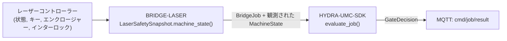

<!-- =============================================================================
HYDRA-UMC-BRIDGE-LASER - Laser cell coordination bridge
Copyright (C) JuanenRac (Electro Hobby 3D) <electrohobby3d@gmail.com>
GPL-3.0-or-later - see LICENSE
============================================================================= -->

<p align="center">
  
</p>

# 🔆 HYDRA-UMC-BRIDGE-LASER

<p align="center"><a href="README.md">🇺🇸 English</a> | <a href="README_spa.md">🇪🇸 Español</a> | <a href="README_fra.md">🇫🇷 Français</a> | <a href="README_ita.md">🇮🇹 Italiano</a> | <a href="README_deu.md">🇩🇪 Deutsch</a> | <a href="README_zho.md">🇨🇳 简体中文</a> | 🇯🇵 <b>日本語</b> | <a href="README_por.md">🇵🇹 Português</a></p>

### 🛑 レーザーセル向けフェイルセーフ連携ブリッジ

<p align="center">
  
  
  
  
  
  
</p>

---

> **誠実性チェック - 今日実際に動くもの:** 4信号の安全スナップショットとそのゲート（`cell.py` の `LaserSafetySnapshot`/`LaserCellBridge`。すべてのジョブは `HYDRA-UMC-SDK` 自身の本物の `evaluate_job()` を通過する）、読み取り専用のエビデンス正規化（`observation.py`）、本物の GPIO インターロック読み取り部（`gpio_safety.py` の `GpioSafetyProbe`、libgpiod v2）、および MQTT 状態/エビデンストランスポート（`mqtt_transport.py`）は本物であり、197件の通過する `unittest` ケースで検証されている（`python tools/build_test.py`）。これにはプロトコルに忠実な手書きの GPIO/MQTT エミュレータに対してこのブリッジを動かす `tests/test_gpio_mqtt_emulator.py` も含まれる。これらはいずれも本物の GPIO チップ、本物の MQTT ブローカー、実際のレーザーコントローラには一切触れていない - `test_gpio_safety.py` は模擬チップに対して読み取りを行い、`test_mqtt_transport.py` も模擬ブローカークライアントを使用している。対象の機械とその文書化されたインターフェースがまだ利用できないため、具体的なレーザーコントローラ・ソフトウェア統合もまだ存在しない - 詳細は下記の「ロードマップと既知の制限」に既に明記されており、これまでに実際に出荷された内容は `CHANGELOG.md` を参照。 MQTT トランスポートは、開発用マシン上の本物の HYDRA-UMC-MQTT-BROKER に対しても実行されています(`tests/test_broker_integration.py`。ブローカーが未インストールの場合はスキップされます)。QoS 0・1・2 でのパブリッシュとサブスクライブ、保持された可用性とそのラストウィル、ブローカーが停止して再起動した後の復帰を確認しています。

> **安全性とセキュリティの現状:** このエコシステムは認証された安全システムではありません。ハードウェアの E-STOP 経路、ファームウェアが強制する制限やインターロック、検証済みの動作コマンドはまだありません。ファームウェアイメージは CRC-32 と Ed25519 署名で検査し、リリースビルドは公開済みの開発用鍵を拒否します(リレーの先のツールヘッドと拡張ボードは引き続き URTC のブートローダーを使い、署名ではなく共有鍵の HMAC-SHA256 を使います)。TLS と相互 TLS は任意で、既定では無効です。独自基板はまだ実装も試験もされていません。ここに書かれた内容を人の安全のために頼る前に、[セキュリティベースライン](https://github.com/JuanenRac/HYDRA-UMC-DOCS/blob/main/docs/SECURITY_BASELINE.md)と[脅威モデル](https://github.com/JuanenRac/HYDRA-UMC-DOCS/blob/main/docs/THREAT_MODEL.md)をお読みください。

---

## 📋 ひと目で

| | |
|---|---|
| バージョン | `0.2.0` |
| 成熟度 | 機能する |
| テスト | 197 (`python tools/build_test.py`) |
| 技術 | Python / Laser controller / G-code / Safety evidence / GPIO interlock reading |
| 対象 | HYDRA-UMC セルの Raspberry Pi CM5 |
| 実機での確認 | シミュレーションのみ：エミュレーター、模擬部品、シミュレーターで試験済み。このバージョンについて実機での動作記録はありません |

**移動：** [概要](#-概要) · [アーキテクチャ](#-アーキテクチャ) · [機能](#-機能) · [セキュリティと安全](#-セキュリティと安全) · [インターフェース](#-インターフェース) · [設定](#-設定) · [クイックスタート](#-クイックスタート) · [テスト](#-テスト) · [トラブルシューティング](#-トラブルシューティング) · [リポジトリの構成](#-リポジトリの構成) · [関連プロジェクト](#-関連プロジェクト)

## 🚦 プロジェクトの状況

各行はこのリポジトリの一部分で、信号は今日どこまで進んでいるかを示します。計画ではなく、リポジトリが示せるもの（テスト、ビルド、実行）に基づいて書かれています。

🟢 完了・検証済み · 🟡 動作する（既知の制限あり） · 🟠 一部のみ、または未検証 · 🔴 未実装または動作しない

| 領域 | 状態 | ここでの意味 |
|---|---|---|
| ソフトウェア | 🟡 | 主な目的では動作します。足りない点は上の正直さの確認に書かれています |
| テスト | 🟢 | 自動テスト 197 件。変更のたびに実行されます |
| 実機 | 🟠 | シミュレーションのみ：エミュレーター、模擬部品、シミュレーターで試験済み。このバージョンについて実機での動作記録はありません |
| ドキュメント | 🟢 | 8 言語の README。変更のたびにマニフェストと照合されます |

## 🎯 概要

**HYDRA-UMC-BRIDGE-LASER** は、レーザーセルとHYDRA-UMCロボット補助装置とを結ぶ高レベルブリッジである。材料の受け渡しなど安全な周辺タスクを連携させることはできるが、レーザーコントローラーを解除・発振・上書きすることは**決してない**。それらは読み取る観測値であって、保持する権限ではない。

本リポジトリは **External Automation Bridges** ファミリーに属する。CNC・LASER・OPENPNP・PRINTER3D・ROS2という兄弟リポジトリ群が、すべて `HYDRA-UMC-SDK` の同じ安全契約を共有しており、いずれのブリッジも独自の「作業に安全」という定義を勝手に作ることはできない。

## 🧩 HYDRA-UMC での役割

**HYDRA-UMC-BRIDGE-LASER** は、レーザーカッターや彫刻機の周りでロボットセルが作業しても、レーザーを待機状態にも発射にもできないようにします。GPIO で独立した 3 つの安全装置（キースイッチ、筐体、インターロック）と GRBL レーザーコントローラーの状態を読み、すべてが安全と答えたセルにだけ作業を渡します。

すべてのブリッジは `HYDRA-UMC-SDK` の共通の安全契約に従います。ジョブは共通の `evaluate_job()` ゲートが許可したときだけ受け付けられ、ゲートは安全側（閉）に倒れます。親プロジェクトは `HYDRA-UMC-SERVER` で、このブリッジはそれを呼び出さず、`HYDRA-UMC-MQTT-BROKER` 経由の MQTT でセルを指令する側に応答します。

## 🏛️ アーキテクチャ

<p align="center">
  
</p>

<details>
<summary>図のテキスト版（Mermaid）</summary>



</details>

**この作りにした理由**

* **なぜ単一のブール値ではなく3つの独立した保護機構を使うのか。** `LaserSafetySnapshot.machine_state()` は `key_enabled`、`enclosure_closed`、`interlock_healthy` を3つの独立した条件として検証する —— 実際のレーザー安全は、それぞれの物理的な安全対策が独立して真であることを必要とする。これらを1つのフラグにまとめてしまうと、実際にどれが失敗したのかが隠れてしまう。
* **なぜブリッジはレーザーを決して解除・発振できないと明記しているのか。** `LaserCellBridge` 自身のドキュメント文字列には「外部補助装置のみを連携させる。レーザーを解除・発振することはできない」と記されている —— これらの条件はコントローラー自身の認証済みインターロックの観測値であり、それらの代替では決してない。
* **なぜコントローラー状態のマッピングを意図的に保守的にしているのか。** 文字列 `IDLE` のみが `MachineState.IDLE` にマッピングされる。認識されない値はすべて `OFFLINE` にフォールバックし、補助作業を許可してしまうような状態には決してならない。
* **なぜブリッジは新しい `BridgeJob` を組み立て、独自の受理/拒否ロジックを書く代わりに共有の `evaluate_job()` に委譲するのか。** 5つのExternal Automation Bridges(CNC、LASER、OPENPNP、PRINTER3D、ROS2)はすべて `HYDRA-UMC-SDK` の全く同じ `bridge_contract` を再利用しており、「何をもってジョブ開始が安全とみなすか」がそれぞれの間で静かに食い違うことがない。
* **なぜ実際のレーザーソフトウェア/コントローラーの選定が意図的に保留されているのか。** 実機とその文書化されたインターロック報告が揃う前に特定ベンダーのインターフェースに縛られることは、このローカルコアが検証できない実際の安全保証を主張することになってしまう。
* **エコシステムの他部分とどう関係するか。** BRIDGE-LASERはレーザーコントローラーと `HYDRA-UMC-SDK` → `HYDRA-UMC-MQTT-BROKER` → 独立した安全システムとの間に位置する。レーザーセルの周辺で補助ロボット作業を調整するものであり、認証済みのレーザー安全システムを置き換えたり上書きしたりすることはない。

観測ヘルパーはエビデンスの正規化を行うものであり、レーザーコントローラーアダプターではない——ネットワークやシリアルの接続を開かず、設定を変更せず、ジョブをアップロードせず、アーム(武装)も発振もしない。[Laser Controller Evidence Boundary](docs/CONTROLLER_EVIDENCE_BOUNDARY.md) は、実際の統合の前に必要な検証を定義している。

**サービスとしての実行。** `python -m hydra_umc_bridge_laser --config /etc/hydra-umc/bridge-laser.toml` は、1 つの TOML ファイルからブリッジを起動します。GPIO チップと 3 本の安全ライン（ライン、`active_low`、バイアス、チャタリング除去）、GRBL コントローラーのシリアルポート、MQTT ブローカー、セル状態の取得元、任意の補助安全装置を設定します。未知のキーは拒否され、ラインの極性には既定値がなく、すべて安全側（フェイルクローズ）に倒れます。コントローラーがなければ OFFLINE、セル状態ファイルが無い・不明・古い場合は `SAFE_STOP` です。`--check` はファイルを検証し、`deploy/` には systemd ユニット（`Restart=on-failure`）と設定例があります。シミュレートした GPIO とコントローラーに対して動作確認済みで、実機のセルでは動かしていません。

## ✨ 機能

* ✅ **4信号の安全スナップショット(ソフトウェアロジック、レーザーなしでテスト済み):** `cell.py` の `LaserSafetySnapshot.machine_state()` は、キースイッチが有効、エンクロージャーが閉じている、**かつ**インターロックが正常であることを同時に要求する —— いずれか一つでも欠けると、`controller_state` を読む前に `SAFE_STOP` へ解決される。*(実装済み、`tests/test_cell.py` でテスト済み)*
* ✅ **実在する共有安全ゲート:** 観測されたすべてのジョブは `HYDRA-UMC-SDK` の `bridge_contract` にある `evaluate_job()` を通じて再評価される。これは他のすべての兄弟ブリッジが使うのと同じゲートである。*(実装済み)*
* ✅ **保守的な状態マッピング:** `IDLE` のみがアイドルとして扱われる。`RUN`/`RUNNING`/`PAUSED` は `RUNNING` に、`FAULT`/`ALARM`/`ERROR` は `FAULT` にマッピングされ、認識されない値はすべて `OFFLINE` にフォールバックする。*(実装済み)*
* ✅ **読み取り専用の安全性実証:** `observation.py` はキー、エンクロージャー、インターロックの本物のブール信号のみを受け入れる。欠落・数値型・テキスト型の値は安全側に倒れて失敗する。レーザーをアームしたり発射したりすることはできない。*(実装済み、`tests/test_observation.py` でテスト済み)*
* ✅ **コントローラーに依存しない GPIO インターロック読み取り(模擬チップに対してのみテスト済み):** `gpio_safety.py` の `GpioSafetyProbe` は、保存されたマッピングではなくGPIO ライン（libgpiod v2。テストは模擬チップを使用）から同じ3つの独立した保護機構を読み取る —— キースイッチ／ドアセンサー／インターロックリレーはブランドを問わずレーザーカッターに共通するため、意図的にコントローラーに依存しない設計になっている。GPIO の読み取りに失敗した場合、3つの保護機構すべてが安全側に倒れて失敗する。*(実装済み、`tests/test_gpio_safety.py` でテスト済み)*
* ✅ **エッジ駆動のインターロック監視(模擬チップに対してのみテスト済み):** `open_gpio_safety()` はキー・筐体・インターロックの各ラインを一度だけ(`INPUT`、`Edge.BOTH`)開き、その単一のリクエストでレベル読み取りとエッジ監視の両方を処理する —— 同じラインへの2回目のリクエストはカーネルに拒否される。`watch_for_interlock_edges()` は、無関係なMQTTメッセージが要求したときだけレベルを再読み取りする代わりに、カーネル自身のエッジイベント通知(libgpiod v2)で待機し、`run_forever(edge_watcher=...)` はラインが遷移した瞬間に更新済みの保持された `state` を公開するデーモンスレッドを起動する。監視が失敗した場合は、フェイルクローズドな `state`(`SAFE_STOP`、理由付き)を公開して再試行を続ける。各ラインの配線は宣言する(`GpioLineSettings`: `active_low`、`bias` —— 既定では断線が非安全として読まれる —— と `debounce_ms`)。`docs/WIRING_GUIDE.md` を参照。実際のGPIOチップではまだ検証されていない。*(実装済み、`tests/test_gpio_safety.py` と、模擬 `gpiod` を用いた `tests/test_hardening.py` でテスト済み)*
* ✅ **安全イベントストリーム(模擬ラインと模擬エッジ監視でテスト済み):** `events.py` はキー・筐体・インターロックの変化ごとにタイムスタンプ付きの記録を `hydra/bridges/laser/event/safety`(データレイクが監査とOEEのために保持するログ)へ出し、セルが安全から非安全に変わったときに一度だけ、開いた保護を示す `hydra/bridges/laser/event/interlock_open` イベントを出す。これによりオーケストレーターはセルのアームを直ちに停止できる。どちらもQoS 1で保持されず、`at_ms` と増加する `sequence` を持つ。最初の読み取りは基準にすぎない。エッジ監視が失敗した場合も、その喪失はインターロック開として報告される。このブリッジは報告するだけで、レーザーを停止することはできない。*(実装済み、`tests/test_events.py` でテスト済み)*
* ✅ **任意の補助保護(模擬入力でテスト済み):** `auxiliary.py` により、セルは追加条件 —— 排煙の稼働、アシストエアのオン、CO2チューブ温度が上限以下 —— を `AuxiliaryCheck` として宣言し、`LaserMqttBridge(auxiliary=...)` に渡せる。いずれかが満たされない間、ABORT 以外のジョブは失敗したチェック名を示して拒否される。読み取れない値、数値でない値、有限でない値は未達として扱われ、`state` には `auxiliary` マップが含まれる。宣言がなければ何も変わらない。読み取り専用で、何も切り替えない。*(実装済み、`tests/test_auxiliary.py` でテスト済み)*
* ✅ **非破壊的なビルド/テスト:** `build-test.bat`/`.sh` はソースをコンパイルし、バージョンファイルやCHANGELOGに一切触れずに安全ゲートのテストスイートを実行する。*(実装済み、下記「ビルドとリリース」を参照)*
* ✅ **GRBL レーザー状態リーダー(模擬ボードに対してのみテスト済み):** `grbl_state.py` の `GrblLaserState` は、シリアルポート上の GRBL 系レーザーコントローラー(LaserGRBL や LightBurn が駆動するボード)向けの本物の `controller_state` です。GRBL のステータス問い合わせ `?` を送り、レポートの状態語を返します。意図的に読み取り専用で、書き込むバイトは `?` だけです(保持・リセット・再開・G コードはありません)。またフェイルクローズドで、応答がなければ空の状態であり、アイドルになることはありません。ポート、再接続する接続、パーサーは CNC ブリッジも使う SDK 共有のシリアル接続です。レポートのレーザー出力と送りは情報として `state` に入ります(`laser_power`、`feed_rate`)が、保護機能としては扱いません。GRBL ボードのシリアルポートは 1 つで、LightBurn や LaserGRBL が保持している間はこのリーダーは使えません。*(実装済み、実ボードでは未検証)*
* 🔜 **具体的なレーザーコントローラー/ソフトウェア統合** —— 実機とその文書化されたインターフェースが揃うまで意図的に保留されている。*(計画中)*
* ✅ **重複した冪等キー:** `LaserMqttBridge` は `IdempotencyStore` を受け取り、重複したジョブキーには再評価せず初回の応答を返す。*（実装済み、`tests/test_idempotency.py` でテスト済み）*
* ✅ **堅牢化されたMQTTループとフェイルクローズドな読み取り:** 大きすぎる(16 KiB超)または読めないペイロード、深くネストされたJSON、想定外の障害には、結果トピックで拒否を返し、ループは決して終了しない。`cmd/job` の応答には `"mode": "gate-only"` が付き、そこを通したABORTは何も停止していないことを明示する(レーザーを止めるのは物理的な非常停止である)。状態には `observed_at` が含まれ、ブリッジはLast Will付きの `availability` トピックで自らを告知する。GPIOライン読み取り中の例外は `OSError` に限らずすべて3つの保護機構を失敗にし、3つのレベルはロックの下で1回の操作で読み取られる。`Hold:0`、`Alarm:1`、`Door:1`、`Jog`、`Home` などGRBL方式のコントローラー状態を理解する。*(実装済み、`tests/test_hardening.py` でテスト済み)*
* ✅ **共有の受け付けを通るジョブ:** 不正な形式のジョブと繰り返された `idempotency_key` の確認は、このブリッジ独自のコードではなく SDK の `JobIntake` が行います(キーに `job:` の接頭辞は付かなくなりました)。
* ✅ **QoS 1 で発行される応答:** コマンドへの応答は QoS 1 で発行されます(共有ディスパッチャーはブリッジが応答に与えた QoS をそのまま保ちます)。そのため、不安定な回線でも結果が失われません。
* ✅ **グローバル停止に従う（既定ではオフ）:** `HYDRA_UMC_LASER_GLOBAL_STOP=1` で、ブリッジは `hydra/swarm/safety/estop` のサーバーの保持通知を読みます。それが `SAFE_STOP` の間、または読み取れない間は、理由を付けて次を拒否します：ジョブ（中止は通す）。停止と読み取り専用の要求は動き続け、拒否を解くのは `READY` だけです。*（実装済み、実際のブローカーに対してテスト済み。実際のサーバーでは未実行）*

## 🔒 セキュリティと安全

| 脅威 | 防御 | 場所 |
|---|---|---|
| 安全でない状態のセルや機械へのジョブ | すべてのジョブは SDK の共通 `evaluate_job()` ゲートを通り、ゲートは安全側に倒れます。ブリッジ自身に受理・拒否のロジックはありません | SDK `bridge_contract` |
| 過大なジョブデータ | パラメーターは最大 32 個、キーは 64 文字、値は 1024 文字、識別子は 128 文字まで（`MAX_PARAMETERS`、`MAX_PARAMETER_KEY_CHARS`、`MAX_PARAMETER_VALUE_CHARS`、`MAX_IDENTIFIER_CHARS`） | SDK `bridge_contract` |
| 繰り返された、または再送された命令 | `IdempotencyStore` は各キーを 24 時間、最大 10 000 件まで記憶し、再送には再評価せず最初の応答を返します | SDK `job_intake` |
| 巨大または悪意のある MQTT ペイロード | 16 KiB を超えるペイロード、読めない・深く入れ子になった JSON、想定外の失敗は、結果トピックで拒否として応答され、ループを終わらせません | `mqtt_transport.py` |
| 誤って待機状態になったレーザー | 独立した 3 つの安全装置（`key_enabled`、`enclosure_closed`、`interlock_healthy`）がすべて安全を示す必要があり、コントローラー状態は正確に `IDLE` のときだけアイドル、それ以外は `OFFLINE` です | `cell.py`, `events.py` |
| 切れたインターロックの配線 | 既定のバイアスは、断線を「安全でない」と読ませます（アクティブローはプルアップ、アクティブハイはプルダウン）。接点のチャタリングは既定で 10 ms 無視され、3 本のラインは別々です | `gpio_safety.py` |
| 失敗する GPIO 読み取り | 保持された `state` は理由付きで安全側（すべての安全装置が未成立、`SAFE_STOP`）に変わり、古い良好な状態を読み続ける人が出ないようにします | `mqtt_transport.py` |
| 再接続時に再実行される保持コマンド | 保持された `cmd/` メッセージは再接続時に無視されます | `mqtt_transport.py` |

**絶対にしないこと：** 外部の補助装置を調整するだけで、レーザーを待機状態にも発射にもできず、GRBL コントローラーには状態照会しか送りません。

## 🔌 インターフェース

`hydra/bridges/laser/` 以下のトピック。停止用の動詞はありません（`STOP_VERBS` は空）。

| トピックまたはルート | 内容 |
|---|---|
| `cmd/status` | 空のペイロード：3 本の GPIO を読み直して状態を公開します |
| `cmd/job` → `cmd/job/result` | JSON の `BridgeJob`。計画だけを行い、応答は `GateDecision` です |
| `state`, `availability` | タイムスタンプ付きの保持スナップショットと `online`/`offline` |
| `event/safety`, `event/interlock_open` | 安全装置が変化したときの QoS 1 イベント（保持なし） |

ライブラリ：`LaserCellBridge`、`LaserSafetySnapshot`、`LaserMqttBridge`、`GpioSafetyProbe`、`open_gpio_safety()`、`GrblLaserState`、`open_grbl_laser_state()`、`AuxiliarySupervisor`（排煙、アシストエア、CO2 チューブ温度）。

## ⚙️ 設定

| 変数 | 既定値 | 設定する内容 |
|---|---|---|
| `GpioLineSettings.active_low` | 必須 | 論理 0 で安全な信号なら `True`（グランドへの常閉接点） |
| `GpioLineSettings.bias` | フェイルセーフ | `pull-up`・`pull-down`・`disabled`・`as-is`。未指定なら断線を安全でないと読ませるものを選びます |
| `GpioLineSettings.debounce_ms` | `10.0` | この時間だけ接点のチャタリングを無視します。`0` で無効、負の値は拒否されます |
| `HYDRA_UMC_LASER_GLOBAL_STOP` | オフ | `1` でサーバーのグローバル停止に従います。保持トピック `hydra/swarm/safety/estop` の最新の通知が `SAFE_STOP`（または読み取れない）の間、ブリッジは理由を付けて次を拒否します：ジョブ（中止は通す）。解除は `READY` のみです。`HYDRA_UMC_LASER_GLOBAL_STOP_TOPIC` でトピックを変更でき、`HYDRA_UMC_LASER_GLOBAL_STOP_STRICT=1` は最初の通知が届くまでも拒否します |
| `HYDRA_MQTT_USERNAME` | なし | MQTT のユーザー名。ブローカーはクライアント ID のプレフィックスに結び付けます |
| `HYDRA_MQTT_PASSWORD` | なし | パスワード。ユーザー名と一緒にのみ有効です |
| `HYDRA_MQTT_PASSWORD_FILE` | なし | ファイルから読むパスワード（Docker や systemd のシークレット）。`HYDRA_MQTT_PASSWORD` があれば無視されます |
| `HYDRA_MQTT_TLS_CA` | なし | ブローカーの証明書に署名した CA のファイル。接続は TLS になり、証明書が検証されます |
| `HYDRA_MQTT_TLS` | オフ | `1` で TLS を有効にし、システムの信頼する CA で検証します |
| `HYDRA_MQTT_TLS_CERT` / `HYDRA_MQTT_TLS_KEY` | なし | 相互 TLS を求めるブローカー用のクライアント証明書とその鍵。両方が必要です |

3 本の GPIO ラインのオフセットとチップは `open_gpio_safety()` の引数、GRBL コントローラーのシリアルデバイスは `open_grbl_laser_state()` の引数です（既定は 115200 ボー、タイムアウト 1 秒）。

## 🚀 クイックスタート

Python 3.11 以上が必要です。テストとビルドスクリプトは、このリポジトリの隣にある `HYDRA-UMC-SDK`（`../HYDRA-UMC-SDK`）、または `HYDRA_UMC_SDK_ROOT` で指定した場所を前提にします。

ハードウェアなしで試す（エミュレーターと模擬部品でブリッジ全体を確認します）：

```bash
py -3 tools/build_test.py          # Windows
python3 tools/build_test.py         # Linux, macOS
```

サービスを起動する（コンソールスクリプトはありません。サービスは MQTT トランスポートの `run_forever()` で、自分の起動コードから呼び出します）：

```python
from hydra_umc_bridge_laser.gpio_safety import GpioLineSettings, open_gpio_safety
from hydra_umc_bridge_laser.grbl_state import open_grbl_laser_state
from hydra_umc_bridge_laser.mqtt_transport import LaserMqttBridge, run_forever
wiring = GpioLineSettings(active_low=True)                       # normally-closed contacts to ground
safety = open_gpio_safety("/dev/gpiochip0", 17, 27, 22, key=wiring, enclosure=wiring, interlock=wiring)
bridge = LaserMqttBridge(safety.lines, controller_state=open_grbl_laser_state("/dev/ttyUSB0"), cell_state=lambda: cell_state)
run_forever(bridge, host="192.168.0.180", edge_watcher=safety.watcher)   # serves cmd/# and publishes the events
```

ユーザー名、パスワード、TLS ファイルは `HYDRA_MQTT_*` 変数から読まれます（設定を参照）。上のコード自体に認証情報は不要です。

## 🧪 テスト

`python tools/build_test.py` で自動 `unittest` 197 件を実行します（各モジュールのコンパイルも行います）。テストにハードウェア、ネットワーク、オプションのパッケージは不要で、`paho-mqtt`・`pyserial`・ベンダーのライブラリが必要なものは代用品を使うか、パッケージがなければスキップされます。

| テストファイル | テスト数 | 対象 |
|---|---|---|
| `test_global_stop.py`, `test_global_stop_broker.py` | - | グローバル停止のガードと理由付きの拒否、および空いているローカルポートの実際のブローカーに対する同じ試験（QoS 0・1・2 での通知、接続時に保持された停止に従うこと、読めない通知は安全側に倒れること） |
| `test_broker_integration.py`, `broker_harness.py` | - | 空いているローカルポート上の実際の HYDRA-UMC-MQTT-BROKER に対する MQTT クライアントの試験：クライアント経由の指示、保持された状態と遺言、ブローカーが落ちて戻った後の復帰。Node.js、`paho-mqtt`、またはインストール済みのブローカー（`HYDRA_UMC_TEST_BROKER_DIR`、既定は隣のフォルダー）がなければ自動的にスキップされます |
| `test_cell.py`, `test_observation.py`, `test_events.py`, `test_auxiliary.py` | - | 安全装置、証拠、イベント、補助の確認 |
| `test_gpio_safety.py`, `test_gpio_mqtt_emulator.py`, `gpio_mqtt_emulator.py` | - | 偽のラインに対する GPIO リーダー、GPIO と MQTT のフィクスチャに対する実ブリッジ |
| `test_grbl_state.py` | - | GRBL のように応答するメモリ上のコントローラー（バナー、`ok`、古い応答）に対する GRBL リーダー |
| `test_mqtt_transport.py`, `test_mqtt_environment.py`, `test_hardening.py`, `test_edge_cases.py`, `test_idempotency.py` | - | トピックの振り分け、環境の認証情報、悪意あるクライアント、異常な読み取り、繰り返しキー |

CI は `HYDRA_UMC_CI=1 python tools/ci_validate.py` を実行し、マニフェスト、文書、8 つの README、図を検査し、SDK のチェックアウトを使ってテストを実行します。

## 🏗️ ビルドとリリース

Python 3.11以上が必要。`tools/build_test.py` は `HYDRA-UMC-SDK` が兄弟ディレクトリ(`../HYDRA-UMC-SDK`)としてチェックアウトされているか、環境変数 `HYDRA_UMC_SDK_ROOT` で指定されていることを期待する。

```bash
# Windows
build-test.bat      # 検証のみ —— バージョン/CHANGELOGの変更なし
build.bat            # 検証後、成功時にバージョン + CHANGELOG を更新

# Linux/macOS
bash build-test.sh
bash build.sh
```

`build-test` は `src/`と`tools/` 配下の各モジュールを `py_compile` でコンパイルし、`tests/` 配下で検出される `unittest` の全スイート(`test_cell.py`、`test_observation.py`、`test_gpio_safety.py`、`test_mqtt_transport.py`、`test_gpio_mqtt_emulator.py`、`test_hardening.py`、`test_idempotency.py`、`test_mqtt_environment.py` - 197件のテスト)を実行して、安全アイドル許可、エンクロージャー拒否、中止転送などを実証する —— リポジトリを一切変更しない。`build` はまず同じ検証を実行し、成功した場合のみ `tools/bump_version.py` を呼び出して `pyproject.toml`、`hydra-umc.project.json`、`CHANGELOG.md` の間でバージョンを同期する。実際のレーザー向け `run` コマンドはまだ存在しない —— それには検証済みで安全なコントローラー統合が必要である。

## 🩺 トラブルシューティング

| 表示 | 原因 | 対処 |
|---|---|---|
| `ModuleNotFoundError: hydra_umc_sdk` | SDK がインストールされておらず、このリポジトリの隣にもありません | `HYDRA-UMC-SDK` をこのリポジトリの隣に置くか、`HYDRA_UMC_SDK_ROOT` を設定します |
| `paho-mqtt is not installed` | MQTT クライアントはオプションの追加パッケージです | `pip install ".[mqtt]"`（`paho-mqtt` 2.1 以上 3 未満が必要） |
| `password was given without a username` | MQTT の認証情報にはユーザー名とパスワードの両方が必要です | パスワードに加えて `HYDRA_MQTT_USERNAME` も設定します |
| `could not reach the MQTT broker after N attempts` | ブローカーが停止している、アドレスが違う、またはポートが閉じています | `HYDRA-UMC-MQTT-BROKER` を起動し、トランスポートに渡したホストとポートを確認します（2 秒間隔で 5 回試行。TLS ハンドシェイクの失敗は再試行しません） |
| `the MQTT broker refused the connection` | ブローカーが認証を拒否しました（または制限時間内に応答しませんでした） | `HYDRA_MQTT_USERNAME` とパスワードを確認します。クライアント ID はブローカーが認証情報に結び付けたプレフィックスで始まる必要があります |
| `state` with every safeguard unsatisfied and `SAFE_STOP` | GPIO の読み取りが失敗した（チップなし、権限、解放済みリクエスト）か、エッジ監視が止まりました | 保持された `state` の理由を読み、チップのパス、ラインのオフセット、サービスを動かすユーザーの権限を確認します |
| `"allowed": false` + `reason` | 共通ゲートまたはガードが命令を拒否しました | `reason` を読んで原因を直します。やみくもに再試行しないでください |

## 📂 リポジトリの構成

<p align="center">
  
</p>

<details>
<summary>ツリーのテキスト版</summary>

```text
HYDRA-UMC-BRIDGE-LASER/
├── src/hydra_umc_bridge_laser/
│   ├── cell.py                    安全装置が安全なアイドルを示さない限りジョブを拒否
│   ├── gpio_safety.py             GPIO（libgpiod）で 3 本の安全ラインを読む
│   ├── grbl_state.py              GRBL コントローラーの状態（状態照会のみ）
│   ├── observation.py             ローカルの安全の証拠（レーザーへの命令は決して出さない）
│   ├── events.py                  安全装置の変化をタイムスタンプ付きイベントにする
│   ├── auxiliary.py               排煙・アシストエア・チューブ温度の確認
│   └── mqtt_transport.py          MQTT のコマンド・状態・イベントのトランスポート
├── tests/                         149 件（GPIO と MQTT のエミュレーター付き）
├── deploy/                        systemd ユニットと設定例
├── docs/                          ブリッジガイド、証拠の境界、配線ガイド
├── tools/                         ビルド・テスト実行、バージョン引き上げ、CI 検証、README と図の生成・検査
├── images/                        バナーと README の図
├── .github/                       CI ワークフローと Issue テンプレート
├── pyproject.toml                 パッケージのメタデータと依存関係
├── hydra-umc.project.json         マニフェスト：バージョン・成熟度・ファミリー
├── CHANGELOG.md                   各バージョンの変更点
├── build.sh build.bat             ビルドスクリプト（バージョンは変えません）
├── build-test.sh build-test.bat   ビルドスクリプト（バージョンは変えません）
├── test.sh test.bat               テストを実行
└── SECURITY.md SUPPORT.md CONTRIBUTING.md CODE_OF_CONDUCT.md LICENSE LICENSE.md
```

</details>

## 🗺️ ロードマップと既知の制限

**現時点の既知の制限**

**現時点で実在するもの:** バージョン `0.2.0`。ローカルでテスト済みのフェイルセーフな計画コア(`LaserSafetySnapshot` + `LaserCellBridge`)が `HYDRA-UMC-SDK` の共有ジョブゲートの上に構築されており、実際に一時停止中のジョブ(`HOLDING`)と実際に発振中のジョブ(`RUNNING`)を区別する厳密な読み取り専用安全証拠の正規化、キー/筐体/インターロックの3つの独立した保護機構のための実際の、コントローラーに依存しない GPIO インターロック読み取り(`GpioSafetyProbe`)、実際の MQTT 状態/エビデンストランスポート(`mqtt_transport.py`)、決定論的な197件の `unittest` スイートと、SDKチェックアウトを伴いCIに組み込まれた非破壊的なbuild-testスクリプトを備える。

**統合境界:** レーザーコントローラー自身の認証済みエンクロージャー、キースイッチ、インターロック権限は決してバイパスされない。このブリッジが調整するのはあくまでその周辺の*補助的な*ロボット作業のみであり、それもコントローラーが報告する状態を読み取ることによってのみ行う。

**今後の課題:** 本ブリッジはまだ実際のレーザーシステムに接続されたり、それを操作するために使われたりしていない —— 具体的なコントローラー/ソフトウェアインターフェースの選定と検証は、実機とその文書化されたインターフェースが揃うまで保留されている。

## 🌍 言語

この README とリポジトリの文書は、英語・スペイン語・ドイツ語・フランス語・イタリア語・日本語・中国語・ポルトガル語（ポルトガル）の 8 言語で提供されています。8 つのファイルは同時に書かれ、同じ節と同じリンクを持つことを CI が確認します。 このリポジトリには独自の画面もメッセージカタログもないため、翻訳すべきインターフェース文字列はありません。

## 🔗 関連プロジェクト

本プロジェクトは、同じ作者(JuanenRac / Electro Hobby 3D)による HYDRA-UMC ロボティクスエコシステムの一部です。リクエストが実はこの中のどれかについてのものである可能性があるため、知っておく価値があります。

**親プロジェクト**
- **[HYDRA-UMC-SERVER](https://github.com/JuanenRac/HYDRA-UMC-SERVER)** — すべての制御クライアントが実際に通信する、本物のヘッドレスバックエンド(REST/WebSocket)。このブリッジはこれを呼び出さず、HYDRA-UMC-MQTT-BROKER を介したMQTTで、セルを指揮する側に応答する。

**兄弟プロジェクト** —— それぞれ独自のクライアントとして、同じく HYDRA-UMC-SERVER 自身の API と通信する
- **[HYDRA-UMC-STUDIO](https://github.com/JuanenRac/HYDRA-UMC-STUDIO)** — リアルタイムのマルチロボット 3D 可視化を備えたウェブ制御ダッシュボード。
- **[HYDRA-UMC-SUITE](https://github.com/JuanenRac/HYDRA-UMC-SUITE)** — 複数のサーバーを同時に扱えるデスクトップ(PySide6)スウォームコマンドセンター、スタンドアロン実行ファイルとしてパッケージ化。
- **[HYDRA-UMC-ANDROID-CONTROL](https://github.com/JuanenRac/HYDRA-UMC-ANDROID-CONTROL)** — 生体認証ログインとペアリングされた Wear OS コンパニオンを備えたネイティブ Android 制御アプリ。
- **[HYDRA-UMC-IOS-CONTROL](https://github.com/JuanenRac/HYDRA-UMC-IOS-CONTROL)** — リアルタイム WebSocket 同期を備えた iOS/iPadOS 制御アプリ(Flutter)。
- **[HYDRA-UMC-DSI](https://github.com/JuanenRac/HYDRA-UMC-DSI)** — 本体搭載の 7 インチ DSI タッチスクリーン向けネイティブタッチ UI、CM5 自体に組み込み。
- **[HYDRA-UMC-BRIDGE-AMR](https://github.com/JuanenRac/HYDRA-UMC-BRIDGE-AMR)** — VDA 5050 MQTT パブリッシャーによる AGV/AMR フリートの調整境界(エミュレートしたフリートに対してのみテスト済み)。
- **[HYDRA-UMC-BRIDGE-CNC](https://github.com/JuanenRac/HYDRA-UMC-BRIDGE-CNC)** — GRBL ステータス/制御バイトへのアクセスを持つ、CNC セルの高レベルコーディネーター(エミュレーターに対してのみテスト済み)。
- **[HYDRA-UMC-BRIDGE-DROIDS](https://github.com/JuanenRac/HYDRA-UMC-BRIDGE-DROIDS)** — Boston Dynamics Spot コマンド送信機能を持つ、脚型/ヒューマノイドドロイドの調整境界(エミュレーターに対してのみテスト済み)。
- **[HYDRA-UMC-BRIDGE-OPENPNP](https://github.com/JuanenRac/HYDRA-UMC-BRIDGE-OPENPNP)** — OpenPnP ピックアンドプレースの基板フローを安全に統括する高レベルコーディネーター。
- **[HYDRA-UMC-BRIDGE-PRINTER3D](https://github.com/JuanenRac/HYDRA-UMC-BRIDGE-PRINTER3D)** — 実際にゲート制御されたジョブコマンドを持つ、Moonraker/Klipper 3D プリンター向けの安全な調整境界。
- **[HYDRA-UMC-BRIDGE-ROS2](https://github.com/JuanenRac/HYDRA-UMC-BRIDGE-ROS2)** — 遅延インポートの rclpy ROS 2 トランスポートを持つコーディネーター(ROS 2 環境ではまだ実行していない)。
- **[HYDRA-UMC-BRIDGE-UAV](https://github.com/JuanenRac/HYDRA-UMC-BRIDGE-UAV)** — MAVLink コマンド送信機能を持つ、カメラ搭載 UAV の調整境界(エミュレーターに対してのみテスト済み)。

**直接関連**
- **[HYDRA-UMC-SDK](https://github.com/JuanenRac/HYDRA-UMC-SDK)** — すべてのブリッジが自身のコマンドを検証する共有 JSON-Schema 契約とソフトウェアのジョブゲート境界(認証済みの安全機能ではない)。
- **[HYDRA-UMC-CONNECTOR-HUB](https://github.com/JuanenRac/HYDRA-UMC-CONNECTOR-HUB)** — 外部マシン用コネクタのための宣言的アダプターマニフェストのレジストリとバリデーター。SDK 自身の契約という発想を外部マシンにまで拡張し、産業用ゲートウェイ系のプロジェクトを置き換えることはありません。
- **[HYDRA-UMC-MQTT-BROKER](https://github.com/JuanenRac/HYDRA-UMC-MQTT-BROKER)** — このブリッジ自身の `hydra/bridges/laser/...` トピック向けの `mqtt_transport.py` の実際のトランスポート——セーフガードのステータスのみ。実際の作動コマンドはここには存在しない(本ブリッジはレーザーをアーム化することも発射することもできない)。詳細はそのリポジトリ自身の `docs/BRIDGE_TOPICS.md` を参照。
- **[HYDRA-UMC-SAFETY-ZONES](https://github.com/JuanenRac/HYDRA-UMC-SAFETY-ZONES)** — 本ブリッジ向けの将来のセルゾーン安全実証。

**エコシステムの他のプロジェクト**

*コアハードウェア&プラットフォーム*
- **[HYDRA-UMC](https://github.com/JuanenRac/HYDRA-UMC)** — ロボットアームのマザーボードの設計——CM5 ホスト + デュアルコア STM32H745、CAN-OTA/SPI-OTA 経由で最大 8 本のツールアームを統括することを目指す(ファームウェアは初期段階で、実装済みの基板はまだない)。
- **[HYDRA-UMC-OS](https://github.com/JuanenRac/HYDRA-UMC-OS)** — CM5 向けの再現可能な Raspberry Pi OS プロダクト層——読み取り専用エージェント、検証済み設定/プロファイル、WiFi 初回接続プロビジョニング。

*コアバックエンド&クライアント*
- **[HYDRA-UMC-EDITOR-URDF](https://github.com/JuanenRac/HYDRA-UMC-EDITOR-URDF)** — 完成したモデルを STUDIO 自身のカタログへ送信するデスクトップ用グラフィカル URDF 作成/編集ツール。
- **[HYDRA-UMC-EDITOR-STL](https://github.com/JuanenRac/HYDRA-UMC-EDITOR-STL)** — HYDRA-UMC-EDITOR-URDF も編集する同じモデルカタログ内で、実在するパーツを変換/置換/削除/追加するデスクトップ STL モデルエディタ。

*URTC ツールプラットフォーム*
- **[URTC](https://github.com/JuanenRac/URTC)** — 物理的な Universal Robot Tool Controller 基板向けファームウェア、CAN バス経由の 25 以上のツールプロファイル。
- **[URTC-FLASHER](https://github.com/JuanenRac/URTC-FLASHER)** — URTC 基板用のデスクトップ GUI 書き込みツール、CAN-OTA およびフルチップ SWD/JTAG。
- **[URTC-TESTER](https://github.com/JuanenRac/URTC-TESTER)** — URTC 基板向けのデスクトップ CAN バスライブ診断ツール、ツールプロファイルごとに 1 パネル。
- **[URTC-WEB-STUDIO](https://github.com/JuanenRac/URTC-WEB-STUDIO)** — Web Serial API を使ったブラウザベースの URTC-TESTER の代替、ローカルインストール不要。
- **[URTC-GATEWAY](https://github.com/JuanenRac/URTC-GATEWAY)** — URTC の CAN バスの前に置くゲートウェイ：許可する識別子のリスト、レート制限、セッション鍵。コンピューター上でテスト済みで、実際のバスではまだ試していません。

*ビジョン AI ノード(Hailo-8)*
- **[HYDRA-UMC-VISION-NODE](https://github.com/JuanenRac/HYDRA-UMC-VISION-NODE)** — Hailo-8 ビジョンパイプラインの統合ハブ、段階ごとの実際のハードウェア準備状況チェック付き。
- **[HYDRA-UMC-DETECTION-HEF](https://github.com/JuanenRac/HYDRA-UMC-DETECTION-HEF)** — Hailo アーキテクチャ/チェックサムによる安全読み込み検証を備えた、実際のコンパイル済みモデルレジストリ。
- **[HYDRA-UMC-VISION-STREAMER](https://github.com/JuanenRac/HYDRA-UMC-VISION-STREAMER)** — 実際の HailoRT 統合境界を持つ、実際の GStreamer パイプライン + MediaMTX 設定生成器。
- **[HYDRA-UMC-VISUAL-SERVOING-API](https://github.com/JuanenRac/HYDRA-UMC-VISUAL-SERVOING-API)** — ゾーン状態を条件に承認する Position-Based Visual Servoing 補正則。カメラによる姿勢推定はまだない。

*コグニティブ AI ノード(Hailo-10)*
- **[HYDRA-UMC-COGNITIVE-NODE](https://github.com/JuanenRac/HYDRA-UMC-COGNITIVE-NODE)** — Hailo-10 コグニティブパイプライン(LLM/VLA/音声オーケストレーション)の統合ハブ。
- **[HYDRA-UMC-VLA-ENGINE](https://github.com/JuanenRac/HYDRA-UMC-VLA-ENGINE)** — Vision-Language-Action モデル向けの、実際のアクショントークンのエンコード/デコードと軌道生成。
- **[HYDRA-UMC-VOICE-UI](https://github.com/JuanenRac/HYDRA-UMC-VOICE-UI)** — 確認ゲート付きの限定的な Watch リレーを備えた、実際の音声フロントエンド(VAD + 意図解析)。
- **[HYDRA-UMC-SEMANTIC-PLANNER](https://github.com/JuanenRac/HYDRA-UMC-SEMANTIC-PLANNER)** — MCU エラーコードに対する、実際のルールベースのタスク分解と意味的エラー復旧。
- **[HYDRA-UMC-DOCS-QA](https://github.com/JuanenRac/HYDRA-UMC-DOCS-QA)** — このエコシステム自身の Markdown ドキュメントに対する、標準ライブラリのみの実際の TF-IDF 文書検索。
- **[HYDRA-UMC-LOCAL-TECHNICIAN](https://github.com/JuanenRac/HYDRA-UMC-LOCAL-TECHNICIAN)** — エコシステム自身のための、ローカルでポリシーゲート付きのAIメンテナンス技術者 — 観察、診断し、修正を提案する;最上位の2つのリスクレベルは意図的にまだ実装されていない。

*オーケストレーション&スウォーム*
- **[HYDRA-UMC-ORCHESTRATOR](https://github.com/JuanenRac/HYDRA-UMC-ORCHESTRATOR)** — 実際の gRPC/Protobuf ヘルスレポート契約とミッションステートマシンを持つ統合ハブ。
- **[HYDRA-UMC-JOB-DISPATCHER](https://github.com/JuanenRac/HYDRA-UMC-JOB-DISPATCHER)** — 実際の HTTP API 上に構築された、優先度ベースの実際のジョブキュー(重複排除付き)。
- **[HYDRA-UMC-NODE-HEALING](https://github.com/JuanenRac/HYDRA-UMC-NODE-HEALING)** — リトライ/バックオフとアイデンティティ不一致検出を備えた、実際の gRPC ベースのフリートヘルスウォッチドッグ。
- **[HYDRA-UMC-PATH-PLANNER-3D](https://github.com/JuanenRac/HYDRA-UMC-PATH-PLANNER-3D)** — 実際の障害物/ワークスペース衝突検証を備えた、実際の RRT ベースの 3D 経路プランナー。
- **[HYDRA-UMC-SWARM-SYNC](https://github.com/JuanenRac/HYDRA-UMC-SWARM-SYNC)** — 複数セルの収束についてプロパティテストされた、実際の CRDT LWW-Element-Map 状態同期。

*デジタルツイン&シミュレーション*
- **[HYDRA-UMC-TWIN](https://github.com/JuanenRac/HYDRA-UMC-TWIN)** — 実際のバージョン互換性同期契約を持つ、デジタルツインエンジンの統合ハブ。
- **[HYDRA-UMC-HIL-BRIDGE](https://github.com/JuanenRac/HYDRA-UMC-HIL-BRIDGE)** — シミュレーションと実機の間にソフトウェアの衝突インターロックを備えたハードウェア・イン・ザ・ループのルーター(実機なしでテスト済み)。
- **[HYDRA-UMC-PHYSICS-REPLICA](https://github.com/JuanenRac/HYDRA-UMC-PHYSICS-REPLICA)** — 実際の URDF サブセットに対する、実際の順運動学と関節限界検証。
- **[HYDRA-UMC-SYNTHETIC-DATA-GEN](https://github.com/JuanenRac/HYDRA-UMC-SYNTHETIC-DATA-GEN)** — YOLO/COCO アノテーションのエクスポート機能を持つ、実際のプロシージャル 2D シーンジェネレーター。

*データ&分析*
- **[HYDRA-UMC-DATALAKE](https://github.com/JuanenRac/HYDRA-UMC-DATALAKE)** — 実際の取り込み/クエリ HTTP API を備えた、実際の sqlite3 ベースの時系列ストア。
- **[HYDRA-UMC-ANOMALY-DETECTOR](https://github.com/JuanenRac/HYDRA-UMC-ANOMALY-DETECTOR)** — ドリフト監視を備えた、実際の FFT + 統計ベースラインによる異常検知器。
- **[HYDRA-UMC-PRODUCTION-REPORTS](https://github.com/JuanenRac/HYDRA-UMC-PRODUCTION-REPORTS)** — DATALAKE の履歴に対する実際の OEE/稼働率計算、再現可能な CSV エクスポート付き。
- **[HYDRA-UMC-TELEMETRY-COLLECTOR](https://github.com/JuanenRac/HYDRA-UMC-TELEMETRY-COLLECTOR)** — シーケンス重複排除機能を備えた、DATALAKE への実際の CAN/WebSocket 取り込みパイプライン。

*産業用ゲートウェイ*
- **[HYDRA-UMC-GATEWAY-INDUSTRIAL](https://github.com/JuanenRac/HYDRA-UMC-GATEWAY-INDUSTRIAL)** — 実際のコマンド許可リスト/バックプレッシャー層を持つ、産業用プロトコルへ中継する統合ハブ。
- **[HYDRA-UMC-OPCUA-SERVER](https://github.com/JuanenRac/HYDRA-UMC-OPCUA-SERVER)** — 実際のバイナリプロトコルクライアントセッションで検証された、実際の OPC-UA アドレス空間。
- **[HYDRA-UMC-MTCONNECT-ADAPTER](https://github.com/JuanenRac/HYDRA-UMC-MTCONNECT-ADAPTER)** — 縮退モード出力を備えた、実際の MTConnect `/probe` および `/current` XML エンドポイント。

*補完ツール&エコシステム運用*
- **[HYDRA-UMC-DASHBOARD-AI](https://github.com/JuanenRac/HYDRA-UMC-DASHBOARD-AI)** — 誠実な統計フォールバックを備えた、DATALAKE/ANOMALY-DETECTOR 上のスマートサマリーと異常ハイライトパネル。
- **[HYDRA-UMC-TOOL-CLI](https://github.com/JuanenRac/HYDRA-UMC-TOOL-CLI)** — 実際の安定した終了コード契約を持つフリート CLI、HYDRA-UMC-SERVER 自身の API の本物のライブクライアント。
- **[HYDRA-UMC-WATCH](https://github.com/JuanenRac/HYDRA-UMC-WATCH)** — 触覚アラートのパターンとペアリング済みスマートフォンへの音声リレーを備えた WearOS コンパニオンアプリ(物理的なウォッチではまだ実行していない)。
- **[URTC-SMART-RACK](https://github.com/JuanenRac/URTC-SMART-RACK)** — 実際の工具 ID デコードと Smart Idle 予熱ロジックを備えた、基板搭載ラック用ファームウェア。
- **[URTC-VISION-TOOL](https://github.com/JuanenRac/URTC-VISION-TOOL)** — サーマル/RGB 検査ツールヘッド向けの、ファームウェアと実際の Python ビジョンコンパニオン。
- **[HYDRA-UMC-UPDATER](https://github.com/JuanenRac/HYDRA-UMC-UPDATER)** — このエコシステム内のすべてのリポジトリを検出・クローン・更新する、管理用デスクトップツール。
- **[HYDRA-UMC-OS-REBUILDER](https://github.com/JuanenRac/HYDRA-UMC-OS-REBUILDER)** — エコシステムの最新バージョンをプリロードした、書き込み可能なCM5イメージを構築するWindows/Linuxデスクトップツール。Raspberry Pi Imager方式の初回起動Wi-Fi/ユーザー/SSH設定を備える。
- **[HYDRA-UMC-OPS-AGENT](https://github.com/JuanenRac/HYDRA-UMC-OPS-AGENT)** — 保守インシデントコーディネーター: 低権限のエッジ役割がサニタイズされたインベントリ/ヘルスのスナップショットを収集し、コントロールプレーン役割がそれを読み取り専用でレンダリングして AI プロバイダーに診断の提案を依頼します - パッチを適用することも、何かをデプロイすることも決してありません。
- **[HYDRA-UMC-DEV-SERVER](https://github.com/JuanenRac/HYDRA-UMC-DEV-SERVER)** — 再現可能な開発ホスト（Raspberry Pi 5 / CM5）。エコシステムのソースコードを保管し、永続キューのもとで境界の明確なビルド/テストタスクを実行する。運用中の CM5 とは明確に異なる、開発専用の役割。

## 📚 ドキュメント

さらに読むには：

* [docs/BRIDGE_GUIDE.md](docs/BRIDGE_GUIDE.md) - 範囲、GPIO 配線設定、GRBL リーダー、スクリプト
* [docs/WIRING_GUIDE.md](docs/WIRING_GUIDE.md) - 3 つの安全信号の配線方法
* [docs/CONTROLLER_EVIDENCE_BOUNDARY.md](docs/CONTROLLER_EVIDENCE_BOUNDARY.md) - 実際の安全の証拠とみなされるもの
* [エコシステムのセキュリティ基準](https://github.com/JuanenRac/HYDRA-UMC-DOCS/blob/main/docs/SECURITY_BASELINE.md)
* [エコシステムの脅威モデル](https://github.com/JuanenRac/HYDRA-UMC-DOCS/blob/main/docs/THREAT_MODEL.md)
* [このリポジトリの変更履歴](CHANGELOG.md)
* [このリポジトリのライセンス](LICENSE.md)

## 🤝 コントリビュートとコミュニティ

* プルリクエストの前に `HYDRA_UMC_CI=1 py -3 tools/ci_validate.py`（または `HYDRA_UMC_CI=1 python3 tools/ci_validate.py`）を実行してください。`CI_VALIDATION=PASS` と表示される必要があります。この確認に `build.sh` や `build.bat` は使わないでください。ビルドは検査ではありません。
* 8 つの README は HYDRA-UMC-DOCS の 1 つのソースから書かれます。手で編集しないでください。ソースを変更し、`tools/make_readmes.py` で書き直します。
* 実行していないことを README に書かないでください。事実であれば「シミュレーションのみ」「実機では未確認」と書きます。
* [CONTRIBUTING.md](CONTRIBUTING.md)、[行動規範](CODE_OF_CONDUCT.md)、[SECURITY.md](SECURITY.md)、[SUPPORT.md](SUPPORT.md) を参照してください。

## 👤 作者

**JuanenRac (Electro Hobby 3D)** · electrohobby3d@gmail.com

## 📜 ライセンス

GPL-3.0-or-later - [LICENSE](LICENSE).
