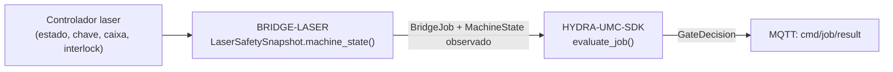

<!-- =============================================================================
HYDRA-UMC-BRIDGE-LASER - Laser cell coordination bridge
Copyright (C) JuanenRac (Electro Hobby 3D) <electrohobby3d@gmail.com>
GPL-3.0-or-later - see LICENSE
============================================================================= -->

<p align="center">
  
</p>

# 🔆 HYDRA-UMC-BRIDGE-LASER

<p align="center"><a href="README.md">🇺🇸 English</a> | <a href="README_spa.md">🇪🇸 Español</a> | <a href="README_fra.md">🇫🇷 Français</a> | <a href="README_ita.md">🇮🇹 Italiano</a> | <a href="README_deu.md">🇩🇪 Deutsch</a> | <a href="README_zho.md">🇨🇳 简体中文</a> | <a href="README_jpn.md">🇯🇵 日本語</a> | 🇵🇹 <b>Português</b></p>

### 🛑 Bridge de coordenação de falha segura para células laser

<p align="center">
  
  
  
  
  
  
</p>

---

> **Verificação de honestidade - o que realmente corre hoje:** o instantâneo de segurança de quatro sinais e a porta (o `LaserSafetySnapshot`/`LaserCellBridge` de `cell.py`, que encaminha cada trabalho pelo `evaluate_job()` do próprio `HYDRA-UMC-SDK`), o normalizador só de leitura de evidência (`observation.py`), o leitor real de interlocks por GPIO (o `GpioSafetyProbe` de `gpio_safety.py`, libgpiod v2) e o transporte MQTT de estado/evidência (`mqtt_transport.py`) são reais e estão cobertos por 196 casos `unittest` que passam (`python tools/build_test.py`), incluindo `tests/test_gpio_mqtt_emulator.py`, que executa este bridge contra um emulador de GPIO/MQTT escrito à mão e fiel ao protocolo. Nada disto tocou num chip GPIO real, num broker MQTT real nem num controlador laser verdadeiro: `test_gpio_safety.py` lê contra um chip falso e `test_mqtt_transport.py` usa um cliente de broker falso. Ainda não há integração concreta com um controlador/software laser, porque a máquina e a sua interface documentada não estão disponíveis; ver «Roteiro e limites conhecidos» abaixo, que já o diz com clareza, e `CHANGELOG.md` para saber exatamente o que foi entregue até agora. O transporte MQTT também foi executado contra um HYDRA-UMC-MQTT-BROKER real numa máquina de desenvolvimento (`tests/test_broker_integration.py`, ignorado se não houver nenhum broker instalado): publicação e subscrição com QoS 0, 1 e 2, a disponibilidade retida e o seu último testamento, e o regresso depois de o broker ter parado e arrancado de novo.

> **Estado de segurança (safety e security):** este ecossistema não é um sistema de segurança certificado. Ainda não existe um caminho de E-STOP por hardware, nem limites ou interlocks impostos pelo firmware, nem um comando de movimento verificado; as imagens de firmware são verificadas com CRC-32 e uma assinatura Ed25519, e uma compilação de versão recusa as chaves de desenvolvimento publicadas (as cabeças de ferramenta e as placas de expansão atrás do relé ainda usam os bootloaders do URTC, que aceitam um HMAC-SHA256 de chave partilhada em vez de uma assinatura); TLS e TLS mútuo são opcionais e estão desativados por defeito; nenhuma placa própria foi ainda montada ou testada. Leia a [base de segurança](https://github.com/JuanenRac/HYDRA-UMC-DOCS/blob/main/docs/SECURITY_BASELINE.md) e o [modelo de ameaças](https://github.com/JuanenRac/HYDRA-UMC-DOCS/blob/main/docs/THREAT_MODEL.md) antes de confiar em qualquer afirmação aqui para a segurança de uma pessoa.

---

## 📋 Num relance

| | |
|---|---|
| Versão | `0.1.9` |
| Maturidade | Funcional |
| Testes | 196 (`python tools/build_test.py`) |
| Tecnologia | Python / Laser controller / G-code / Safety evidence / GPIO interlock reading |
| Destino | O Raspberry Pi CM5 de uma célula HYDRA-UMC |
| Em hardware real | Só simulado: testado com emuladores, dublês de teste ou simuladores; não há registo de execução em hardware real para esta versão |

**Ir para:** [Visão geral](#-visão-geral) · [Arquitetura](#-arquitetura) · [Funcionalidades](#-funcionalidades) · [Segurança e proteção](#-segurança-e-proteção) · [Interfaces](#-interfaces) · [Configuração](#-configuração) · [Início rápido](#-início-rápido) · [Testes](#-testes) · [Resolução de problemas](#-resolução-de-problemas) · [Estrutura do repositório](#-estrutura-do-repositório) · [Projetos relacionados](#-projetos-relacionados)

## 🚦 Estado do projeto

Cada linha é uma parte deste repositório e a luz diz até onde chega hoje. É escrita com o que o repositório consegue demonstrar (testes, compilações, execuções), não com o que está previsto.

🟢 Feito e verificado · 🟡 Funciona, com limites conhecidos · 🟠 Feito a meio ou ainda por verificar · 🔴 Por fazer ou a não funcionar

| Área | Estado | O que significa aqui |
|---|---|---|
| Software | 🟡 | Funciona para o seu propósito principal; a verificação de honestidade acima lista o que ainda falta |
| Testes | 🟢 | 196 testes automáticos, executados a cada alteração |
| Hardware real | 🟠 | Só simulado: testado com emuladores, dublês de teste ou simuladores; não há registo de execução em hardware real para esta versão |
| Documentação | 🟢 | README em oito idiomas, verificado contra o manifesto a cada alteração |

## 🎯 Visão geral

O **HYDRA-UMC-BRIDGE-LASER** é o bridge de alto nível para células laser e auxiliares robóticos do HYDRA-UMC. Pode coordenar tarefas periféricas seguras, como a entrega de material, mas **nunca** pode armar, disparar nem anular um controlador laser: são observações que lê, não autoridades que detém.

Pertence à família de **Bridges de automação externa**: um conjunto de repositórios irmãos (CNC, LASER, OPENPNP, PRINTER3D, ROS2) que falam todos o mesmo contrato de segurança partilhado do `HYDRA-UMC-SDK`, de modo que nenhum bridge possa inventar a sua própria definição de «seguro para trabalhar».

## 🧩 Papel no HYDRA-UMC

O **HYDRA-UMC-BRIDGE-LASER** deixa uma célula de robôs trabalhar à volta de um cortador ou gravador laser sem nunca o poder armar nem disparar. Lê três salvaguardas independentes (chave, invólucro, interbloqueio) por GPIO e o estado de um controlador laser GRBL, e só uma célula em que todas as salvaguardas dizem seguro recebe trabalho.

Todos os bridges falam o contrato de segurança partilhado do `HYDRA-UMC-SDK`: um trabalho só é aceite quando a porta partilhada `evaluate_job()` o permite, e essa porta falha fechada. O projeto pai é o `HYDRA-UMC-SERVER`; este bridge não o chama, responde por MQTT, através do `HYDRA-UMC-MQTT-BROKER`, a quem comanda a célula.

## 🏛️ Arquitetura

<p align="center">
  
</p>

<details>
<summary>Versão em texto do diagrama (Mermaid)</summary>



</details>

**Porque é construído assim**

* **Porque três proteções independentes em vez de um único booleano.** `LaserSafetySnapshot.machine_state()` verifica `key_enabled`, `enclosure_closed` e `interlock_healthy` como três condições separadas: a segurança laser real exige que cada proteção física seja verdadeira de forma independente; juntá-las numa só bandeira esconderia qual delas falhou de facto.
* **Porque o bridge documenta que nunca pode armar nem disparar um laser.** A docstring do próprio `LaserCellBridge` diz que «coordena apenas auxiliares externos; não pode armar nem disparar um laser»: essas condições são observações dos interlocks certificados do próprio controlador, nunca um substituto deles.
* **Porque o mapeamento do estado do controlador é conservador de propósito.** Só a cadeia literal `IDLE` corresponde a `MachineState.IDLE`. Todo o valor não reconhecido volta a `OFFLINE`, nunca a algo que permitisse trabalho auxiliar.
* **Porque o bridge constrói um novo `BridgeJob` e delega no `evaluate_job()` partilhado em vez de escrever a sua própria lógica de aceitar/rejeitar.** Os cinco Bridges de automação externa (CNC, LASER, OPENPNP, PRINTER3D, ROS2) reutilizam exatamente o mesmo `bridge_contract` do `HYDRA-UMC-SDK`, de modo que o que conta como «seguro para iniciar um trabalho» não pode divergir em silêncio entre eles.
* **Porque a escolha do software/controlador laser real se adia de propósito.** Comprometer-se com uma interface concreta de um fabricante antes de a máquina e a sua comunicação documentada de interlocks estarem disponíveis seria afirmar uma garantia de segurança real que este núcleo local não consegue verificar.
* **Como se encaixa no resto do ecossistema.** O BRIDGE-LASER fica entre o controlador laser e o `HYDRA-UMC-SDK` → `HYDRA-UMC-MQTT-BROKER` → segurança independente: coordena o trabalho auxiliar do robô em redor da célula laser e não substitui nem anula a segurança laser certificada.

O auxiliar de observação é um normalizador de evidência, não um adaptador de controlador laser: não abre ligações de rede nem série, não altera definições, não carrega trabalhos, não arma nem dispara. O [Limite de evidência do controlador laser](docs/CONTROLLER_EVIDENCE_BOUNDARY.md) define a validação exigida antes de uma integração real.

**Execução como serviço.** `python -m hydra_umc_bridge_laser --config /etc/hydra-umc/bridge-laser.toml` arranca o bridge a partir de um único ficheiro TOML: o chip GPIO e as três linhas de salvaguarda (linha, `active_low`, polarização, antirressalto), a porta série do controlador GRBL, o broker MQTT, a origem do estado da célula e as salvaguardas auxiliares opcionais. Uma chave desconhecida é recusada, a polaridade de uma linha não tem valor predefinido e tudo falha fechado: sem controlador lê-se OFFLINE e um ficheiro de estado da célula em falta, desconhecido ou caducado é `SAFE_STOP`. `--check` valida o ficheiro; `deploy/` tem a unidade systemd (`Restart=on-failure`) e um ficheiro de exemplo. Correu contra GPIO e um controlador simulados, não numa célula real.

## ✨ Funcionalidades

* ✅ **Instantâneo de segurança de quatro sinais (lógica de software, testado sem laser):** o `LaserSafetySnapshot.machine_state()` de `cell.py` exige simultaneamente a chave ativada, a caixa fechada **e** o interlock saudável: se faltar qualquer um, resolve-se em `SAFE_STOP`, antes de sequer se ler `controller_state`. *(implementado, testado em `tests/test_cell.py`)*
* ✅ **Porta de segurança partilhada real:** cada trabalho observado é reavaliado pelo `evaluate_job()` do `bridge_contract` do `HYDRA-UMC-SDK`, a mesma porta que usam todos os bridges irmãos. *(implementado)*
* ✅ **Mapeamento de estados conservador:** só `IDLE` se trata como inativo; `RUN`/`RUNNING` corresponde a `RUNNING`, `PAUSED` corresponde a `HOLDING` (uma condição real e distinta: o feixe não está a cortar/gravar ativamente), `FAULT`/`ALARM`/`ERROR` correspondem a `FAULT` e tudo o que não se reconhece volta a `OFFLINE`. *(implementado)*
* ✅ **Evidência de segurança só de leitura:** `observation.py` só aceita sinais booleanos genuínos de chave, caixa e interlock; valores em falta, numéricos ou parecidos com texto falham de forma segura. Não pode armar nem disparar um laser. *(implementado, testado em `tests/test_observation.py`)*
* ✅ **Leitura de interlocks por GPIO, neutra quanto ao controlador (testada só contra um chip simulado):** o `GpioSafetyProbe` de `gpio_safety.py` lê as mesmas 3 proteções independentes a partir de linhas GPIO (libgpiod v2; os testes usam um chip simulado) em vez de um mapeamento guardado; neutro quanto ao controlador de propósito, porque um interruptor de chave/sensor de porta/relé de interlock é universal nas cortadoras laser, seja qual for a marca. Uma falha de leitura GPIO faz falhar de forma segura as 3 proteções. *(implementado, testado em `tests/test_gpio_safety.py`)*
* ✅ **Vigilância de interlocks por flancos (testada só contra um chip simulado):** `open_gpio_safety()` abre as linhas de chave, caixa e interlock UMA só vez (`INPUT`, `Edge.BOTH`) e serve com esse único pedido tanto os leitores de nível como o vigilante de flancos — o kernel recusa um segundo pedido das mesmas linhas. `watch_for_interlock_edges()` bloqueia nas notificações de eventos de flanco do próprio kernel (libgpiod v2) em vez de reler os níveis só quando uma mensagem MQTT alheia o pede, e `run_forever(edge_watcher=...)` arranca uma thread daemon que publica um `state` retido atualizado no instante em que uma linha muda; se o vigilante falhar, publica um `state` com falha segura (`SAFE_STOP`, com o motivo) e continua a tentar. A cablagem de cada linha é declarada (`GpioLineSettings`: `active_low`, `bias` — o valor por omissão faz com que um fio cortado seja lido como inseguro — e `debounce_ms`); ver `docs/WIRING_GUIDE.md`. Ainda não validado num chip GPIO real. *(implementado, testado em `tests/test_gpio_safety.py` e, com um `gpiod` simulado, em `tests/test_hardening.py`)*
* ✅ **Fluxo de eventos de segurança (testado com linhas simuladas e um vigilante de flancos simulado):** o `events.py` transforma cada alteração de chave, caixa e interlock num registo com marca temporal em `hydra/bridges/laser/event/safety` (o registo que um data lake guarda para auditoria e OEE) e, uma única vez, quando a célula passa de segura a insegura, um evento `hydra/bridges/laser/event/interlock_open` com as proteções que se abriram, para que o orquestrador pare de imediato os braços da célula. Ambos são QoS 1 e nunca retidos; trazem `at_ms` e um `sequence` crescente; a primeira leitura é só uma referência; se o vigilante de flancos falhar, a perda também é comunicada como interlock aberto. O bridge só comunica: não pode parar um laser. *(implementado, testado em `tests/test_events.py`)*
* ✅ **Proteções auxiliares opcionais (testadas com entradas simuladas):** o `auxiliary.py` permite à célula declarar condições extra - extração de fumos em funcionamento, ar de assistência ligado, temperatura do tubo CO2 no máximo igual a um limite - como `AuxiliaryCheck` passados a `LaserMqttBridge(auxiliary=...)`. Um trabalho que não seja ABORT é recusado, com o nome da verificação que falha, enquanto alguma não estiver satisfeita; uma leitura ilegível, não numérica ou não finita conta como não satisfeita; o `state` traz um mapa `auxiliary`. Sem nenhuma declarada, nada muda. Só de leitura: não comuta nada. *(implementado, testado em `tests/test_auxiliary.py`)*
* ✅ **Compilação/teste que não altera nada:** `build-test.bat`/`.sh` compilam o código-fonte e executam a suíte determinista da porta de segurança sem tocar nos ficheiros de versão nem no CHANGELOG. *(implementado, ver Compilação e publicação abaixo)*
* ✅ **Leitor de estado de laser GRBL (testado apenas contra uma placa simulada):** o `GrblLaserState` de `grbl_state.py` é o `controller_state` real para um controlador laser da família GRBL numa porta série (as placas que o LaserGRBL e o LightBurn conduzem): envia a consulta de estado do GRBL `?` e devolve a palavra de estado do relatório. É só de leitura de propósito - o único byte que escreve é `?`, não há retenção, reinício, retoma nem G-code - e falha em segurança (sem resposta é um estado vazio, nunca em repouso). A porta, a ligação que se reabre e o analisador são a ligação série partilhada do SDK que o bridge CNC também usa. A potência do laser e o avanço do relatório vão para o `state` como informação (`laser_power`, `feed_rate`), nunca como proteção. Uma placa GRBL tem uma só porta série: enquanto o LightBurn ou o LaserGRBL a tiverem, este leitor não a pode usar. *(implementado, não experimentado numa placa real)*
* 🔜 **Integração concreta com um controlador/software laser:** adiada de propósito até a máquina e a sua interface documentada estarem disponíveis; a leitura de interlocks ao nível do GPIO é real hoje, um caminho concreto de comandos G-code/controlador não. *(planeado)*
* ✅ **Chaves de idempotência repetidas:** `LaserMqttBridge` aceita um `IdempotencyStore`: uma chave de trabalho repetida recebe a resposta dada da primeira vez em vez de ser avaliada de novo. *(implementado, testado em `tests/test_idempotency.py`)*
* ✅ **Ciclo MQTT blindado e leituras com falha segura:** uma carga demasiado grande (mais de 16 KiB) ou ilegível, um JSON profundamente aninhado e qualquer falha inesperada recebem uma recusa no tópico de resultado e nunca terminam o ciclo; as respostas de `cmd/job` indicam `"mode": "gate-only"` e um ABORT por aí diz que nada foi parado (o E-STOP físico para o laser); o estado inclui `observed_at` e o bridge anuncia-se num tópico `availability` com Last Will; qualquer exceção ao ler as linhas GPIO — não só `OSError` — faz falhar as três proteções, e os três níveis são lidos numa só operação sob um bloqueio; são compreendidos estados de controlador ao estilo GRBL, como `Hold:0`, `Alarm:1`, `Door:1`, `Jog` e `Home`. *(implementado, testado em `tests/test_hardening.py`)*
* ✅ **Trabalhos pela admissão partilhada:** a verificação de um trabalho mal formado e de uma `idempotency_key` repetida é o `JobIntake` do SDK em vez de código desta ponte (as chaves deixaram de ter o prefixo `job:`).
* ✅ **Respostas publicadas com QoS 1:** as respostas aos comandos são publicadas com QoS 1 (o despachante partilhado mantém o QoS que uma ponte dá a uma resposta), pelo que um resultado não se perde numa ligação instável.
* ✅ **Segue a paragem global (desativado por defeito):** com `HYDRA_UMC_LASER_GLOBAL_STOP=1` o bridge lê o anúncio retido do servidor em `hydra/swarm/safety/estop`; enquanto disser `SAFE_STOP`, ou não puder ser lido, recusa com um motivo: um trabalho (um aborto passa). As paragens e os pedidos só de leitura continuam a funcionar e só `READY` termina a recusa. *(implementado, testado contra um broker real; nunca executado com um servidor real)*

## 🔒 Segurança e proteção

| Ameaça | Defesa | Onde |
|---|---|---|
| Um trabalho para uma célula ou máquina que não está em estado seguro | Todo o trabalho passa pela porta partilhada `evaluate_job()` do SDK, que falha fechada; o bridge não tem lógica própria de aceitar ou recusar | SDK `bridge_contract` |
| Dados de trabalho desmesurados | No máximo 32 parâmetros, chaves até 64 carateres, valores até 1024, identificadores até 128 (`MAX_PARAMETERS`, `MAX_PARAMETER_KEY_CHARS`, `MAX_PARAMETER_VALUE_CHARS`, `MAX_IDENTIFIER_CHARS`) | SDK `bridge_contract` |
| Uma ordem repetida ou reenviada | Um `IdempotencyStore` lembra cada chave durante 24 horas e no máximo 10 000 entradas; uma repetição recebe a primeira resposta em vez de ser avaliada de novo | SDK `job_intake` |
| Uma carga MQTT enorme ou hostil | Uma carga acima de 16 KiB, um JSON ilegível ou muito aninhado e qualquer falha inesperada recebem uma recusa no tópico de resultado e nunca terminam o ciclo | `mqtt_transport.py` |
| Um laser armado por engano | As três salvaguardas independentes (`key_enabled`, `enclosure_closed`, `interlock_healthy`) têm de dizer todas seguro; só o estado exato `IDLE` do controlador conta como repouso, qualquer outro é `OFFLINE` | `cell.py`, `events.py` |
| Um fio de interbloqueio cortado | A polarização predefinida faz um fio cortado ler-se como inseguro (pull-up para sinal ativo a baixo, pull-down para ativo a alto), o ressalto é ignorado 10 ms por predefinição e as três linhas são distintas | `gpio_safety.py` |
| Uma leitura GPIO que falha | O `state` retido passa a falhar fechado com o motivo (todas as salvaguardas por cumprir, `SAFE_STOP`) para ninguém continuar a ler um estado bom antigo | `mqtt_transport.py` |
| Um comando retido repetido ao reconectar | Uma mensagem `cmd/` retida é ignorada ao reconectar | `mqtt_transport.py` |

**O que nunca faz:** só coordena auxiliares externos: não pode armar nem disparar um laser e ao controlador GRBL não envia mais do que a consulta de estado.

## 🔌 Interfaces

Tópicos sob `hydra/bridges/laser/`; não há verbo de paragem (`STOP_VERBS` está vazio).

| Tópico ou rota | O que leva |
|---|---|
| `cmd/status` | carga vazia: volta a ler as três linhas GPIO e publica o estado |
| `cmd/job` → `cmd/job/result` | um `BridgeJob` em JSON; só planeia: a resposta é uma `GateDecision` |
| `state`, `availability` | o instantâneo retido com a sua marca de tempo e `online`/`offline` |
| `event/safety`, `event/interlock_open` | eventos QoS 1, não retidos, quando uma salvaguarda muda |

A biblioteca: `LaserCellBridge`, `LaserSafetySnapshot`, `LaserMqttBridge`, `GpioSafetyProbe`, `open_gpio_safety()`, `GrblLaserState`, `open_grbl_laser_state()` e `AuxiliarySupervisor` (extração de fumos, ar de assistência, temperatura do tubo CO2).

## ⚙️ Configuração

| Variável | Predefinição | O que define |
|---|---|---|
| `GpioLineSettings.active_low` | obrigatório | `True` quando o sinal é seguro no nível 0 (um contacto normalmente fechado à massa) |
| `GpioLineSettings.bias` | à prova de falha | `pull-up`, `pull-down`, `disabled` ou `as-is`; sem valor escolhe a que faz um fio cortado ler-se como inseguro |
| `GpioLineSettings.debounce_ms` | `10.0` | ressalto ignorado durante este tempo; `0` desliga, um valor negativo é recusado |
| `HYDRA_UMC_LASER_GLOBAL_STOP` | desativado | `1` segue a paragem global do servidor: enquanto o último anúncio no tópico retido `hydra/swarm/safety/estop` disser `SAFE_STOP` (ou não puder ser lido), o bridge recusa com um motivo: um trabalho (um aborto passa); só `READY` lhe põe fim. `HYDRA_UMC_LASER_GLOBAL_STOP_TOPIC` muda o tópico e `HYDRA_UMC_LASER_GLOBAL_STOP_STRICT=1` recusa também até chegar o primeiro anúncio |
| `HYDRA_MQTT_USERNAME` | nenhum | O nome de utilizador MQTT; o broker liga-o a um prefixo de ID de cliente |
| `HYDRA_MQTT_PASSWORD` | nenhum | A palavra-passe; só vale em conjunto com o nome de utilizador |
| `HYDRA_MQTT_PASSWORD_FILE` | nenhum | A palavra-passe lida de um ficheiro (segredo do Docker ou do systemd); ignorada se `HYDRA_MQTT_PASSWORD` estiver definida |
| `HYDRA_MQTT_TLS_CA` | nenhum | O ficheiro da CA que assinou o certificado do broker: a ligação é TLS e o certificado é verificado |
| `HYDRA_MQTT_TLS` | desativado | `1` ativa o TLS, verificado com as CA de confiança do sistema |
| `HYDRA_MQTT_TLS_CERT` / `HYDRA_MQTT_TLS_KEY` | nenhum | O certificado de cliente e a sua chave para um broker que exige TLS mútuo; são precisos os dois |

Os deslocamentos das três linhas GPIO e o chip são argumentos de `open_gpio_safety()`; o dispositivo série do controlador GRBL é o argumento de `open_grbl_laser_state()` (115200 baud, tempo limite de 1 segundo por predefinição).

## 🚀 Início rápido

Requer Python 3.11 ou superior. Os testes e os scripts de compilação esperam o `HYDRA-UMC-SDK` clonado ao lado deste repositório (`../HYDRA-UMC-SDK`) ou indicado com `HYDRA_UMC_SDK_ROOT`.

Experimente sem hardware (isto verifica todo o bridge com os seus emuladores e dublês de teste):

```bash
py -3 tools/build_test.py          # Windows
python3 tools/build_test.py         # Linux, macOS
```

Arrancar o serviço (não há um script de consola: o serviço é o `run_forever()` do transporte MQTT, que chama a partir do seu próprio código de arranque):

```python
from hydra_umc_bridge_laser.gpio_safety import GpioLineSettings, open_gpio_safety
from hydra_umc_bridge_laser.grbl_state import open_grbl_laser_state
from hydra_umc_bridge_laser.mqtt_transport import LaserMqttBridge, run_forever
wiring = GpioLineSettings(active_low=True)                       # normally-closed contacts to ground
safety = open_gpio_safety("/dev/gpiochip0", 17, 27, 22, key=wiring, enclosure=wiring, interlock=wiring)
bridge = LaserMqttBridge(safety.lines, controller_state=open_grbl_laser_state("/dev/ttyUSB0"), cell_state=lambda: cell_state)
run_forever(bridge, host="192.168.0.180", edge_watcher=safety.watcher)   # serves cmd/# and publishes the events
```

O nome de utilizador, a palavra-passe e os ficheiros TLS vêm das variáveis `HYDRA_MQTT_*` (ver Configuração); o código acima não precisa de credenciais próprias.

## 🧪 Testes

196 casos `unittest` automáticos correm com `python tools/build_test.py` (que também compila cada módulo). Os testes não precisam de hardware, rede nem pacotes opcionais: os que precisariam de `paho-mqtt`, `pyserial` ou de uma biblioteca do fabricante usam um substituto ou são saltados se o pacote faltar.

| Ficheiro de testes | Testes | O que cobre |
|---|---|---|
| `test_cell.py`, `test_observation.py`, `test_events.py`, `test_auxiliary.py` | - | salvaguardas, evidência, eventos e verificações auxiliares |
| `test_gpio_safety.py`, `test_gpio_mqtt_emulator.py`, `gpio_mqtt_emulator.py` | - | o leitor GPIO contra linhas simuladas; o bridge real contra fixtures de GPIO e MQTT |
| `test_grbl_state.py` | - | o leitor GRBL contra um controlador em memória que fala como o GRBL (banner, `ok`, respostas antigas) |
| `test_mqtt_transport.py`, `test_mqtt_environment.py`, `test_hardening.py`, `test_edge_cases.py`, `test_idempotency.py` | - | distribuição de tópicos, credenciais do ambiente, clientes hostis, leituras estranhas e chaves repetidas |

A CI executa `HYDRA_UMC_CI=1 python tools/ci_validate.py`, que verifica o manifesto, os documentos, os oito README e as imagens, e corre os testes com uma cópia do SDK.

## 🏗️ Compilação e publicação

Requer Python 3.11+. `tools/build_test.py` espera o `HYDRA-UMC-SDK` extraído como diretoria irmã (`../HYDRA-UMC-SDK`) ou indicado pela variável de ambiente `HYDRA_UMC_SDK_ROOT`.

```bash
# Windows
build-test.bat      # só valida - sem alteração de versão/CHANGELOG
build.bat            # Valida e compila (compilar nunca altera a versão)

# Linux/macOS
bash build-test.sh
bash build.sh
```

`build-test` compila com `py_compile` cada módulo em `src/` e `tools/` e executa a suíte `unittest` completa descoberta em `tests/` (`test_cell.py`, `test_observation.py`, `test_gpio_safety.py`, `test_mqtt_transport.py`, `test_gpio_mqtt_emulator.py`, `test_hardening.py`, `test_idempotency.py`, `test_mqtt_environment.py` - 196 testes), que prova, entre tudo o resto que cobre, a admissão com inatividade segura, a rejeição por caixa aberta e o encaminhamento de aborto; nunca modifica o repositório. `build` executa primeiro essa mesma validação e, só se correr bem, chama `tools/bump_version.py` para sincronizar a versão em `pyproject.toml`, `hydra-umc.project.json` e `CHANGELOG.md`. Ainda não há comando `run` de laser vivo: exige uma integração de controlador validada e segura.

## 🩺 Resolução de problemas

| Vê | Porque | Faça |
|---|---|---|
| `ModuleNotFoundError: hydra_umc_sdk` | O SDK não está instalado nem ao lado deste repositório | Clone o `HYDRA-UMC-SDK` ao lado deste repositório ou defina `HYDRA_UMC_SDK_ROOT` |
| `paho-mqtt is not installed` | O cliente MQTT é um extra opcional | `pip install ".[mqtt]"` (precisa de `paho-mqtt` 2.1 ou superior, inferior a 3) |
| `password was given without a username` | As credenciais MQTT precisam das duas partes | Defina também `HYDRA_MQTT_USERNAME`, não só a palavra-passe |
| `could not reach the MQTT broker after N attempts` | O broker está em baixo, o endereço está errado ou a porta está fechada | Arranque o `HYDRA-UMC-MQTT-BROKER` e verifique o anfitrião e a porta dados ao transporte (5 tentativas com 2 segundos de intervalo); uma falha do handshake TLS não é repetida |
| `the MQTT broker refused the connection` | O broker recusou a credencial (ou não respondeu a tempo) | Verifique `HYDRA_MQTT_USERNAME` e a palavra-passe; o ID de cliente tem de começar pelo prefixo que o broker ligou à credencial |
| `state` with every safeguard unsatisfied and `SAFE_STOP` | Falhou uma leitura GPIO (chip em falta, permissões, pedido libertado) ou o vigia de flancos parou | Leia o motivo no `state` retido; verifique o caminho do chip, os deslocamentos das linhas e as permissões do utilizador do serviço |
| `"allowed": false` + `reason` | A porta partilhada ou uma guarda recusou a ordem | Leia `reason` e corrija a causa; não repita às cegas |

## 📂 Estrutura do repositório

<p align="center">
  
</p>

<details>
<summary>Versão em texto da árvore</summary>

```text
HYDRA-UMC-BRIDGE-LASER/
├── src/hydra_umc_bridge_laser/
│   ├── cell.py                    recusa trabalho a menos que as salvaguardas indiquem repouso seguro
│   ├── gpio_safety.py             lê as três linhas de salvaguarda por GPIO (libgpiod)
│   ├── grbl_state.py              estado do controlador GRBL; só a consulta de estado
│   ├── observation.py             evidência local de segurança, nunca um comando ao laser
│   ├── events.py                  eventos com marca de tempo quando uma salvaguarda muda
│   ├── auxiliary.py               verificações de extração de fumos, ar de assistência e temperatura do tubo
│   └── mqtt_transport.py          transporte MQTT de comandos, estado e eventos
├── tests/                         149 testes, com um emulador de GPIO e MQTT
├── deploy/                        unidade systemd e configuração de exemplo
├── docs/                          guia do bridge, limite da evidência, guia de cablagem
├── tools/                         executor de compilação e testes, subida de versão, validador de CI, geradores e verificações de README e imagens
├── images/                        faixa e imagens do README
├── .github/                       fluxo de CI e modelos de questões
├── pyproject.toml                 metadados do pacote e dependências
├── hydra-umc.project.json         manifesto: versão, maturidade, família
├── CHANGELOG.md                   o que mudou em cada versão
├── build.sh build.bat             scripts de compilação (nunca mudam a versão)
├── build-test.sh build-test.bat   scripts de compilação (nunca mudam a versão)
├── test.sh test.bat               executam os testes
└── SECURITY.md SUPPORT.md CONTRIBUTING.md CODE_OF_CONDUCT.md LICENSE LICENSE.md
```

</details>

## 🗺️ Roteiro e limites conhecidos

**Limites conhecidos hoje**

**Real hoje:** versão `0.1.9`, um núcleo de planeamento com falha segura testado localmente (`LaserSafetySnapshot` + `LaserCellBridge`) apoiado pela porta de trabalhos partilhada do `HYDRA-UMC-SDK`, uma normalização estrita e só de leitura da evidência de segurança que distingue um trabalho realmente em pausa (`HOLDING`) de um que está a disparar (`RUNNING`), um leitor GPIO real e neutro quanto ao controlador (`GpioSafetyProbe`) para as 3 proteções independentes de chave/caixa/interlock, um transporte MQTT real de estado/evidência (`mqtt_transport.py`), uma suíte `unittest` determinista de 196 testes e scripts build-test que não alteram nada ligados ao CI com um checkout do SDK.

**Fronteira de integração:** nunca se contorna a autoridade certificada de caixa, interruptor de chave e interlock do próprio controlador laser; este bridge apenas regula o trabalho robótico *auxiliar* à sua volta, e só lendo o estado que ele comunica.

**Ainda por fazer:** o bridge não foi ligado a um sistema laser real nem usado para o operar: escolher e validar uma interface concreta de controlador/software adia-se até a máquina e a sua interface documentada estarem disponíveis.

## 🌍 Idiomas

Este README e os documentos do repositório existem em oito idiomas: inglês, espanhol, alemão, francês, italiano, japonês, chinês e português (Portugal). São escritos em conjunto e a CI verifica que os oito ficheiros têm as mesmas secções e as mesmas ligações. Este repositório não tem ecrã nem catálogo de mensagens próprios, por isso não há textos de interface para traduzir.

## 🔗 Projetos relacionados

Este projeto faz parte do ecossistema de robótica HYDRA-UMC do mesmo autor (JuanenRac / Electro Hobby 3D). Vale a pena conhecê-los, porque um pedido pode ser, na verdade, sobre um destes e não sobre este repositório.

**Projeto-mãe**
- **[HYDRA-UMC-SERVER](https://github.com/JuanenRac/HYDRA-UMC-SERVER)** — o verdadeiro backend sem interface (REST/WebSocket) com que falam todos os clientes de controlo; este bridge não o chama: responde por MQTT, através do HYDRA-UMC-MQTT-BROKER, a quem comanda a célula.

**Projetos irmãos** — também falam com a API do próprio HYDRA-UMC-SERVER, cada um como cliente próprio
- **[HYDRA-UMC-STUDIO](https://github.com/JuanenRac/HYDRA-UMC-STUDIO)** — painel web de controlo com visualização 3D em tempo real de vários robôs.
- **[HYDRA-UMC-SUITE](https://github.com/JuanenRac/HYDRA-UMC-SUITE)** — centro de comando de enxame para desktop (PySide6) para vários servidores ao mesmo tempo, empacotado como executável independente.
- **[HYDRA-UMC-ANDROID-CONTROL](https://github.com/JuanenRac/HYDRA-UMC-ANDROID-CONTROL)** — aplicação Android nativa de controlo, com início de sessão biométrico e um companheiro Wear OS emparelhado.
- **[HYDRA-UMC-IOS-CONTROL](https://github.com/JuanenRac/HYDRA-UMC-IOS-CONTROL)** — aplicação de controlo para iOS/iPadOS (Flutter) com sincronização WebSocket em tempo real.
- **[HYDRA-UMC-DSI](https://github.com/JuanenRac/HYDRA-UMC-DSI)** — interface tátil nativa para o ecrã tátil DSI de 7" integrado, executada no próprio CM5.
- **[HYDRA-UMC-BRIDGE-AMR](https://github.com/JuanenRac/HYDRA-UMC-BRIDGE-AMR)** — fronteira de coordenação para frotas AGV/AMR através de um publicador MQTT VDA 5050 (testado apenas contra uma frota emulada).
- **[HYDRA-UMC-BRIDGE-CNC](https://github.com/JuanenRac/HYDRA-UMC-BRIDGE-CNC)** — coordenador de células CNC de alto nível com acesso ao estado GRBL e aos bytes de controlo (testado apenas contra um emulador).
- **[HYDRA-UMC-BRIDGE-DROIDS](https://github.com/JuanenRac/HYDRA-UMC-BRIDGE-DROIDS)** — fronteira de coordenação para droides com patas/humanoides, com um emissor de comandos para o Boston Dynamics Spot (testado apenas contra um emulador).
- **[HYDRA-UMC-BRIDGE-OPENPNP](https://github.com/JuanenRac/HYDRA-UMC-BRIDGE-OPENPNP)** — coordenador seguro de fluxo de placa de alto nível para pick-and-place com OpenPnP.
- **[HYDRA-UMC-BRIDGE-PRINTER3D](https://github.com/JuanenRac/HYDRA-UMC-BRIDGE-PRINTER3D)** — fronteira de coordenação segura para impressoras 3D Moonraker/Klipper, com comandos de trabalho reais protegidos por portas.
- **[HYDRA-UMC-BRIDGE-ROS2](https://github.com/JuanenRac/HYDRA-UMC-BRIDGE-ROS2)** — coordenador com um transporte ROS 2 baseado em rclpy importado sob demanda (ainda não executado contra uma instalação ROS 2).
- **[HYDRA-UMC-BRIDGE-UAV](https://github.com/JuanenRac/HYDRA-UMC-BRIDGE-UAV)** — fronteira de coordenação para UAV com câmara, com um emissor de comandos MAVLink (testado apenas contra um emulador).

**Diretamente relacionados**
- **[HYDRA-UMC-SDK](https://github.com/JuanenRac/HYDRA-UMC-SDK)** — o contrato JSON-Schema partilhado e a fronteira de software de controlo de trabalhos contra a qual cada bridge valida os seus comandos (não é uma função de segurança certificada).
- **[HYDRA-UMC-CONNECTOR-HUB](https://github.com/JuanenRac/HYDRA-UMC-CONNECTOR-HUB)** — registo declarativo de manifestos de adaptador e validador para conectores de máquinas externas; estende a ideia de contrato do SDK a máquinas externas sem substituir os projetos de gateway industrial.
- **[HYDRA-UMC-MQTT-BROKER](https://github.com/JuanenRac/HYDRA-UMC-MQTT-BROKER)** — o transporte real de `mqtt_transport.py` para os tópicos `hydra/bridges/laser/...` deste bridge: só o estado das proteções, porque aqui não existe nenhum comando real de atuação (de uma forma ou de outra, este bridge não pode armar nem disparar um laser); ver o `docs/BRIDGE_TOPICS.md` desse repositório.
- **[HYDRA-UMC-SAFETY-ZONES](https://github.com/JuanenRac/HYDRA-UMC-SAFETY-ZONES)** — evidência futura de segurança por zonas da célula para este bridge.

**Também fazem parte do ecossistema**

*Hardware e plataforma centrais*
- **[HYDRA-UMC](https://github.com/JuanenRac/HYDRA-UMC)** — o desenho da placa-mãe do braço robótico: anfitrião CM5 + STM32H745 de dois núcleos, pensado para orquestrar até 8 braços de ferramenta por CAN-OTA/SPI-OTA (firmware numa fase inicial; ainda sem placa montada).
- **[HYDRA-UMC-OS](https://github.com/JuanenRac/HYDRA-UMC-OS)** — camada de produto reproduzível do Raspberry Pi OS para o CM5: agente só de leitura, configuração/perfis validados, aprovisionamento Wi-Fi de primeiro contacto.

*Backend central e clientes*
- **[HYDRA-UMC-EDITOR-URDF](https://github.com/JuanenRac/HYDRA-UMC-EDITOR-URDF)** — criador/editor gráfico de URDF para desktop que envia os modelos concluídos para o catálogo do STUDIO.
- **[HYDRA-UMC-EDITOR-STL](https://github.com/JuanenRac/HYDRA-UMC-EDITOR-STL)** — editor de modelos STL para desktop que transforma/substitui/remove/adiciona peças reais no mesmo catálogo de modelos que o HYDRA-UMC-EDITOR-URDF também edita.

*Plataforma de ferramentas URTC*
- **[URTC](https://github.com/JuanenRac/URTC)** — firmware da placa física Universal Robot Tool Controller, mais de 25 perfis de ferramenta por barramento CAN.
- **[URTC-FLASHER](https://github.com/JuanenRac/URTC-FLASHER)** — ferramenta gráfica de gravação para desktop das placas URTC, por CAN-OTA e também SWD/JTAG de chip completo.
- **[URTC-TESTER](https://github.com/JuanenRac/URTC-TESTER)** — ferramenta de diagnóstico CAN em tempo real para desktop das placas URTC, com um painel por perfil de ferramenta.
- **[URTC-WEB-STUDIO](https://github.com/JuanenRac/URTC-WEB-STUDIO)** — alternativa no navegador ao URTC-TESTER através da Web Serial API, sem instalação local.
- **[URTC-GATEWAY](https://github.com/JuanenRac/URTC-GATEWAY)** — gateway à frente do barramento CAN do URTC: lista de identificadores permitidos, limite de taxa e chave de sessão; software testado num computador, ainda não num barramento real.

*Nó de IA de visão (Hailo-8)*
- **[HYDRA-UMC-VISION-NODE](https://github.com/JuanenRac/HYDRA-UMC-VISION-NODE)** — centro de integração do pipeline de visão Hailo-8, com uma verificação real de prontidão de hardware por fase.
- **[HYDRA-UMC-DETECTION-HEF](https://github.com/JuanenRac/HYDRA-UMC-DETECTION-HEF)** — registo real de modelos compilados com verificação segura de carga por arquitetura Hailo e soma de verificação.
- **[HYDRA-UMC-VISION-STREAMER](https://github.com/JuanenRac/HYDRA-UMC-VISION-STREAMER)** — pipeline GStreamer real e gerador de configuração MediaMTX com uma fronteira de integração HailoRT real.
- **[HYDRA-UMC-VISUAL-SERVOING-API](https://github.com/JuanenRac/HYDRA-UMC-VISUAL-SERVOING-API)** — lei de correção de servovisão baseada em posição com autorização condicionada ao estado da zona; ainda sem estimativa de pose por câmara.

*Nó de IA cognitiva (Hailo-10)*
- **[HYDRA-UMC-COGNITIVE-NODE](https://github.com/JuanenRac/HYDRA-UMC-COGNITIVE-NODE)** — centro de integração do pipeline cognitivo do Hailo-10 (orquestração de LLM/VLA/voz).
- **[HYDRA-UMC-VLA-ENGINE](https://github.com/JuanenRac/HYDRA-UMC-VLA-ENGINE)** — codificação/descodificação real de tokens de ação e geração de trajetórias para um modelo Visão-Linguagem-Ação.
- **[HYDRA-UMC-VOICE-UI](https://github.com/JuanenRac/HYDRA-UMC-VOICE-UI)** — front-end de voz real (VAD + analisador de intenções) com um relé para o relógio limitado e protegido por confirmação.
- **[HYDRA-UMC-SEMANTIC-PLANNER](https://github.com/JuanenRac/HYDRA-UMC-SEMANTIC-PLANNER)** — decomposição real de tarefas baseada em regras e recuperação semântica de erros sobre os códigos de erro do MCU.
- **[HYDRA-UMC-DOCS-QA](https://github.com/JuanenRac/HYDRA-UMC-DOCS-QA)** — pesquisa real de documentos TF-IDF só com a biblioteca padrão sobre a documentação Markdown deste ecossistema.
- **[HYDRA-UMC-LOCAL-TECHNICIAN](https://github.com/JuanenRac/HYDRA-UMC-LOCAL-TECHNICIAN)** — técnico de manutenção de IA local, protegido por políticas, para o próprio ecossistema: observa, diagnostica e propõe correções; os dois níveis de maior risco não estão implementados de propósito.

*Orquestração e enxame*
- **[HYDRA-UMC-ORCHESTRATOR](https://github.com/JuanenRac/HYDRA-UMC-ORCHESTRATOR)** — centro de integração com um contrato real de relatório de saúde gRPC/Protobuf e uma máquina de estados de missões.
- **[HYDRA-UMC-JOB-DISPATCHER](https://github.com/JuanenRac/HYDRA-UMC-JOB-DISPATCHER)** — fila real de trabalhos por prioridade com deduplicação, sobre uma API HTTP real.
- **[HYDRA-UMC-NODE-HEALING](https://github.com/JuanenRac/HYDRA-UMC-NODE-HEALING)** — vigilante real de saúde da frota por gRPC com repetição/recuo e deteção de identidade incoerente.
- **[HYDRA-UMC-PATH-PLANNER-3D](https://github.com/JuanenRac/HYDRA-UMC-PATH-PLANNER-3D)** — planeador real de trajetórias 3D baseado em RRT com validação real de colisões com obstáculos e espaço de trabalho.
- **[HYDRA-UMC-SWARM-SYNC](https://github.com/JuanenRac/HYDRA-UMC-SWARM-SYNC)** — sincronização real de estado CRDT LWW-Element-Map, testada por propriedades para a convergência de várias células.

*Gémeo digital e simulação*
- **[HYDRA-UMC-TWIN](https://github.com/JuanenRac/HYDRA-UMC-TWIN)** — centro de integração do motor de gémeo digital, com um contrato real de sincronização de compatibilidade de versões.
- **[HYDRA-UMC-HIL-BRIDGE](https://github.com/JuanenRac/HYDRA-UMC-HIL-BRIDGE)** — encaminhador hardware-in-the-loop com um interlock de software de colisão entre a simulação e o hardware real (testado sem hardware real).
- **[HYDRA-UMC-PHYSICS-REPLICA](https://github.com/JuanenRac/HYDRA-UMC-PHYSICS-REPLICA)** — cinemática direta real e validação de limites de juntas sobre um subconjunto real de URDF.
- **[HYDRA-UMC-SYNTHETIC-DATA-GEN](https://github.com/JuanenRac/HYDRA-UMC-SYNTHETIC-DATA-GEN)** — gerador procedural real de cenas 2D com exportação de anotações YOLO/COCO.

*Dados e análise*
- **[HYDRA-UMC-DATALAKE](https://github.com/JuanenRac/HYDRA-UMC-DATALAKE)** — armazém real de séries temporais sobre sqlite3 com uma API HTTP real de ingestão/consulta.
- **[HYDRA-UMC-ANOMALY-DETECTOR](https://github.com/JuanenRac/HYDRA-UMC-ANOMALY-DETECTOR)** — detetor real de anomalias por FFT e linha de base estatística, com monitorização de deriva.
- **[HYDRA-UMC-PRODUCTION-REPORTS](https://github.com/JuanenRac/HYDRA-UMC-PRODUCTION-REPORTS)** — cálculo real de OEE/disponibilidade sobre o histórico do DATALAKE, com exportação CSV reprodutível.
- **[HYDRA-UMC-TELEMETRY-COLLECTOR](https://github.com/JuanenRac/HYDRA-UMC-TELEMETRY-COLLECTOR)** — pipeline real de ingestão CAN/WebSocket para o DATALAKE, com deduplicação por sequência.

*Gateway industrial*
- **[HYDRA-UMC-GATEWAY-INDUSTRIAL](https://github.com/JuanenRac/HYDRA-UMC-GATEWAY-INDUSTRIAL)** — centro de integração que retransmite para protocolos industriais, com uma camada real de lista de comandos permitidos e contrapressão.
- **[HYDRA-UMC-OPCUA-SERVER](https://github.com/JuanenRac/HYDRA-UMC-OPCUA-SERVER)** — espaço de endereços OPC-UA real, verificado com uma sessão de cliente real do protocolo binário.
- **[HYDRA-UMC-MTCONNECT-ADAPTER](https://github.com/JuanenRac/HYDRA-UMC-MTCONNECT-ADAPTER)** — endpoints XML MTConnect `/probe` e `/current` reais com saída em modo degradado.

*Ferramentas complementares e operações do ecossistema*
- **[HYDRA-UMC-DASHBOARD-AI](https://github.com/JuanenRac/HYDRA-UMC-DASHBOARD-AI)** — painéis de Resumos Inteligentes e Realce de Anomalias sobre o DATALAKE/ANOMALY-DETECTOR, com um recurso estatístico honesto.
- **[HYDRA-UMC-TOOL-CLI](https://github.com/JuanenRac/HYDRA-UMC-TOOL-CLI)** — CLI da frota com um contrato de códigos de saída real e estável, um cliente vivo genuíno da API do HYDRA-UMC-SERVER.
- **[HYDRA-UMC-WATCH](https://github.com/JuanenRac/HYDRA-UMC-WATCH)** — aplicação companheira WearOS com padrões de alerta tátil e um relé de voz para o telemóvel emparelhado (ainda não executada num relógio físico).
- **[URTC-SMART-RACK](https://github.com/JuanenRac/URTC-SMART-RACK)** — firmware de um rack de montagem de placas com descodificação real do ID da ferramenta e lógica de pré-aquecimento Smart Idle.
- **[URTC-VISION-TOOL](https://github.com/JuanenRac/URTC-VISION-TOOL)** — firmware mais um companheiro de visão em Python real para uma cabeça de ferramenta de inspeção térmica/RGB.
- **[HYDRA-UMC-UPDATER](https://github.com/JuanenRac/HYDRA-UMC-UPDATER)** — ferramenta administrativa de desktop que descobre, clona e atualiza todos os repositórios deste ecossistema.
- **[HYDRA-UMC-OS-REBUILDER](https://github.com/JuanenRac/HYDRA-UMC-OS-REBUILDER)** — ferramenta de desktop para Windows/Linux que constrói uma imagem do CM5 pronta a gravar com as versões mais recentes do ecossistema, com configuração de primeiro arranque de Wi-Fi/utilizador/SSH ao estilo do Raspberry Pi Imager.
- **[HYDRA-UMC-OPS-AGENT](https://github.com/JuanenRac/HYDRA-UMC-OPS-AGENT)** — coordenador de incidentes de manutenção: um papel de borda de poucos privilégios recolhe um inventário/estado higienizado, um papel de plano de controlo mostra-o só de leitura e pede a um fornecedor de IA que sugira um diagnóstico; nunca aplica um patch nem implanta nada.
- **[HYDRA-UMC-DEV-SERVER](https://github.com/JuanenRac/HYDRA-UMC-DEV-SERVER)** — anfitrião de desenvolvimento reproduzível (Raspberry Pi 5 / CM5) que guarda o código-fonte do ecossistema e executa tarefas limitadas de compilação/teste numa fila durável; um papel de desenvolvimento dedicado, explicitamente não um CM5 operacional.

## 📚 Documentação

Onde ler mais:

* [docs/BRIDGE_GUIDE.md](docs/BRIDGE_GUIDE.md) - âmbito, definições de cablagem GPIO, o leitor GRBL, scripts
* [docs/WIRING_GUIDE.md](docs/WIRING_GUIDE.md) - como se ligam os três sinais de salvaguarda
* [docs/CONTROLLER_EVIDENCE_BOUNDARY.md](docs/CONTROLLER_EVIDENCE_BOUNDARY.md) - o que conta como evidência real de segurança
* [Base de segurança do ecossistema](https://github.com/JuanenRac/HYDRA-UMC-DOCS/blob/main/docs/SECURITY_BASELINE.md)
* [Modelo de ameaças do ecossistema](https://github.com/JuanenRac/HYDRA-UMC-DOCS/blob/main/docs/THREAT_MODEL.md)
* [Registo de alterações deste repositório](CHANGELOG.md)
* [Licença deste repositório](LICENSE.md)

## 🤝 Contribuir e comunidade

* Antes de um pull request execute `HYDRA_UMC_CI=1 py -3 tools/ci_validate.py` (ou `HYDRA_UMC_CI=1 python3 tools/ci_validate.py`): tem de imprimir `CI_VALIDATION=PASS`. Não execute `build.sh` nem `build.bat` para esta verificação; compilar não é verificar.
* Os oito README são escritos a partir de uma única fonte em HYDRA-UMC-DOCS; não os edite à mão. Altere a fonte e escreva-os de novo com `tools/make_readmes.py`.
* Não afirme num README o que não foi executado: diga «simulado» ou «não testado em hardware» quando for a verdade.
* Consulte [CONTRIBUTING.md](CONTRIBUTING.md), o [código de conduta](CODE_OF_CONDUCT.md), [SECURITY.md](SECURITY.md) e [SUPPORT.md](SUPPORT.md).

## 👤 AUTOR

**JuanenRac (Electro Hobby 3D)** · electrohobby3d@gmail.com

## 📜 LICENÇA

GPL-3.0-or-later - [LICENSE](LICENSE).
