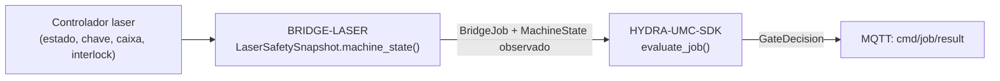

<!-- =============================================================================
HYDRA-UMC-BRIDGE-LASER - Laser cell auxiliary coordination bridge
Copyright (C) 2026 JuanenRac (Electro Hobby 3D) <electrohobby3d@gmail.com>
GPL-3.0-or-later - see LICENSE
============================================================================= -->

<p align="center">
  
</p>

# 🔦 HYDRA-UMC-BRIDGE-LASER

<p align="center"><a href="README.md">🇺🇸 English</a> | <a href="README_spa.md">🇪🇸 Español</a> | <a href="README_fra.md">🇫🇷 Français</a> | <a href="README_ita.md">🇮🇹 Italiano</a> | <a href="README_deu.md">🇩🇪 Deutsch</a> | <a href="README_zho.md">🇨🇳 简体中文</a> | <a href="README_jpn.md">🇯🇵 日本語</a> | 🇵🇹 <b>Português</b></p>

### 🛑 Bridge de coordenação de falha segura para células laser

<p align="center">
  
  
  
</p>

---

> **Verificação de honestidade - o que realmente corre hoje:** o instantâneo de segurança de quatro sinais e a porta (o `LaserSafetySnapshot`/`LaserCellBridge` de `cell.py`, que encaminha cada trabalho pelo `evaluate_job()` do próprio `HYDRA-UMC-SDK`), o normalizador só de leitura de evidência (`observation.py`), o leitor real de interlocks por GPIO (o `GpioSafetyProbe` de `gpio_safety.py`, libgpiod v2) e o transporte MQTT de estado/evidência (`mqtt_transport.py`) são reais e estão cobertos por 96 casos `unittest` que passam (`python tools/build_test.py`), incluindo `tests/test_gpio_mqtt_emulator.py`, que executa este bridge contra um emulador de GPIO/MQTT escrito à mão e fiel ao protocolo. Nada disto tocou num chip GPIO real, num broker MQTT real nem num controlador laser verdadeiro: `test_gpio_safety.py` lê contra um chip falso e `test_mqtt_transport.py` usa um cliente de broker falso. Ainda não há integração concreta com um controlador/software laser, porque a máquina e a sua interface documentada não estão disponíveis; ver «Estado atual e próximos passos» abaixo, que já o diz com clareza, e `CHANGELOG.md` para saber exatamente o que foi entregue até agora.

> **Estado de segurança (safety e security):** este ecossistema não é um sistema de segurança certificado. Ainda não existe um caminho de E-STOP por hardware, nem limites ou interlocks impostos pelo firmware, nem um comando de movimento verificado; as imagens de firmware são verificadas com CRC32 e um HMAC-SHA256 de chave partilhada, não com uma assinatura assimétrica; TLS e TLS mútuo são opcionais e estão desativados por defeito; nenhuma placa própria foi ainda montada ou testada. Leia a [base de segurança](https://github.com/JuanenRac/HYDRA-UMC-DOCS/blob/main/docs/SECURITY_BASELINE.md) e o [modelo de ameaças](https://github.com/JuanenRac/HYDRA-UMC-DOCS/blob/main/docs/THREAT_MODEL.md) antes de confiar em qualquer afirmação aqui para a segurança de uma pessoa.

## 📋 Num relance

| | |
|---|---|
| Versão | `0.1.7` |
| Maturidade | Funcional |
| Testes | 96 (`python tools/build_test.py`) |
| Tecnologia | Python / Laser controller / G-code / Safety evidence / GPIO interlock reading |
| Destino | O Raspberry Pi CM5 de uma célula HYDRA-UMC |
| Em hardware real | Só simulado: testado com emuladores, dublês de teste ou simuladores; não há registo de execução em hardware real para esta versão |

## 1. 🛠️ VISÃO TÉCNICA GERAL

O **HYDRA-UMC-BRIDGE-LASER** é o bridge de alto nível para células laser e auxiliares robóticos do HYDRA-UMC. Pode coordenar tarefas periféricas seguras, como a entrega de material, mas **nunca** pode armar, disparar nem anular um controlador laser: são observações que lê, não autoridades que detém.

Pertence à família de **Bridges de automação externa**: um conjunto de repositórios irmãos (CNC, LASER, OPENPNP, PRINTER3D, ROS2) que falam todos o mesmo contrato de segurança partilhado do `HYDRA-UMC-SDK`, de modo que nenhum bridge possa inventar a sua própria definição de «seguro para trabalhar».

### Funcionalidades principais:
* ✅ **Instantâneo de segurança de quatro sinais (lógica de software, testado sem laser):** o `LaserSafetySnapshot.machine_state()` de `cell.py` exige simultaneamente a chave ativada, a caixa fechada **e** o interlock saudável: se faltar qualquer um, resolve-se em `SAFE_STOP`, antes de sequer se ler `controller_state`. *(implementado, testado em `tests/test_cell.py`)*
* ✅ **Porta de segurança partilhada real:** cada trabalho observado é reavaliado pelo `evaluate_job()` do `bridge_contract` do `HYDRA-UMC-SDK`, a mesma porta que usam todos os bridges irmãos. *(implementado)*
* ✅ **Mapeamento de estados conservador:** só `IDLE` se trata como inativo; `RUN`/`RUNNING` corresponde a `RUNNING`, `PAUSED` corresponde a `HOLDING` (uma condição real e distinta: o feixe não está a cortar/gravar ativamente), `FAULT`/`ALARM`/`ERROR` correspondem a `FAULT` e tudo o que não se reconhece volta a `OFFLINE`. *(implementado)*
* ✅ **Evidência de segurança só de leitura:** `observation.py` só aceita sinais booleanos genuínos de chave, caixa e interlock; valores em falta, numéricos ou parecidos com texto falham de forma segura. Não pode armar nem disparar um laser. *(implementado, testado em `tests/test_observation.py`)*
* ✅ **Leitura de interlocks por GPIO, neutra quanto ao controlador (testada só contra um chip simulado):** o `GpioSafetyProbe` de `gpio_safety.py` lê as mesmas 3 proteções independentes a partir de linhas GPIO (libgpiod v2; os testes usam um chip simulado) em vez de um mapeamento guardado; neutro quanto ao controlador de propósito, porque um interruptor de chave/sensor de porta/relé de interlock é universal nas cortadoras laser, seja qual for a marca. Uma falha de leitura GPIO faz falhar de forma segura as 3 proteções. *(implementado, testado em `tests/test_gpio_safety.py`)*
* ✅ **Vigilância de interlocks por flancos (testada só contra um chip simulado):** `open_gpio_safety()` abre as linhas de chave, caixa e interlock UMA só vez (`INPUT`, `Edge.BOTH`) e serve com esse único pedido tanto os leitores de nível como o vigilante de flancos — o kernel recusa um segundo pedido das mesmas linhas. `watch_for_interlock_edges()` bloqueia nas notificações de eventos de flanco do próprio kernel (libgpiod v2) em vez de reler os níveis só quando uma mensagem MQTT alheia o pede, e `run_forever(edge_watcher=...)` arranca uma thread daemon que publica um `state` retido atualizado no instante em que uma linha muda; se o vigilante falhar, publica um `state` com falha segura (`SAFE_STOP`, com o motivo) e continua a tentar. A cablagem de cada linha é declarada (`GpioLineSettings`: `active_low`, `bias` — o valor por omissão faz com que um fio cortado seja lido como inseguro — e `debounce_ms`); ver `docs/WIRING_GUIDE.md`. Ainda não validado num chip GPIO real. *(implementado, testado em `tests/test_gpio_safety.py` e, com um `gpiod` simulado, em `tests/test_hardening.py`)*
* ✅ **Compilação/teste que não altera nada:** `build-test.bat`/`.sh` compilam o código-fonte e executam a suíte determinista da porta de segurança sem tocar nos ficheiros de versão nem no CHANGELOG. *(implementado, ver COMPILAR E EXECUTAR abaixo)*
* 🔜 **Integração concreta com um controlador/software laser:** adiada de propósito até a máquina e a sua interface documentada estarem disponíveis; a leitura de interlocks ao nível do GPIO é real hoje, um caminho concreto de comandos G-code/controlador não. *(planeado)*
* ✅ **Chaves de idempotência repetidas:** `LaserMqttBridge` aceita um `IdempotencyStore`: uma chave de trabalho repetida recebe a resposta dada da primeira vez em vez de ser avaliada de novo. *(implementado, testado em `tests/test_idempotency.py`)*
* ✅ **Ciclo MQTT blindado e leituras com falha segura:** uma carga demasiado grande (mais de 16 KiB) ou ilegível, um JSON profundamente aninhado e qualquer falha inesperada recebem uma recusa no tópico de resultado e nunca terminam o ciclo; as respostas de `cmd/job` indicam `"mode": "gate-only"` e um ABORT por aí diz que nada foi parado (o E-STOP físico para o laser); o estado inclui `observed_at` e o bridge anuncia-se num tópico `availability` com Last Will; qualquer exceção ao ler as linhas GPIO — não só `OSError` — faz falhar as três proteções, e os três níveis são lidos numa só operação sob um bloqueio; são compreendidos estados de controlador ao estilo GRBL, como `Hold:0`, `Alarm:1`, `Door:1`, `Jog` e `Home`. *(implementado, testado em `tests/test_hardening.py`)*

---

## 2. 🔄 FLUXO DE COORDENAÇÃO DA CÉLULA



---

## 3. 🧱 ARQUITETURA E DECISÕES DE DESENHO

* **Porque três proteções independentes em vez de um único booleano.** `LaserSafetySnapshot.machine_state()` verifica `key_enabled`, `enclosure_closed` e `interlock_healthy` como três condições separadas: a segurança laser real exige que cada proteção física seja verdadeira de forma independente; juntá-las numa só bandeira esconderia qual delas falhou de facto.
* **Porque o bridge documenta que nunca pode armar nem disparar um laser.** A docstring do próprio `LaserCellBridge` diz que «coordena apenas auxiliares externos; não pode armar nem disparar um laser»: essas condições são observações dos interlocks certificados do próprio controlador, nunca um substituto deles.
* **Porque o mapeamento do estado do controlador é conservador de propósito.** Só a cadeia literal `IDLE` corresponde a `MachineState.IDLE`. Todo o valor não reconhecido volta a `OFFLINE`, nunca a algo que permitisse trabalho auxiliar.
* **Porque o bridge constrói um novo `BridgeJob` e delega no `evaluate_job()` partilhado em vez de escrever a sua própria lógica de aceitar/rejeitar.** Os cinco Bridges de automação externa (CNC, LASER, OPENPNP, PRINTER3D, ROS2) reutilizam exatamente o mesmo `bridge_contract` do `HYDRA-UMC-SDK`, de modo que o que conta como «seguro para iniciar um trabalho» não pode divergir em silêncio entre eles.
* **Porque a escolha do software/controlador laser real se adia de propósito.** Comprometer-se com uma interface concreta de um fabricante antes de a máquina e a sua comunicação documentada de interlocks estarem disponíveis seria afirmar uma garantia de segurança real que este núcleo local não consegue verificar.
* **Como se encaixa no resto do ecossistema.** O BRIDGE-LASER fica entre o controlador laser e o `HYDRA-UMC-SDK` → `HYDRA-UMC-MQTT-BROKER` → segurança independente: coordena o trabalho auxiliar do robô em redor da célula laser e não substitui nem anula a segurança laser certificada.

O auxiliar de observação é um normalizador de evidência, não um adaptador de controlador laser: não abre ligações de rede nem série, não altera definições, não carrega trabalhos, não arma nem dispara. O [Limite de evidência do controlador laser](docs/CONTROLLER_EVIDENCE_BOUNDARY.md) define a validação exigida antes de uma integração real.

---

## 📂 ESTRUTURA DE DIRETORIAS

```text
HYDRA-UMC-BRIDGE-LASER/
├── src/
│   └── hydra_umc_bridge_laser/
│       ├── __init__.py
│       ├── cell.py              # LaserSafetySnapshot + porta de segurança LaserCellBridge
│       ├── observation.py       # Normalização de evidência de segurança só de leitura
│       ├── gpio_safety.py       # Lê por GPIO os 3 sinais reais e independentes de proteção - nunca um comando laser
│       └── mqtt_transport.py    # Transporte real por broker MQTT - só estado/evidência, este bridge não pode armar nem disparar um laser
├── tests/
│   ├── test_cell.py             # Admissão com inatividade segura, rejeição por caixa aberta, encaminhamento de aborto
│   ├── test_observation.py      # A evidência de segurança em falta falha de forma segura
│   ├── test_gpio_safety.py      # Leituras reais de proteções GPIO contra um chip falso, incl. os caminhos de falha segura
│   ├── test_mqtt_transport.py   # Testes do formato de estado/evidência MQTT contra um cliente de broker falso
│   ├── test_mqtt_environment.py # As credenciais MQTT e o TLS do ambiente do serviço chegam ao cliente
│   ├── test_idempotency.py      # Uma chave de idempotência repetida é respondida uma só vez
│   ├── gpio_mqtt_emulator.py    # Emulador GPIO/MQTT fiel ao protocolo (dublê de teste realista)
│   ├── test_gpio_mqtt_emulator.py # Comportamento do bridge contra o emulador GPIO/MQTT
│   └── test_hardening.py        # Cargas hostis, pedido único com gpiod simulado, falha do vigilante, respostas honestas
├── tools/
│   ├── build_test.py            # Executor de compilação + testes que não altera nada (build-test.bat/.sh)
│   ├── bump_version.py          # Sincroniza pyproject.toml, o manifesto e CHANGELOG.md
│   ├── ci_validate.py           # Base de CI sem dependências e não destrutiva (usada por .github/workflows/ci.yml)
│   └── inspect_controller_evidence.py # Normaliza um ficheiro JSON de evidência local guardado (sem abrir nenhuma ligação)
├── docs/
│   ├── BRIDGE_GUIDE.md                    # Âmbito, plataformas compatíveis, scripts, porta de aceitação de hardware
│   ├── CONTROLLER_EVIDENCE_BOUNDARY.md    # O que conta como evidência real de segurança e o que este bridge se recusa a inferir
│   └── WIRING_GUIDE.md                    # Cablagem das três proteções: polaridade, contactos normalmente fechados, bias, anti-ressalto
├── images/
│   └── HYDRA_UMC_BANNER.svg     # Banner do README
├── build-test.bat / build-test.sh  # Só valida, nunca modifica o repositório
├── build.bat / build.sh            # Valida e, se correr bem, sobe a versão + CHANGELOG
├── pyproject.toml               # Metadados do pacote; depende do HYDRA-UMC-SDK (git)
├── hydra-umc.project.json       # Manifesto do ecossistema (versão, maturidade, família)
├── CHANGELOG.md
├── CODE_OF_CONDUCT.md / CONTRIBUTING.md / SECURITY.md / SUPPORT.md
├── LICENSE / LICENSE.md
└── README.md / README_*.md      # Este ficheiro e as suas 7 traduções
```

---

## 4. ⚙️ COMPILAR E EXECUTAR

Requer Python 3.11+. `tools/build_test.py` espera o `HYDRA-UMC-SDK` extraído como diretoria irmã (`../HYDRA-UMC-SDK`) ou indicado pela variável de ambiente `HYDRA_UMC_SDK_ROOT`.

```bash
# Windows
build-test.bat      # só valida - sem alteração de versão/CHANGELOG
build.bat            # valida e, se correr bem, sobe a versão + CHANGELOG

# Linux/macOS
bash build-test.sh
bash build.sh
```

`build-test` compila com `py_compile` cada módulo em `src/` e `tools/` e executa a suíte `unittest` completa descoberta em `tests/` (`test_cell.py`, `test_observation.py`, `test_gpio_safety.py`, `test_mqtt_transport.py`, `test_gpio_mqtt_emulator.py`, `test_hardening.py`, `test_idempotency.py`, `test_mqtt_environment.py` - 96 testes), que prova, entre tudo o resto que cobre, a admissão com inatividade segura, a rejeição por caixa aberta e o encaminhamento de aborto; nunca modifica o repositório. `build` executa primeiro essa mesma validação e, só se correr bem, chama `tools/bump_version.py` para sincronizar a versão em `pyproject.toml`, `hydra-umc.project.json` e `CHANGELOG.md`. Ainda não há comando `run` de laser vivo: exige uma integração de controlador validada e segura.

---

## ✅ Estado atual e próximos passos

**Real hoje:** versão `0.1.7`, um núcleo de planeamento com falha segura testado localmente (`LaserSafetySnapshot` + `LaserCellBridge`) apoiado pela porta de trabalhos partilhada do `HYDRA-UMC-SDK`, uma normalização estrita e só de leitura da evidência de segurança que distingue um trabalho realmente em pausa (`HOLDING`) de um que está a disparar (`RUNNING`), um leitor GPIO real e neutro quanto ao controlador (`GpioSafetyProbe`) para as 3 proteções independentes de chave/caixa/interlock, um transporte MQTT real de estado/evidência (`mqtt_transport.py`), uma suíte `unittest` determinista de 96 testes e scripts build-test que não alteram nada ligados ao CI com um checkout do SDK.

**Fronteira de integração:** nunca se contorna a autoridade certificada de caixa, interruptor de chave e interlock do próprio controlador laser; este bridge apenas regula o trabalho robótico *auxiliar* à sua volta, e só lendo o estado que ele comunica.

**Ainda por fazer:** o bridge não foi ligado a um sistema laser real nem usado para o operar: escolher e validar uma interface concreta de controlador/software adia-se até a máquina e a sua interface documentada estarem disponíveis.

---

## 🔗 Projetos relacionados

Este projeto faz parte do ecossistema de robótica HYDRA-UMC do mesmo autor (JuanenRac / Electro Hobby 3D). Vale a pena conhecê-los, porque um pedido pode ser, na verdade, sobre um destes e não sobre este repositório.

**Projeto-mãe**
- **[HYDRA-UMC-SERVER](https://github.com/JuanenRac/HYDRA-UMC-SERVER)** — o verdadeiro backend sem interface (REST/WebSocket) com que falam todos os clientes de controlo; este bridge não o chama: responde por MQTT, através do HYDRA-UMC-MQTT-BROKER, a quem comanda a célula.

**Projetos irmãos** — também falam com a API do próprio HYDRA-UMC-SERVER, cada um como cliente próprio
- **[HYDRA-UMC-STUDIO](https://github.com/JuanenRac/HYDRA-UMC-STUDIO)** — painel web de controlo com visualização 3D em tempo real de vários robôs.
- **[HYDRA-UMC-SUITE](https://github.com/JuanenRac/HYDRA-UMC-SUITE)** — centro de comando de enxame para desktop (PySide6) para vários servidores ao mesmo tempo, empacotado como executável independente.
- **[HYDRA-UMC-ANDROID-CONTROL](https://github.com/JuanenRac/HYDRA-UMC-ANDROID-CONTROL)** — aplicação Android nativa de controlo, com início de sessão biométrico e um companheiro Wear OS emparelhado.
- **[HYDRA-UMC-IOS-CONTROL](https://github.com/JuanenRac/HYDRA-UMC-IOS-CONTROL)** — aplicação de controlo para iOS/iPadOS (Flutter) com sincronização WebSocket em tempo real.
- **[HYDRA-UMC-DSI](https://github.com/JuanenRac/HYDRA-UMC-DSI)** — interface tátil nativa para o ecrã tátil DSI de 7" integrado, executada no próprio CM5.
- **[HYDRA-UMC-BRIDGE-AMR](https://github.com/JuanenRac/HYDRA-UMC-BRIDGE-AMR)** — fronteira de coordenação para frotas AGV/AMR através de um publicador MQTT VDA 5050 (testado apenas contra uma frota emulada).
- **[HYDRA-UMC-BRIDGE-CNC](https://github.com/JuanenRac/HYDRA-UMC-BRIDGE-CNC)** — coordenador de células CNC de alto nível com acesso ao estado GRBL e aos bytes de controlo (testado apenas contra um emulador).
- **[HYDRA-UMC-BRIDGE-DROIDS](https://github.com/JuanenRac/HYDRA-UMC-BRIDGE-DROIDS)** — fronteira de coordenação para droides com patas/humanoides, com um emissor de comandos para o Boston Dynamics Spot (testado apenas contra um emulador).
- **[HYDRA-UMC-BRIDGE-OPENPNP](https://github.com/JuanenRac/HYDRA-UMC-BRIDGE-OPENPNP)** — coordenador seguro de fluxo de placa de alto nível para pick-and-place com OpenPnP.
- **[HYDRA-UMC-BRIDGE-PRINTER3D](https://github.com/JuanenRac/HYDRA-UMC-BRIDGE-PRINTER3D)** — fronteira de coordenação segura para impressoras 3D Moonraker/Klipper, com comandos de trabalho reais protegidos por portas.
- **[HYDRA-UMC-BRIDGE-ROS2](https://github.com/JuanenRac/HYDRA-UMC-BRIDGE-ROS2)** — coordenador com um transporte ROS 2 baseado em rclpy importado sob demanda (ainda não executado contra uma instalação ROS 2).
- **[HYDRA-UMC-BRIDGE-UAV](https://github.com/JuanenRac/HYDRA-UMC-BRIDGE-UAV)** — fronteira de coordenação para UAV com câmara, com um emissor de comandos MAVLink (testado apenas contra um emulador).

**Diretamente relacionados**
- **[HYDRA-UMC-SDK](https://github.com/JuanenRac/HYDRA-UMC-SDK)** — o contrato JSON-Schema partilhado e a fronteira de software de controlo de trabalhos contra a qual cada bridge valida os seus comandos (não é uma função de segurança certificada).
- **[HYDRA-UMC-CONNECTOR-HUB](https://github.com/JuanenRac/HYDRA-UMC-CONNECTOR-HUB)** — registo declarativo de manifestos de adaptador e validador para conectores de máquinas externas; estende a ideia de contrato do SDK a máquinas externas sem substituir os projetos de gateway industrial.
- **[HYDRA-UMC-MQTT-BROKER](https://github.com/JuanenRac/HYDRA-UMC-MQTT-BROKER)** — o transporte real de `mqtt_transport.py` para os tópicos `hydra/bridges/laser/...` deste bridge: só o estado das proteções, porque aqui não existe nenhum comando real de atuação (de uma forma ou de outra, este bridge não pode armar nem disparar um laser); ver o `docs/BRIDGE_TOPICS.md` desse repositório.
- **[HYDRA-UMC-SAFETY-ZONES](https://github.com/JuanenRac/HYDRA-UMC-SAFETY-ZONES)** — evidência futura de segurança por zonas da célula para este bridge.

**Também fazem parte do ecossistema**

*Hardware e plataforma centrais*
- **[HYDRA-UMC](https://github.com/JuanenRac/HYDRA-UMC)** — o desenho da placa-mãe do braço robótico: anfitrião CM5 + STM32H745 de dois núcleos, pensado para orquestrar até 8 braços de ferramenta por CAN-OTA/SPI-OTA (firmware numa fase inicial; ainda sem placa montada).
- **[HYDRA-UMC-OS](https://github.com/JuanenRac/HYDRA-UMC-OS)** — camada de produto reproduzível do Raspberry Pi OS para o CM5: agente só de leitura, configuração/perfis validados, aprovisionamento Wi-Fi de primeiro contacto.

*Backend central e clientes*
- **[HYDRA-UMC-EDITOR-URDF](https://github.com/JuanenRac/HYDRA-UMC-EDITOR-URDF)** — criador/editor gráfico de URDF para desktop que envia os modelos concluídos para o catálogo do STUDIO.
- **[HYDRA-UMC-EDITOR-STL](https://github.com/JuanenRac/HYDRA-UMC-EDITOR-STL)** — editor de modelos STL para desktop que transforma/substitui/remove/adiciona peças reais no mesmo catálogo de modelos que o HYDRA-UMC-EDITOR-URDF também edita.

*Plataforma de ferramentas URTC*
- **[URTC](https://github.com/JuanenRac/URTC)** — firmware da placa física Universal Robot Tool Controller, mais de 25 perfis de ferramenta por barramento CAN.
- **[URTC-FLASHER](https://github.com/JuanenRac/URTC-FLASHER)** — ferramenta gráfica de gravação para desktop das placas URTC, por CAN-OTA e também SWD/JTAG de chip completo.
- **[URTC-TESTER](https://github.com/JuanenRac/URTC-TESTER)** — ferramenta de diagnóstico CAN em tempo real para desktop das placas URTC, com um painel por perfil de ferramenta.
- **[URTC-WEB-STUDIO](https://github.com/JuanenRac/URTC-WEB-STUDIO)** — alternativa no navegador ao URTC-TESTER através da Web Serial API, sem instalação local.

*Nó de IA de visão (Hailo-8)*
- **[HYDRA-UMC-VISION-NODE](https://github.com/JuanenRac/HYDRA-UMC-VISION-NODE)** — centro de integração do pipeline de visão Hailo-8, com uma verificação real de prontidão de hardware por fase.
- **[HYDRA-UMC-DETECTION-HEF](https://github.com/JuanenRac/HYDRA-UMC-DETECTION-HEF)** — registo real de modelos compilados com verificação segura de carga por arquitetura Hailo e soma de verificação.
- **[HYDRA-UMC-VISION-STREAMER](https://github.com/JuanenRac/HYDRA-UMC-VISION-STREAMER)** — pipeline GStreamer real e gerador de configuração MediaMTX com uma fronteira de integração HailoRT real.
- **[HYDRA-UMC-VISUAL-SERVOING-API](https://github.com/JuanenRac/HYDRA-UMC-VISUAL-SERVOING-API)** — lei de correção de servovisão baseada em posição com autorização condicionada ao estado da zona; ainda sem estimativa de pose por câmara.

*Nó de IA cognitiva (Hailo-10)*
- **[HYDRA-UMC-COGNITIVE-NODE](https://github.com/JuanenRac/HYDRA-UMC-COGNITIVE-NODE)** — centro de integração do pipeline cognitivo do Hailo-10 (orquestração de LLM/VLA/voz).
- **[HYDRA-UMC-VLA-ENGINE](https://github.com/JuanenRac/HYDRA-UMC-VLA-ENGINE)** — codificação/descodificação real de tokens de ação e geração de trajetórias para um modelo Visão-Linguagem-Ação.
- **[HYDRA-UMC-VOICE-UI](https://github.com/JuanenRac/HYDRA-UMC-VOICE-UI)** — front-end de voz real (VAD + analisador de intenções) com um relé para o relógio limitado e protegido por confirmação.
- **[HYDRA-UMC-SEMANTIC-PLANNER](https://github.com/JuanenRac/HYDRA-UMC-SEMANTIC-PLANNER)** — decomposição real de tarefas baseada em regras e recuperação semântica de erros sobre os códigos de erro do MCU.
- **[HYDRA-UMC-DOCS-QA](https://github.com/JuanenRac/HYDRA-UMC-DOCS-QA)** — pesquisa real de documentos TF-IDF só com a biblioteca padrão sobre a documentação Markdown deste ecossistema.
- **[HYDRA-UMC-LOCAL-TECHNICIAN](https://github.com/JuanenRac/HYDRA-UMC-LOCAL-TECHNICIAN)** — técnico de manutenção de IA local, protegido por políticas, para o próprio ecossistema: observa, diagnostica e propõe correções; os dois níveis de maior risco não estão implementados de propósito.

*Orquestração e enxame*
- **[HYDRA-UMC-ORCHESTRATOR](https://github.com/JuanenRac/HYDRA-UMC-ORCHESTRATOR)** — centro de integração com um contrato real de relatório de saúde gRPC/Protobuf e uma máquina de estados de missões.
- **[HYDRA-UMC-JOB-DISPATCHER](https://github.com/JuanenRac/HYDRA-UMC-JOB-DISPATCHER)** — fila real de trabalhos por prioridade com deduplicação, sobre uma API HTTP real.
- **[HYDRA-UMC-NODE-HEALING](https://github.com/JuanenRac/HYDRA-UMC-NODE-HEALING)** — vigilante real de saúde da frota por gRPC com repetição/recuo e deteção de identidade incoerente.
- **[HYDRA-UMC-PATH-PLANNER-3D](https://github.com/JuanenRac/HYDRA-UMC-PATH-PLANNER-3D)** — planeador real de trajetórias 3D baseado em RRT com validação real de colisões com obstáculos e espaço de trabalho.
- **[HYDRA-UMC-SWARM-SYNC](https://github.com/JuanenRac/HYDRA-UMC-SWARM-SYNC)** — sincronização real de estado CRDT LWW-Element-Map, testada por propriedades para a convergência de várias células.

*Gémeo digital e simulação*
- **[HYDRA-UMC-TWIN](https://github.com/JuanenRac/HYDRA-UMC-TWIN)** — centro de integração do motor de gémeo digital, com um contrato real de sincronização de compatibilidade de versões.
- **[HYDRA-UMC-HIL-BRIDGE](https://github.com/JuanenRac/HYDRA-UMC-HIL-BRIDGE)** — encaminhador hardware-in-the-loop com um interlock de software de colisão entre a simulação e o hardware real (testado sem hardware real).
- **[HYDRA-UMC-PHYSICS-REPLICA](https://github.com/JuanenRac/HYDRA-UMC-PHYSICS-REPLICA)** — cinemática direta real e validação de limites de juntas sobre um subconjunto real de URDF.
- **[HYDRA-UMC-SYNTHETIC-DATA-GEN](https://github.com/JuanenRac/HYDRA-UMC-SYNTHETIC-DATA-GEN)** — gerador procedural real de cenas 2D com exportação de anotações YOLO/COCO.

*Dados e análise*
- **[HYDRA-UMC-DATALAKE](https://github.com/JuanenRac/HYDRA-UMC-DATALAKE)** — armazém real de séries temporais sobre sqlite3 com uma API HTTP real de ingestão/consulta.
- **[HYDRA-UMC-ANOMALY-DETECTOR](https://github.com/JuanenRac/HYDRA-UMC-ANOMALY-DETECTOR)** — detetor real de anomalias por FFT e linha de base estatística, com monitorização de deriva.
- **[HYDRA-UMC-PRODUCTION-REPORTS](https://github.com/JuanenRac/HYDRA-UMC-PRODUCTION-REPORTS)** — cálculo real de OEE/disponibilidade sobre o histórico do DATALAKE, com exportação CSV reprodutível.
- **[HYDRA-UMC-TELEMETRY-COLLECTOR](https://github.com/JuanenRac/HYDRA-UMC-TELEMETRY-COLLECTOR)** — pipeline real de ingestão CAN/WebSocket para o DATALAKE, com deduplicação por sequência.

*Gateway industrial*
- **[HYDRA-UMC-GATEWAY-INDUSTRIAL](https://github.com/JuanenRac/HYDRA-UMC-GATEWAY-INDUSTRIAL)** — centro de integração que retransmite para protocolos industriais, com uma camada real de lista de comandos permitidos e contrapressão.
- **[HYDRA-UMC-OPCUA-SERVER](https://github.com/JuanenRac/HYDRA-UMC-OPCUA-SERVER)** — espaço de endereços OPC-UA real, verificado com uma sessão de cliente real do protocolo binário.
- **[HYDRA-UMC-MTCONNECT-ADAPTER](https://github.com/JuanenRac/HYDRA-UMC-MTCONNECT-ADAPTER)** — endpoints XML MTConnect `/probe` e `/current` reais com saída em modo degradado.

*Ferramentas complementares e operações do ecossistema*
- **[HYDRA-UMC-DASHBOARD-AI](https://github.com/JuanenRac/HYDRA-UMC-DASHBOARD-AI)** — painéis de Resumos Inteligentes e Realce de Anomalias sobre o DATALAKE/ANOMALY-DETECTOR, com um recurso estatístico honesto.
- **[HYDRA-UMC-TOOL-CLI](https://github.com/JuanenRac/HYDRA-UMC-TOOL-CLI)** — CLI da frota com um contrato de códigos de saída real e estável, um cliente vivo genuíno da API do HYDRA-UMC-SERVER.
- **[HYDRA-UMC-WATCH](https://github.com/JuanenRac/HYDRA-UMC-WATCH)** — aplicação companheira WearOS com padrões de alerta tátil e um relé de voz para o telemóvel emparelhado (ainda não executada num relógio físico).
- **[URTC-SMART-RACK](https://github.com/JuanenRac/URTC-SMART-RACK)** — firmware de um rack de montagem de placas com descodificação real do ID da ferramenta e lógica de pré-aquecimento Smart Idle.
- **[URTC-VISION-TOOL](https://github.com/JuanenRac/URTC-VISION-TOOL)** — firmware mais um companheiro de visão em Python real para uma cabeça de ferramenta de inspeção térmica/RGB.
- **[HYDRA-UMC-UPDATER](https://github.com/JuanenRac/HYDRA-UMC-UPDATER)** — ferramenta administrativa de desktop que descobre, clona e atualiza todos os repositórios deste ecossistema.
- **[HYDRA-UMC-OS-REBUILDER](https://github.com/JuanenRac/HYDRA-UMC-OS-REBUILDER)** — ferramenta de desktop para Windows/Linux que constrói uma imagem do CM5 pronta a gravar com as versões mais recentes do ecossistema, com configuração de primeiro arranque de Wi-Fi/utilizador/SSH ao estilo do Raspberry Pi Imager.
- **[HYDRA-UMC-OPS-AGENT](https://github.com/JuanenRac/HYDRA-UMC-OPS-AGENT)** — coordenador de incidentes de manutenção: um papel de borda de poucos privilégios recolhe um inventário/estado higienizado, um papel de plano de controlo mostra-o só de leitura e pede a um fornecedor de IA que sugira um diagnóstico; nunca aplica um patch nem implanta nada.
- **[HYDRA-UMC-DEV-SERVER](https://github.com/JuanenRac/HYDRA-UMC-DEV-SERVER)** — anfitrião de desenvolvimento reproduzível (Raspberry Pi 5 / CM5) que guarda o código-fonte do ecossistema e executa tarefas limitadas de compilação/teste numa fila durável; um papel de desenvolvimento dedicado, explicitamente não um CM5 operacional.

---

## 📚 Documentação e comunidade

- **[CONTRIBUTING.md](CONTRIBUTING.md)** — pilha tecnológica e diretrizes de código para um pull request.
- **[CODE_OF_CONDUCT.md](CODE_OF_CONDUCT.md)** — as normas de comportamento esperadas nesta comunidade.
- **[SECURITY.md](SECURITY.md)** — como comunicar uma vulnerabilidade e as áreas de segurança em que este projeto se concentra.
- **[SUPPORT.md](SUPPORT.md)** — onde fazer perguntas e comunicar erros.
- **[LICENSE.md](LICENSE.md)** — a licença deste projeto.

## 👤 AUTOR
**JuanenRac** (Electro Hobby 3D)
📧 electrohobby3d@gmail.com
📺 [youtube.com/@electrohobby3d](https://youtube.com/@electrohobby3d)

## 📜 LICENÇA
GPL-3.0-or-later - consulte LICENSE para mais detalhes.

