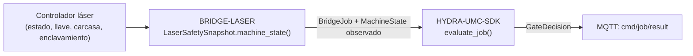

<!-- =============================================================================
HYDRA-UMC-BRIDGE-LASER - Puente de coordinación de celda láser
Copyright (C) JuanenRac (Electro Hobby 3D) <electrohobby3d@gmail.com>
GPL-3.0-or-later - see LICENSE
============================================================================= -->

<p align="center">
  
</p>

# 🔦 HYDRA-UMC-BRIDGE-LASER

<p align="center"><a href="README.md">🇺🇸 English</a> | 🇪🇸 <b>Español</b> | <a href="README_fra.md">🇫🇷 Français</a> | <a href="README_ita.md">🇮🇹 Italiano</a> | <a href="README_deu.md">🇩🇪 Deutsch</a> | <a href="README_zho.md">🇨🇳 简体中文</a> | <a href="README_jpn.md">🇯🇵 日本語</a> | <a href="README_por.md">🇵🇹 Português</a></p>

### 🛑 Puente de coordinación seguro por defecto para celdas láser

<p align="center">
  
  
  
</p>

---

> **Comprobación de honestidad - qué funciona realmente hoy:** el snapshot de seguridad de cuatro señales y su puerta (`cell.py` con `LaserSafetySnapshot`/`LaserCellBridge`, que hace pasar cada trabajo por el propio `evaluate_job()` de `HYDRA-UMC-SDK`), el normalizador de evidencia de solo lectura (`observation.py`), el lector real de enclavamiento GPIO (`gpio_safety.py` con `GpioSafetyProbe`, libgpiod v2), y el transporte MQTT de estado/evidencia (`mqtt_transport.py`) son reales y están cubiertos por 149 casos `unittest` que pasan (`python tools/build_test.py`), incluyendo `tests/test_gpio_mqtt_emulator.py`, que ejecuta este bridge contra un emulador GPIO/MQTT fiel al protocolo pero escrito a mano. Nada de esto ha tocado un chip GPIO real, un broker MQTT real, ni un controlador láser real - `test_gpio_safety.py` lee contra un chip falso y `test_mqtt_transport.py` usa un cliente de broker falso. Todavía no existe una integración concreta con software/controlador láser, porque la máquina y su interfaz documentada no están disponibles - ver "Estado actual y próximos pasos" más abajo, que ya lo dice con claridad, y `CHANGELOG.md` para lo que se ha entregado exactamente hasta ahora.

---

> **Estado de seguridad física y de ciberseguridad:** este ecosistema no es un sistema de seguridad certificado. Todavía no existe una ruta de E-STOP por hardware, ni límites ni enclavamientos aplicados por el firmware, ni un comando de movimiento verificado; las imágenes de firmware se comprueban con CRC32 y un HMAC-SHA256 de clave compartida, no con una firma asimétrica; TLS y TLS mutuo son opcionales y están desactivados por defecto; aún no se ha poblado ni probado ninguna placa propia. Lee la [línea base de seguridad](https://github.com/JuanenRac/HYDRA-UMC-DOCS/blob/main/docs/SECURITY_BASELINE.md) y el [modelo de amenazas](https://github.com/JuanenRac/HYDRA-UMC-DOCS/blob/main/docs/THREAT_MODEL.md) antes de fiarte de cualquier afirmación de aquí para la seguridad de una persona.

## 📋 De un vistazo

| | |
|---|---|
| Versión | `0.1.8` |
| Madurez | Funcional |
| Tests | 96 (`python tools/build_test.py`) |
| Tecnología | Python / Laser controller / G-code / Safety evidence / GPIO interlock reading |
| Destino | La Raspberry Pi CM5 de una celda HYDRA-UMC |
| En hardware real | Solo simulado: probado con emuladores, dobles de prueba o simuladores; no consta ninguna ejecución en hardware real para esta versión |

## 1. 🛠️ VISIÓN TÉCNICA GENERAL

**HYDRA-UMC-BRIDGE-LASER** es el puente de alto nivel para celdas láser y auxiliares robóticos HYDRA-UMC. Puede coordinar tareas periféricas seguras como el traspaso de material, pero **nunca** puede armar, disparar o anular un controlador láser: esas condiciones son observaciones que lee, no autoridades que posee.

Pertenece a la familia **External Automation Bridges**: un conjunto de repositorios hermanos (CNC, LASER, OPENPNP, PRINTER3D, ROS2) que hablan el mismo contrato de seguridad compartido de `HYDRA-UMC-SDK`, de modo que ningún puente puede inventar su propia definición de "seguro para trabajar".

### Características clave:
* ✅ **Instantánea de seguridad de cuatro señales (lógica de software, probada sin láser):** `cell.py` — `LaserSafetySnapshot.machine_state()` exige que la llave esté habilitada, la carcasa cerrada **y** el enclavamiento en buen estado simultáneamente; si falta cualquiera de ellas, resuelve en `SAFE_STOP` incluso antes de leer `controller_state`. *(implementado, probado en `tests/test_cell.py`)*
* ✅ **Puerta de seguridad compartida, real:** cada trabajo observado se reevalúa mediante `evaluate_job()` de `bridge_contract` en `HYDRA-UMC-SDK`, la misma puerta que usan todos los puentes hermanos. *(implementado)*
* ✅ **Mapeo de estado conservador:** solo `IDLE` se trata como reposo; `RUN`/`RUNNING`/`PAUSED` se mapean a `RUNNING`, `FAULT`/`ALARM`/`ERROR` a `FAULT`, y cualquier valor no reconocido cae en `OFFLINE`. *(implementado)*
* ✅ **Evidencia de seguridad de solo lectura:** `observation.py` solo acepta señales booleanas genuinas de llave, carcasa e enclavamiento; los valores faltantes, numéricos o de tipo texto fallan de forma segura. No puede armar ni disparar un láser. *(implementado, probado en `tests/test_observation.py`)*
* ✅ **Lectura de enclavamiento GPIO independiente del controlador (probada solo contra un chip simulado):** `GpioSafetyProbe` de `gpio_safety.py` lee las mismas 3 protecciones independientes desde líneas GPIO (libgpiod v2; las pruebas usan un chip simulado) en vez de un mapeo guardado — deliberadamente agnóstico del controlador, ya que una llave/sensor de puerta/relé de enclavamiento es universal en cortadoras láser sin importar la marca. Un fallo de lectura GPIO hace fallar de forma segura las 3 protecciones. *(implementado, probado en `tests/test_gpio_safety.py`)*
* ✅ **Vigilancia de enclavamientos por flancos (probada solo contra un chip simulado):** `open_gpio_safety()` abre las líneas de llave, carcasa y enclavamiento UNA sola vez (`INPUT`, `Edge.BOTH`) y atiende con esa única petición tanto a los lectores de nivel como al vigilante de flancos — el kernel rechaza una segunda petición de las mismas líneas. `watch_for_interlock_edges()` se bloquea en las notificaciones de eventos de flanco del propio kernel (libgpiod v2) en lugar de releer niveles solo cuando un mensaje MQTT ajeno lo pide, y `run_forever(edge_watcher=...)` lanza un hilo demonio que publica un `state` retenido actualizado en el instante en que una línea cambia; si el vigilante falla, publica un `state` que falla cerrado (`SAFE_STOP`, con el motivo) y sigue intentándolo. El cableado de cada línea se declara (`GpioLineSettings`: `active_low`, `bias` — el valor por defecto hace que un cable cortado se lea como inseguro — y `debounce_ms`); véase `docs/WIRING_GUIDE.md`. Aún no validado en un chip GPIO real. *(implementado, probado en `tests/test_gpio_safety.py` y, con un `gpiod` simulado, en `tests/test_hardening.py`)*
* ✅ **Flujo de eventos de seguridad (probado con líneas simuladas y un vigilante de flancos simulado):** `events.py` convierte cada cambio de llave, cerramiento e interlock en un registro con marca de tiempo en `hydra/bridges/laser/event/safety` (el registro que un data lake guarda para auditoría y OEE) y, una sola vez, cuando la celda pasa de segura a insegura, un evento `hydra/bridges/laser/event/interlock_open` con las protecciones que se abrieron, para que el orquestador pare los brazos de la celda al instante. Ambos son QoS 1 y nunca retenidos; llevan `at_ms` y un `sequence` creciente; la primera lectura es solo una referencia; un vigilante de flancos que falla comunica la pérdida también como interlock abierto. El bridge solo informa: no puede parar un láser. *(implementado, probado en `tests/test_events.py`)*
* ✅ **Protecciones auxiliares opcionales (probadas con entradas simuladas):** `auxiliary.py` permite a la celda declarar condiciones extra - extracción de humos en marcha, aire de asistencia activo, temperatura del tubo CO2 como máximo un límite - como `AuxiliaryCheck` pasados a `LaserMqttBridge(auxiliary=...)`. Un trabajo que no sea ABORT se rechaza, nombrando la comprobación que falla, mientras alguna no se cumpla; una lectura ilegible, no numérica o no finita cuenta como no cumplida; `state` lleva un mapa `auxiliary`. Sin ninguna declarada no cambia nada. Solo lectura: no conmuta nada. *(implementado, probado en `tests/test_auxiliary.py`)*
* ✅ **Compilación/prueba no mutante:** `build-test.bat`/`.sh` compilan el código y ejecutan la batería de pruebas de la puerta de seguridad sin tocar archivos de versión ni el CHANGELOG. *(implementado, ver COMPILACIÓN Y EJECUCIÓN más abajo)*
* ✅ **Lector de estado de láser GRBL (probado solo contra una placa simulada):** el `GrblLaserState` de `grbl_state.py` es el `controller_state` real para un controlador láser de la familia GRBL en un puerto serie (las placas que manejan LaserGRBL y LightBurn): envía la consulta de estado de GRBL `?` y devuelve la palabra de estado del informe. Es de solo lectura a propósito - el único byte que escribe es `?`, no hay retención, reinicio, reanudación ni G-code - y falla cerrado (sin respuesta es un estado vacío, nunca reposo). El puerto, la conexión que se reabre y el analizador son el enlace serie compartido del SDK que usa también el bridge CNC. La potencia del láser y el avance del informe van en `state` como información (`laser_power`, `feed_rate`), nunca como salvaguarda. Una placa GRBL tiene un solo puerto serie: mientras LightBurn o LaserGRBL lo tienen, este lector no puede usarlo. *(implementado, no probado en una placa real)*
* 🔜 **Integración concreta con controlador/software láser** — deliberadamente aplazada hasta que la máquina y su interfaz documentada estén disponibles. *(planeado)*
* ✅ **Claves de idempotencia repetidas:** `LaserMqttBridge` acepta un `IdempotencyStore`: una clave de trabajo repetida recibe la respuesta dada la primera vez en lugar de evaluarse de nuevo. *(implementado, probado en `tests/test_idempotency.py`)*
* ✅ **Bucle MQTT blindado y lecturas que fallan cerradas:** una carga demasiado grande (más de 16 KiB) o ilegible, un JSON profundamente anidado y cualquier fallo inesperado reciben una negativa en el topic de resultado y nunca terminan el bucle; las respuestas de `cmd/job` indican `"mode": "gate-only"` y un ABORT por ahí dice que no se detuvo nada (el E-STOP físico detiene el láser); el estado lleva `observed_at` y el bridge se anuncia en un topic `availability` con Last Will; cualquier excepción al leer las líneas GPIO — no solo `OSError` — hace fallar las tres protecciones, y los tres niveles se leen en una sola operación bajo un cerrojo; se entienden estados de controlador de estilo GRBL como `Hold:0`, `Alarm:1`, `Door:1`, `Jog` y `Home`. *(implementado, probado en `tests/test_hardening.py`)*

---

## 2. 🔄 FLUJO DE COORDINACIÓN DE CELDA



---

## 3. 🧱 ARQUITECTURA Y DECISIONES DE DISEÑO

* **Por qué tres protecciones independientes en lugar de un solo booleano.** `LaserSafetySnapshot.machine_state()` comprueba `key_enabled`, `enclosure_closed` e `interlock_healthy` como tres condiciones separadas: la seguridad láser real necesita que cada resguardo físico sea independientemente verdadero; reducirlas a un solo indicador ocultaría cuál de ellas falló en realidad.
* **Por qué el puente documenta que nunca puede armar ni disparar un láser.** El propio docstring de `LaserCellBridge` afirma que "coordina solo auxiliares externos; no puede armar ni disparar un láser" — esas condiciones son observaciones de los propios enclavamientos certificados del controlador, nunca un sustituto de ellos.
* **Por qué el mapeo del estado del controlador es deliberadamente conservador.** Solo la cadena literal `IDLE` se mapea a `MachineState.IDLE`. Cualquier valor no reconocido cae en `OFFLINE`, nunca en algo que permitiría trabajo auxiliar.
* **Por qué el puente construye un nuevo `BridgeJob` y delega en el `evaluate_job()` compartido en lugar de escribir su propia lógica de aceptación/rechazo.** Los cinco External Automation Bridges (CNC, LASER, OPENPNP, PRINTER3D, ROS2) reutilizan exactamente el mismo `bridge_contract` de `HYDRA-UMC-SDK`, de modo que "qué cuenta como seguro para iniciar un trabajo" no puede divergir silenciosamente entre ellos.
* **Por qué la elección del software/controlador láser real se aplaza deliberadamente.** Comprometerse con la interfaz de un fabricante concreto antes de que la máquina y su reporte de enclavamiento documentado estén disponibles significaría afirmar una garantía de seguridad real que este núcleo local no puede verificar.
* **Cómo encaja en el resto del ecosistema.** BRIDGE-LASER se sitúa entre el controlador láser y `HYDRA-UMC-SDK` → `HYDRA-UMC-MQTT-BROKER` → seguridad independiente: coordina trabajo robótico auxiliar alrededor de la celda láser, no reemplaza ni anula la seguridad láser certificada.

El asistente de observación es un normalizador de evidencia, no un adaptador de controlador láser: no abre ningún enlace de red o serie, no altera ajustes, no sube trabajos, no arma ni dispara. [Laser Controller Evidence Boundary](docs/CONTROLLER_EVIDENCE_BOUNDARY.md) define la validación necesaria antes de una integración real.

---

## 📂 ESTRUCTURA DE DIRECTORIOS

```text
HYDRA-UMC-BRIDGE-LASER/
├── src/
│   └── hydra_umc_bridge_laser/
│       ├── __init__.py
│       ├── cell.py              # Puerta de seguridad LaserSafetySnapshot + LaserCellBridge
│       ├── auxiliary.py       # extraction / assist air / tube temperature checks
│       ├── events.py          # interlock_open + safeguard-change events
│       ├── observation.py       # Normalización de solo lectura de la evidencia de seguridad
│       ├── grbl_state.py       # Estado de solo lectura del controlador láser GRBL: la consulta de estado y nada más
│       ├── gpio_safety.py       # Lee las 3 señales de seguridad reales e independientes por GPIO - nunca un comando láser
│       └── mqtt_transport.py    # Transporte MQTT real - solo estado/evidencia, este bridge no puede armar ni disparar un láser
├── tests/
│   ├── test_cell.py             # Admisión en reposo seguro, rechazo por carcasa, reenvío de aborto
│   ├── test_observation.py      # La evidencia de seguridad ausente falla cerrado
│   ├── test_gpio_safety.py      # Lecturas reales de seguridad GPIO contra un chip simulado, incl. rutas fail-closed
│   ├── test_mqtt_transport.py   # Tests de forma de estado/evidencia MQTT contra un cliente de broker simulado
│   ├── test_mqtt_environment.py # Las credenciales MQTT y el TLS del entorno del servicio llegan al cliente
│   ├── test_grbl_state.py       # Lector GRBL contra una placa simulada: banner y líneas viejas, enlace caído, reconexión, placa muda
│   ├── test_idempotency.py      # Una clave de idempotencia repetida se responde una sola vez
│   ├── gpio_mqtt_emulator.py    # Emulador de GPIO/MQTT fiel al protocolo (doble de prueba realista)
│   ├── test_gpio_mqtt_emulator.py # Comportamiento del bridge frente al emulador GPIO/MQTT
│   └── test_hardening.py        # Cargas hostiles, petición única con gpiod simulado, fallo del vigilante, respuestas honestas
├── tools/
│   ├── build_test.py            # Compilador + ejecutor de pruebas no mutante (build-test.bat/.sh)
│   ├── bump_version.py          # Sincroniza pyproject.toml, manifiesto y CHANGELOG.md
│   ├── ci_validate.py           # Línea base de CI sin dependencias y no destructiva (usada por .github/workflows/ci.yml)
│   └── inspect_controller_evidence.py # Normaliza un archivo JSON de evidencia local guardado (sin abrir enlace)
├── docs/
│   ├── BRIDGE_GUIDE.md                    # Alcance, plataformas compatibles, scripts, puerta de aceptación de hardware
│   ├── CONTROLLER_EVIDENCE_BOUNDARY.md    # Qué cuenta como evidencia de seguridad real y qué se niega a inferir este bridge
│   └── WIRING_GUIDE.md                    # Cableado de las tres protecciones: polaridad, contactos normalmente cerrados, bias, antirrebote
├── images/
│   └── HYDRA_UMC_BANNER.svg     # Banner del README
├── build-test.bat / build-test.sh  # Solo valida, nunca modifica el repositorio
├── build.bat / build.sh            # Valida y compila (compilar nunca cambia la versión)
├── pyproject.toml               # Metadatos del paquete; depende de HYDRA-UMC-SDK (git)
├── hydra-umc.project.json       # Manifiesto del ecosistema (versión, madurez, familia)
├── CHANGELOG.md
├── CODE_OF_CONDUCT.md / CONTRIBUTING.md / SECURITY.md / SUPPORT.md
├── LICENSE / LICENSE.md
└── README.md / README_*.md      # Este archivo y sus 6 traducciones
```

---

## 4. ⚙️ COMPILACIÓN Y EJECUCIÓN

Requiere Python 3.11+. `tools/build_test.py` espera que `HYDRA-UMC-SDK` esté clonado como directorio hermano (`../HYDRA-UMC-SDK`) o indicado mediante la variable de entorno `HYDRA_UMC_SDK_ROOT`.

```bash
# Windows
build-test.bat      # solo valida — sin cambio de versión/CHANGELOG
build.bat            # Valida y compila (compilar nunca cambia la versión)

# Linux/macOS
bash build-test.sh
bash build.sh
```

`build-test` compila cada módulo bajo `src/` y `tools/` con `py_compile` y ejecuta la batería completa de `unittest` descubierta en `tests/` (`test_cell.py`, `test_observation.py`, `test_gpio_safety.py`, `test_mqtt_transport.py`, `test_gpio_mqtt_emulator.py`, `test_hardening.py`, `test_idempotency.py`, `test_mqtt_environment.py` - 149 tests), demostrando la admisión en reposo seguro, el rechazo por carcasa y el reenvío de aborto entre todo lo demás cubierto — nunca modifica el repositorio. `build` ejecuta primero esa misma validación y, solo si tiene éxito, llama a `tools/bump_version.py` para sincronizar la versión en `pyproject.toml`, `hydra-umc.project.json` y `CHANGELOG.md`. Todavía no existe un comando `run` real de láser — eso requiere una integración de controlador validada y segura.

---

## ✅ ESTADO ACTUAL Y PRÓXIMOS PASOS

**Real hoy:** versión `0.1.8`, un núcleo de planificación seguro por defecto probado en local (`LaserSafetySnapshot` + `LaserCellBridge`) apoyado en la puerta de trabajo compartida de `HYDRA-UMC-SDK`, normalización estricta de evidencia de seguridad en solo lectura que distingue un trabajo realmente en pausa (`HOLDING`) de uno realmente disparando (`RUNNING`), una lectura real de enclavamiento GPIO independiente del controlador (`GpioSafetyProbe`) para las 3 protecciones independientes de llave/carcasa/enclavamiento, un transporte MQTT real de estado/evidencia (`mqtt_transport.py`), una batería `unittest` determinista de 149 pruebas, y scripts de build-test no mutantes conectados a CI con clonado del SDK.

**Frontera de integración:** la carcasa, la llave y el enclavamiento certificados del propio controlador láser nunca se eluden; este puente solo controla trabajo robótico *auxiliar* a su alrededor, y únicamente leyendo su estado reportado.

**Todavía pendiente:** el puente no se ha conectado ni usado para operar un sistema láser real — elegir y validar una interfaz concreta de controlador/software se aplaza hasta disponer de la máquina y su interfaz documentada.

---

## 🔗 Proyectos Relacionados

Este proyecto es parte del ecosistema de robótica HYDRA-UMC del mismo autor (JuanenRac / Electro Hobby 3D). Vale la pena conocerlo, ya que una petición podría en realidad ser sobre alguno de estos en vez de sobre este repositorio.

**Proyecto Padre**
- **[HYDRA-UMC-SERVER](https://github.com/JuanenRac/HYDRA-UMC-SERVER)** — el backend headless real (REST/WebSocket) con el que habla de verdad cada cliente de control; este bridge no lo llama: responde por MQTT, a través de HYDRA-UMC-MQTT-BROKER, a quien manda en la celda.

**Proyectos Hermanos** — también hablan con la propia API de HYDRA-UMC-SERVER, cada uno como su propio cliente
- **[HYDRA-UMC-STUDIO](https://github.com/JuanenRac/HYDRA-UMC-STUDIO)** — panel de control web con visualización 3D multi-robot en tiempo real.
- **[HYDRA-UMC-SUITE](https://github.com/JuanenRac/HYDRA-UMC-SUITE)** — centro de mando de enjambre de escritorio (PySide6) para varios servidores a la vez, empaquetado como ejecutable independiente.
- **[HYDRA-UMC-ANDROID-CONTROL](https://github.com/JuanenRac/HYDRA-UMC-ANDROID-CONTROL)** — app nativa de control para Android con inicio de sesión biométrico y un compañero Wear OS emparejado.
- **[HYDRA-UMC-IOS-CONTROL](https://github.com/JuanenRac/HYDRA-UMC-IOS-CONTROL)** — app de control para iOS/iPadOS (Flutter) con sincronización en tiempo real por WebSocket.
- **[HYDRA-UMC-DSI](https://github.com/JuanenRac/HYDRA-UMC-DSI)** — interfaz táctil nativa para la pantalla táctil DSI de 7" a bordo, embebida en el propio CM5.
- **[HYDRA-UMC-BRIDGE-AMR](https://github.com/JuanenRac/HYDRA-UMC-BRIDGE-AMR)** — barrera de coordinación para flotas AGV/AMR mediante un publicador MQTT VDA 5050 (probado solo contra una flota emulada).
- **[HYDRA-UMC-BRIDGE-CNC](https://github.com/JuanenRac/HYDRA-UMC-BRIDGE-CNC)** — coordinador de alto nivel para celdas CNC con acceso a estado/bytes de control GRBL (probado solo contra un emulador).
- **[HYDRA-UMC-BRIDGE-DROIDS](https://github.com/JuanenRac/HYDRA-UMC-BRIDGE-DROIDS)** — barrera de coordinación para droides con patas/humanoides, con un emisor de comandos para Boston Dynamics Spot (probado solo contra un emulador).
- **[HYDRA-UMC-BRIDGE-OPENPNP](https://github.com/JuanenRac/HYDRA-UMC-BRIDGE-OPENPNP)** — coordinador de alto nivel seguro para el flujo de placas de pick-and-place OpenPnP.
- **[HYDRA-UMC-BRIDGE-PRINTER3D](https://github.com/JuanenRac/HYDRA-UMC-BRIDGE-PRINTER3D)** — barrera de coordinación segura para impresoras 3D Moonraker/Klipper, con comandos de trabajo reales y controlados.
- **[HYDRA-UMC-BRIDGE-ROS2](https://github.com/JuanenRac/HYDRA-UMC-BRIDGE-ROS2)** — coordinador con un transporte ROS 2 rclpy importado de forma perezosa (todavía no ejecutado contra una instalación de ROS 2).
- **[HYDRA-UMC-BRIDGE-UAV](https://github.com/JuanenRac/HYDRA-UMC-BRIDGE-UAV)** — barrera de coordinación para UAV equipados con cámara, con un emisor de comandos MAVLink (probado solo contra un emulador).

**Directamente Relacionados**
- **[HYDRA-UMC-SDK](https://github.com/JuanenRac/HYDRA-UMC-SDK)** — el contrato JSON-Schema compartido y la barrera de software de puerta de trabajos contra la que cada bridge valida sus comandos (no es una función de seguridad certificada).
- **[HYDRA-UMC-CONNECTOR-HUB](https://github.com/JuanenRac/HYDRA-UMC-CONNECTOR-HUB)** — registro declarativo y validador de manifiestos de adaptador para conectores de máquinas externas; extiende la propia idea de contrato del SDK a máquinas externas sin sustituir a los proyectos de pasarela industrial.
- **[HYDRA-UMC-MQTT-BROKER](https://github.com/JuanenRac/HYDRA-UMC-MQTT-BROKER)** — el transporte real de `mqtt_transport.py` para los propios tópicos `hydra/bridges/laser/...` de este bridge — solo estado de las salvaguardas, ya que aquí no existe ningún comando real de accionamiento (este bridge no puede armar ni disparar un láser en ningún caso); ver el propio `docs/BRIDGE_TOPICS.md` de ese repositorio.
- **[HYDRA-UMC-SAFETY-ZONES](https://github.com/JuanenRac/HYDRA-UMC-SAFETY-ZONES)** — futura evidencia de seguridad de zona de celda para este bridge.

**También Forma Parte del Ecosistema**

*Hardware y Plataforma Base*
- **[HYDRA-UMC](https://github.com/JuanenRac/HYDRA-UMC)** — el diseño de la placa madre del brazo robótico: host CM5 + coprocesador STM32H745 de doble núcleo, pensado para coordinar hasta 8 brazos herramienta por CAN-OTA/SPI-OTA (firmware en fase temprana; todavía no hay ninguna placa poblada).
- **[HYDRA-UMC-OS](https://github.com/JuanenRac/HYDRA-UMC-OS)** — capa de producto reproducible sobre Raspberry Pi OS para el CM5: agente de solo lectura, config/perfiles validados, aprovisionamiento WiFi de primer contacto.

*Backend Central y Clientes*
- **[HYDRA-UMC-EDITOR-URDF](https://github.com/JuanenRac/HYDRA-UMC-EDITOR-URDF)** — creador/editor gráfico de URDF de escritorio que envía los modelos terminados al propio catálogo de STUDIO.
- **[HYDRA-UMC-EDITOR-STL](https://github.com/JuanenRac/HYDRA-UMC-EDITOR-STL)** — editor de escritorio de modelos STL, que transforma/reemplaza/quita/añade piezas reales en el mismo catálogo de modelos que también edita HYDRA-UMC-EDITOR-URDF.

*Plataforma de Herramientas URTC*
- **[URTC](https://github.com/JuanenRac/URTC)** — firmware para la placa física del Universal Robot Tool Controller, más de 25 perfiles de herramienta por bus CAN.
- **[URTC-FLASHER](https://github.com/JuanenRac/URTC-FLASHER)** — herramienta de escritorio con GUI para flashear placas URTC, CAN-OTA más SWD/JTAG de chip completo.
- **[URTC-TESTER](https://github.com/JuanenRac/URTC-TESTER)** — herramienta de escritorio de diagnóstico CAN-bus en vivo para placas URTC, un panel por perfil de herramienta.
- **[URTC-WEB-STUDIO](https://github.com/JuanenRac/URTC-WEB-STUDIO)** — alternativa basada en navegador a URTC-TESTER mediante la Web Serial API, sin instalación local.
- **[URTC-GATEWAY](https://github.com/JuanenRac/URTC-GATEWAY)** — pasarela delante del bus CAN de URTC: lista de identificadores permitidos, límite de tasa y clave de sesión; software probado en ordenador, aún no en un bus real.

*Nodo IA de Visión (Hailo-8)*
- **[HYDRA-UMC-VISION-NODE](https://github.com/JuanenRac/HYDRA-UMC-VISION-NODE)** — nodo de integración para el pipeline de visión Hailo-8, con una comprobación real de disponibilidad de hardware por etapa.
- **[HYDRA-UMC-DETECTION-HEF](https://github.com/JuanenRac/HYDRA-UMC-DETECTION-HEF)** — registro real de modelos compilados con verificación de carga segura por arquitectura Hailo/checksum.
- **[HYDRA-UMC-VISION-STREAMER](https://github.com/JuanenRac/HYDRA-UMC-VISION-STREAMER)** — generador real de pipeline GStreamer + config MediaMTX, con una frontera de integración HailoRT real.
- **[HYDRA-UMC-VISUAL-SERVOING-API](https://github.com/JuanenRac/HYDRA-UMC-VISUAL-SERVOING-API)** — ley de corrección Position-Based Visual Servoing con autorización condicionada al estado de zona; todavía sin estimación de pose por cámara.

*Nodo IA Cognitivo (Hailo-10)*
- **[HYDRA-UMC-COGNITIVE-NODE](https://github.com/JuanenRac/HYDRA-UMC-COGNITIVE-NODE)** — nodo de integración para el pipeline cognitivo Hailo-10 (orquestación de LLM/VLA/voz).
- **[HYDRA-UMC-VLA-ENGINE](https://github.com/JuanenRac/HYDRA-UMC-VLA-ENGINE)** — codificación/decodificación real de tokens de acción y generación de trayectoria para un modelo Vision-Language-Action.
- **[HYDRA-UMC-VOICE-UI](https://github.com/JuanenRac/HYDRA-UMC-VOICE-UI)** — front-end de voz real (VAD + analizador de intención) con un relé a Watch acotado y con confirmación.
- **[HYDRA-UMC-SEMANTIC-PLANNER](https://github.com/JuanenRac/HYDRA-UMC-SEMANTIC-PLANNER)** — descomposición real de tareas basada en reglas y recuperación semántica de errores sobre códigos de error del MCU.
- **[HYDRA-UMC-DOCS-QA](https://github.com/JuanenRac/HYDRA-UMC-DOCS-QA)** — búsqueda real de documentos TF-IDF (solo librería estándar) sobre los propios documentos Markdown de este ecosistema.
- **[HYDRA-UMC-LOCAL-TECHNICIAN](https://github.com/JuanenRac/HYDRA-UMC-LOCAL-TECHNICIAN)** — técnico de mantenimiento con IA local y con puertas de política para el propio ecosistema - observa, diagnostica y propone arreglos; los dos niveles de riesgo más altos están deliberadamente sin implementar todavía.

*Orquestación y Enjambre*
- **[HYDRA-UMC-ORCHESTRATOR](https://github.com/JuanenRac/HYDRA-UMC-ORCHESTRATOR)** — nodo de integración con un contrato real de informe de salud gRPC/Protobuf y una máquina de estados de misión.
- **[HYDRA-UMC-JOB-DISPATCHER](https://github.com/JuanenRac/HYDRA-UMC-JOB-DISPATCHER)** — cola de trabajos real basada en prioridad con deduplicación, sobre una API HTTP real.
- **[HYDRA-UMC-NODE-HEALING](https://github.com/JuanenRac/HYDRA-UMC-NODE-HEALING)** — watchdog de salud de flota real basado en gRPC, con reintento/backoff y detección de discrepancia de identidad.
- **[HYDRA-UMC-PATH-PLANNER-3D](https://github.com/JuanenRac/HYDRA-UMC-PATH-PLANNER-3D)** — planificador de rutas 3D real basado en RRT, con validación real de colisión de obstáculos/espacio de trabajo.
- **[HYDRA-UMC-SWARM-SYNC](https://github.com/JuanenRac/HYDRA-UMC-SWARM-SYNC)** — sincronización de estado real mediante CRDT LWW-Element-Map, con pruebas de propiedades para convergencia multi-celda.

*Gemelo Digital y Simulación*
- **[HYDRA-UMC-TWIN](https://github.com/JuanenRac/HYDRA-UMC-TWIN)** — nodo de integración para el motor de gemelo digital, con un contrato real de sincronización por compatibilidad de versión.
- **[HYDRA-UMC-HIL-BRIDGE](https://github.com/JuanenRac/HYDRA-UMC-HIL-BRIDGE)** — enrutador hardware-in-the-loop con un enclavamiento de software por colisión entre simulación y hardware real (probado sin hardware real).
- **[HYDRA-UMC-PHYSICS-REPLICA](https://github.com/JuanenRac/HYDRA-UMC-PHYSICS-REPLICA)** — cinemática directa real y validación de límites articulares sobre un subconjunto real de URDF.
- **[HYDRA-UMC-SYNTHETIC-DATA-GEN](https://github.com/JuanenRac/HYDRA-UMC-SYNTHETIC-DATA-GEN)** — generador real de escenas 2D procedurales con exportación de anotaciones YOLO/COCO.

*Datos y Analítica*
- **[HYDRA-UMC-DATALAKE](https://github.com/JuanenRac/HYDRA-UMC-DATALAKE)** — almacén de series temporales real respaldado por sqlite3, con una API HTTP real de ingesta/consulta.
- **[HYDRA-UMC-ANOMALY-DETECTOR](https://github.com/JuanenRac/HYDRA-UMC-ANOMALY-DETECTOR)** — detector de anomalías real basado en FFT + línea base estadística, con monitorización de deriva.
- **[HYDRA-UMC-PRODUCTION-REPORTS](https://github.com/JuanenRac/HYDRA-UMC-PRODUCTION-REPORTS)** — cálculo real de OEE/disponibilidad sobre el histórico de DATALAKE, con exportación CSV reproducible.
- **[HYDRA-UMC-TELEMETRY-COLLECTOR](https://github.com/JuanenRac/HYDRA-UMC-TELEMETRY-COLLECTOR)** — pipeline real de ingesta CAN/WebSocket hacia DATALAKE, con deduplicación por secuencia.

*Pasarela Industrial*
- **[HYDRA-UMC-GATEWAY-INDUSTRIAL](https://github.com/JuanenRac/HYDRA-UMC-GATEWAY-INDUSTRIAL)** — nodo de integración que retransmite a protocolos industriales, con una capa real de lista blanca de comandos/contrapresión.
- **[HYDRA-UMC-OPCUA-SERVER](https://github.com/JuanenRac/HYDRA-UMC-OPCUA-SERVER)** — espacio de direcciones OPC-UA real, verificado con una sesión de cliente real del protocolo binario.
- **[HYDRA-UMC-MTCONNECT-ADAPTER](https://github.com/JuanenRac/HYDRA-UMC-MTCONNECT-ADAPTER)** — endpoints XML reales `/probe` y `/current` de MTConnect, con salida en modo degradado.

*Herramientas Complementarias y Operaciones del Ecosistema*
- **[HYDRA-UMC-DASHBOARD-AI](https://github.com/JuanenRac/HYDRA-UMC-DASHBOARD-AI)** — paneles de Resúmenes Inteligentes y Resaltado de Anomalías sobre DATALAKE/ANOMALY-DETECTOR, con un respaldo estadístico honesto.
- **[HYDRA-UMC-TOOL-CLI](https://github.com/JuanenRac/HYDRA-UMC-TOOL-CLI)** — CLI de flota con un contrato real y estable de códigos de salida, cliente real y en vivo de la propia API de HYDRA-UMC-SERVER.
- **[HYDRA-UMC-WATCH](https://github.com/JuanenRac/HYDRA-UMC-WATCH)** — app compañera de WearOS con patrones de alerta háptica y un relé de voz al teléfono emparejado (todavía no ejecutada en un reloj físico).
- **[URTC-SMART-RACK](https://github.com/JuanenRac/URTC-SMART-RACK)** — firmware para un rack de montaje de placas con decodificación real de ID de herramienta y lógica de precalentamiento Smart Idle.
- **[URTC-VISION-TOOL](https://github.com/JuanenRac/URTC-VISION-TOOL)** — firmware más un compañero de visión real en Python para un cabezal de inspección térmica/RGB.
- **[HYDRA-UMC-UPDATER](https://github.com/JuanenRac/HYDRA-UMC-UPDATER)** — herramienta administrativa de escritorio que descubre, clona y actualiza cada repositorio de este ecosistema.
- **[HYDRA-UMC-OS-REBUILDER](https://github.com/JuanenRac/HYDRA-UMC-OS-REBUILDER)** — herramienta de escritorio Windows/Linux que construye una imagen de la CM5 lista para grabar, precargada con las versiones más actuales del ecosistema, con configuración de primer arranque de Wi-Fi/usuario/SSH al estilo de Raspberry Pi Imager.
- **[HYDRA-UMC-OPS-AGENT](https://github.com/JuanenRac/HYDRA-UMC-OPS-AGENT)** — coordinador de incidencias de mantenimiento: un rol edge de bajo privilegio recopila un snapshot de inventario/salud saneado, un rol control-plane lo renderiza de solo lectura y pide a un proveedor de IA que sugiera un diagnóstico - nunca aplica un parche ni despliega nada.
- **[HYDRA-UMC-DEV-SERVER](https://github.com/JuanenRac/HYDRA-UMC-DEV-SERVER)** — host de desarrollo reproducible (Raspberry Pi 5 / CM5) que almacena el código del ecosistema y ejecuta tareas acotadas de compilación/pruebas bajo una cola duradera; un rol de desarrollo dedicado, explícitamente distinto de un CM5 operativo.

---

## 📚 Documentación y Comunidad

- **[CONTRIBUTING.md](CONTRIBUTING.md)** — stack tecnológico y pautas de codificación para un pull request.
- **[CODE_OF_CONDUCT.md](CODE_OF_CONDUCT.md)** — los estándares de comportamiento esperados en esta comunidad.
- **[SECURITY.md](SECURITY.md)** — cómo reportar una vulnerabilidad, y las áreas reales de enfoque en seguridad de este proyecto.
- **[SUPPORT.md](SUPPORT.md)** — dónde hacer preguntas y reportar errores.
- **[LICENSE.md](LICENSE.md)** — la licencia propia de este proyecto.

## 👤 AUTOR
**JuanenRac** (Electro Hobby 3D)
📧 electrohobby3d@gmail.com
📺 [youtube.com/@electrohobby3d](https://youtube.com/@electrohobby3d)

## 📜 LICENCIA
GPL-3.0-or-later - Ver LICENSE para más detalles.
